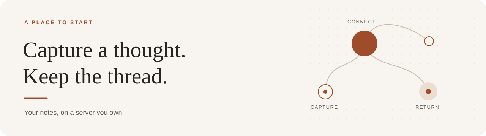
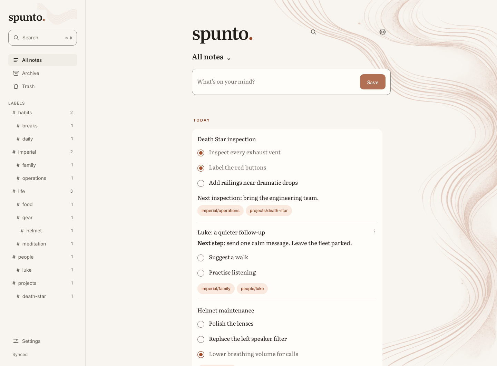
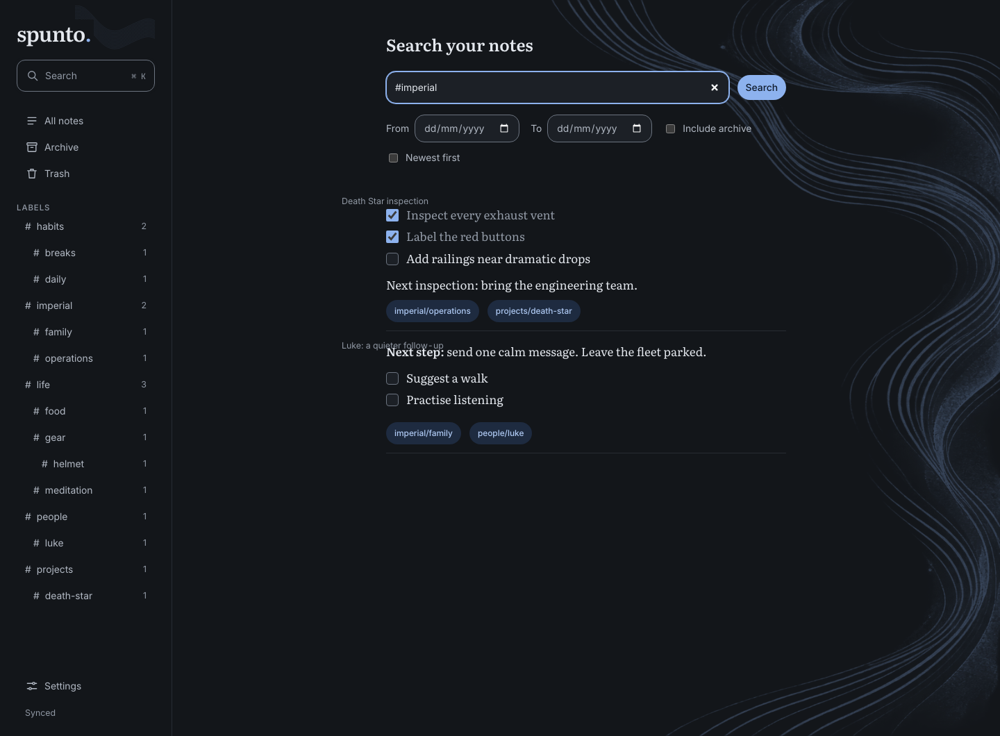
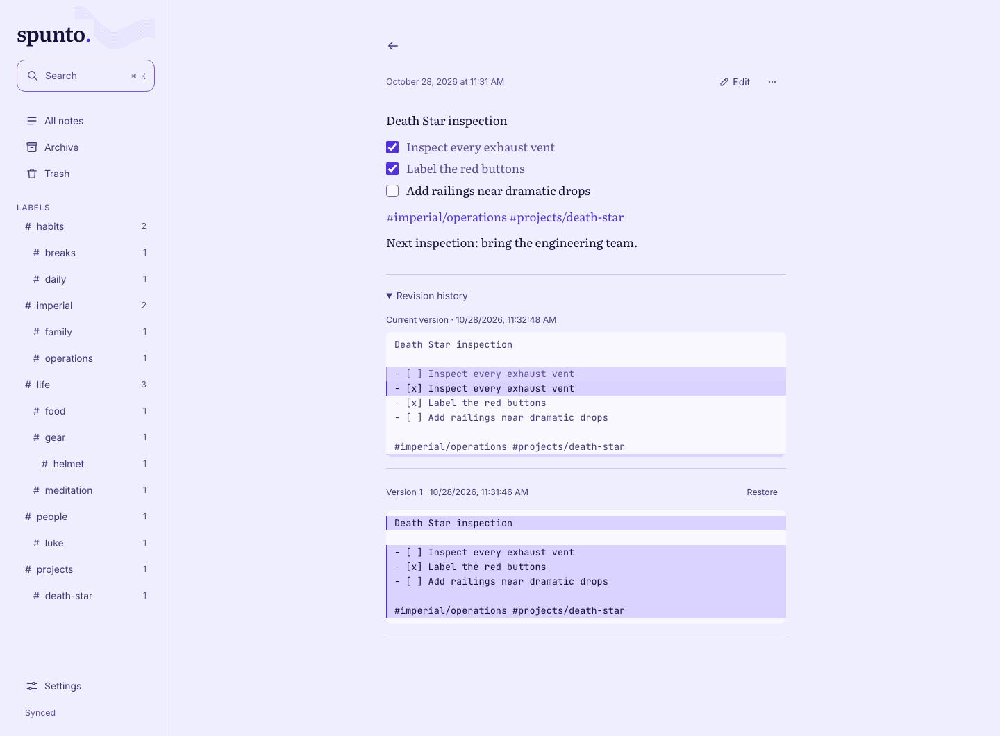
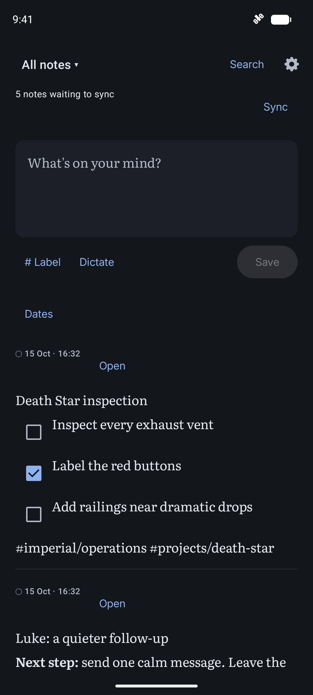
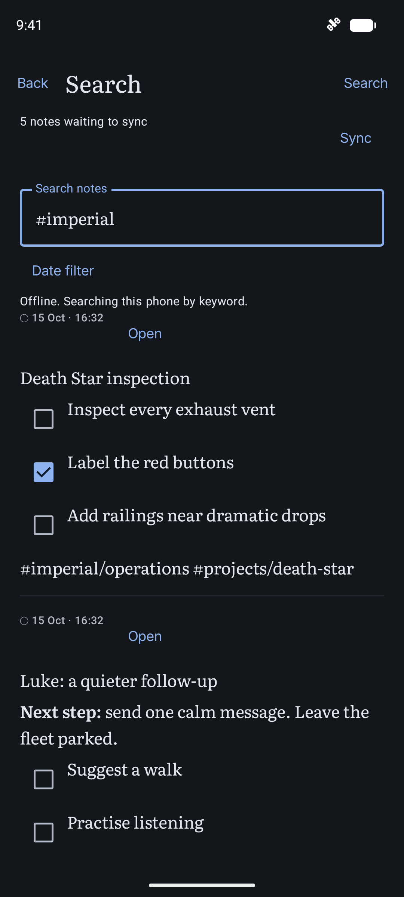
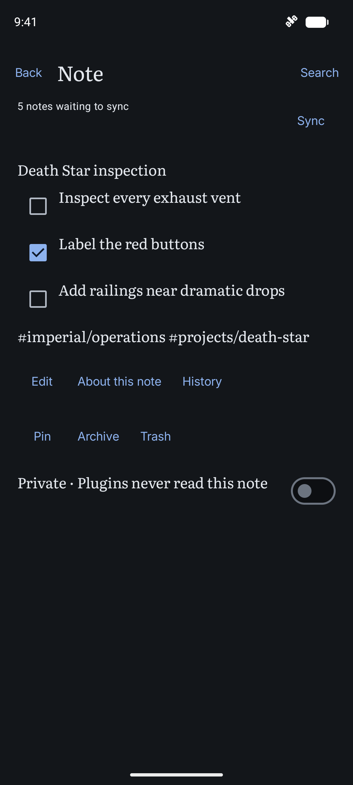
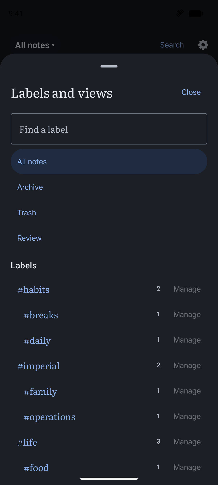
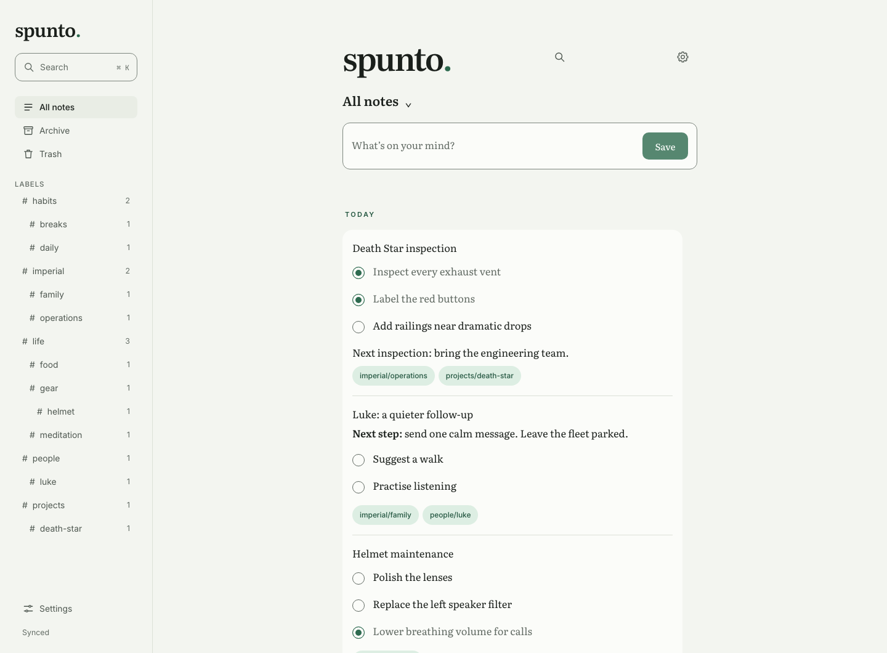
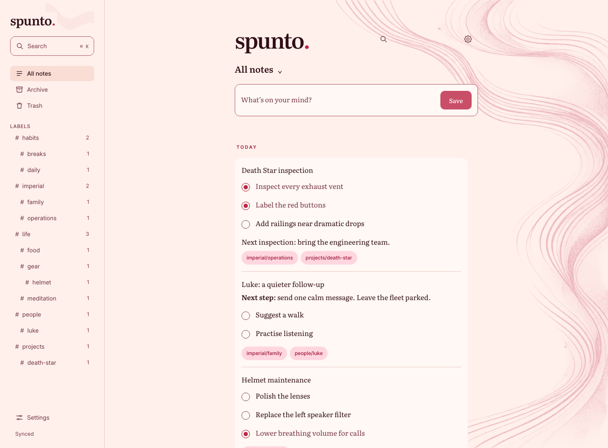

<p align="center">
  
</p>

<h1 align="center">Spunto</h1>

<p align="center">
  <strong>Your notes, with room to work together. Self-hosted, with optional AI.</strong><br>
  Write offline on Android. Pick up on the web. Share a note or a space.
</p>

<p align="center">
  <a href="#get-started">Get started</a> ·
  <a href="#downloads-and-updates">Downloads</a> ·
  <a href="#more-than-a-place-to-put-notes">Explore features</a> ·
  <a href="docs/android-distribution.md">Android</a> ·
  <a href="docs/README.md">Documentation</a>
</p>

<p align="center">
  <a href="LICENSE">AGPL-3.0-only</a> · Self-hosted · CalVer
</p>

<p align="center">
  <a href="docs/assets/web-timeline-carta.png"></a>
</p>

<p align="center"><em>A checklist for the Death Star, a calmer follow-up with Luke, and everything connected by labels. Fictional notes, saved in the running app.</em></p>

<p align="center">
  <a href="docs/assets/web-search-ardesia-dark.png"></a>
  <a href="docs/assets/web-note-elettrica.png"></a>
</p>

<p align="center"><em>Find a thread with #imperial, then revisit the note and its revision history. Open any screenshot to see it at full size.</em></p>

<details>
<summary>Android: capture, search and revisit the same fictional notes</summary>

<p align="center">
  <a href="fastlane/metadata/android/en-US/images/phoneScreenshots/1.png"></a>
  <a href="fastlane/metadata/android/en-US/images/phoneScreenshots/2.png"></a>
  <a href="fastlane/metadata/android/en-US/images/phoneScreenshots/3.png"></a>
</p>

<p align="center"><em>Capture → find → revisit. Fictional sample notes — even Darth Vader needs a second brain.</em></p>

<p align="center">
  <a href="fastlane/metadata/android/en-US/images/phoneScreenshots/4.png"></a>
</p>

</details>

## More than a place to put notes

Write a line, make a checklist or add a `#nested/label`. A short first-run guide introduces capture, labels, search and sync; replay it from Settings whenever you want. The core works on its own; plugins add capabilities in a few fixed places, so your notes remain the centre of the app. [Five built-in themes](#make-it-your-own) include light and dark modes.

| When you want to… | Spunto helps you… |
|---|---|
| **Catch the thought** | Write Markdown and checklists, share into Android, use quick capture or dictate with an available on-device speech service. |
| **Find the thread again** | Search by words and nested labels. Add semantic search, related notes and answers with source citations when AI is configured. |
| **Carry context into your work** | Curate selected notes into a reusable **context pack**, with a brief and source snapshots that reveal when the originals have changed. |
| **Remember why you decided** | Record alternatives, reasoning and an expected outcome in the **decision journal**. Add dated reviews and outcome notes while retaining the original decision. No AI required. |
| **Keep your tags useful** | Suggest labels using past tagging examples. Opt in to applying confident existing tags automatically; review new labels and all curation changes yourself. |
| **Work together** | In the web app on a multi-account installation, share one note or a space with an existing account, with explicit view or edit access. |
| **Keep a recoverable record** | Use revision history, private notes, export, scheduled snapshots and explicit restore tools. |

Context-pack and decision-journal changes require a connection; synced decision notes remain readable offline. [Plugin guides](docs/plugins.md#context-packs) explain the workflows and tag curation.

## Make it your own

Open **Settings → Appearance** to choose **Carta**, **Ardesia**, **Salvia**, **Corallo** or **Elettrica**. In the web app, select **System**, **Light** or **Dark** independently of the palette. Use **Use a different theme on this device** for a browser-specific palette; otherwise the palette follows your instance setting.

<p align="center">
  <a href="docs/assets/web-timeline-salvia.png"></a>
  <a href="docs/assets/web-timeline-corallo.png"></a>
</p>

<p align="center"><em>Salvia on plain paper; Corallo with ink waves. The same notes, with a different atmosphere.</em></p>

The browser also offers **Background style → Plain / Artwork**, **Reading face → Serif / Sans**, and three text sizes. These choices stay in this browser. [See the Appearance controls](docs/assets/web-appearance.png), or compare [Carta](docs/assets/web-timeline-carta.png), [Ardesia dark](docs/assets/web-search-ardesia-dark.png) and [Elettrica](docs/assets/web-note-elettrica.png).

## One library, three ways in

| Client | What it is good at | Connection |
|---|---|---|
| **Android** | Capture, editing, search and a local replica that syncs later. Optional biometric or device-credential app lock. | Core note work continues offline. |
| **Web** | A larger workspace for notes, review, context packs and instance settings. Capture drafts stay in the browser until Save. | Requires the server; no offline note replica. |
| **MCP** | Let a coding agent search, read or capture notes through the same server. Separate tokens scope each client's access. | Requires the server and an authorized client. |

Use Android on its own, or pair it with your server using a QR or one-use code. The [Android guide](android/README.md) explains both paths. Open the web app on your server, or set up [API and agent access](docs/api.md#mcp).

## Personal by default, shared when useful

Labels stay the main way to organize notes. Your personal space is the default; you do not need projects, a team hierarchy or a workspace setup step to start writing. Create a shared space only when a group needs the same library and permissions. Its owner manages membership, editors write notes, and viewers read them.

For a single note, use **Share** and enter the exact username or verified email of an existing account. The recipient finds it in **Shared with me**, without gaining access to the rest of your library. Grants can be changed or revoked. This is authenticated collaboration; there are no anonymous public-note links or invitation emails.

Existing and shared notes autosave, with a **Save** action available immediately. Independent edits can merge, and overlapping changes are preserved as conflict copies for review.

The [hosted guide](docs/hosted.md) explains multiple accounts, shared spaces, roles and recovery. Sign in with a username and password or an optional SSO provider such as Authentik.

## AI on your terms

The core needs no model service. Configure local or cloud profiles when you want semantic search, related notes, translation, summaries, tag suggestions or cited answers. Chat, vision, transcription and embeddings can use different profiles; for example, keep embeddings local while choosing a cloud chat model. Choose models from your configured providers in web **Settings → AI**; provider addresses, credentials and limits stay under operator control.

Proposed rewrites wait for review. Label automation is an explicit setting restricted to existing labels; new labels and taxonomy cleanup always require your approval. The decision journal and manually curated context packs work without AI.

Private notes are excluded from built-in AI processing. Agent tokens can read them only when explicitly granted private-note access. Configured cloud models and enabled external integrations can send data outside your server; choose their permissions and profiles accordingly. See the [privacy policy](PRIVACY.md), [AI configuration](docs/operations.md#ai-profiles-and-index-recovery) and [plugin contracts](docs/plugins.md).

## Get started

For a local, single-owner installation, you need Git and Docker with BuildKit. The image includes the web app and server. For multiple accounts with optional SSO, use the [hosted setup](docs/hosted.md#operator-setup).

```sh
git clone https://github.com/vitofico/spunto.git
cd spunto

docker build -t spunto:local -f server/Dockerfile .
docker run -d --name spunto \
  -p 127.0.0.1:8080:8080 \
  -v spunto-data:/data \
  --read-only --tmpfs /tmp \
  --cap-drop ALL --security-opt no-new-privileges \
  -e SPUNTO_PUBLIC_URL=http://localhost:8080 \
  spunto:local

docker logs spunto
```

Open **<http://localhost:8080>**, enter the one-time setup code from the logs and choose your owner password. Your data persists in the `spunto-data` volume. This SQLite mode has one owner: subsequent sign-ins need only that password. Add an optional private display name in **Settings → Profile**.

This example binds to your own machine. To use Spunto from your phone or remotely, configure your actual public URL and HTTPS. The [Compose HTTPS guide](deploy/compose/minimal/README.md) and [Kubernetes reference](deploy/k8s/README.md) use an imported immutable image and a protected owner-password hash. [Operations](docs/operations.md) covers configuration, backups and recovery.

Take your notes with you: download a Markdown ZIP from web **Settings → Data**, or use **Share** and **Save Markdown** on an Android note. Android exports saved local text offline; attachment files are not bundled.

## Downloads and updates

| What you need | Where to get it |
|---|---|
| **Android** | [Download the latest signed Android release](https://github.com/vitofico/spunto/releases/latest), with its APK and checksum. Android 8 or newer. |
| **Android updates** | [Set up Obtainium](docs/android-distribution.md#obtainium) with the [import configuration](distribution/obtainium.json). It follows signed Android releases directly from GitHub. |
| **Server and web app** | [Build from source](#get-started), or check the [container guide](docs/operations.md#published-container-images) for available prebuilt core images. |

Spunto has been [submitted to F-Droid](https://gitlab.com/fdroid/fdroiddata/-/merge_requests/53280) and is awaiting review. It is **not listed in F-Droid** yet; use GitHub Releases or Obtainium for Android downloads.

Found a bug or have an idea? [Open an issue](https://github.com/vitofico/spunto/issues) with the client, version and a reproducible example. See [Contributing](CONTRIBUTING.md), help [translate Spunto](docs/translating.md), and report vulnerabilities through the [security policy](SECURITY.md). Maintained by [@vitofico](https://github.com/vitofico).

## License

[GNU Affero General Public License v3.0 only](LICENSE). Contributions are
accepted under the [contributor agreement](CLA.md).

## Support

If Spunto is useful to you and you'd like to chip in, you can buy me a coffee:

[](https://ko-fi.com/vito507767)
