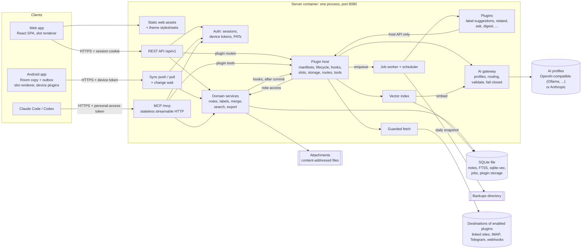
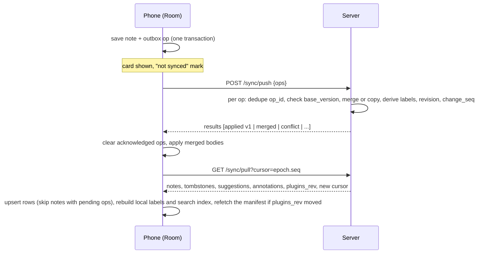

# 02 · Technical spec

Status: revised 2026-10-13 for the redesign the owner approved that day. Inputs: [`01-requirements.md`](01-requirements.md) (story IDs such as CAP-1 come from there), [`04-redesign.md`](04-redesign.md) (the core and plugin mechanism; this revision applies its §7 change list and its §9 fixes), [`05-redesign-ux.md`](05-redesign-ux.md) (how plugin output and the themes look), [`research/stack.md`](research/stack.md), [`research/blinko.md`](research/blinko.md), [`research/landscape.md`](research/landscape.md). The visual design is [`03-design.md`](03-design.md). Next step: an implementation plan per milestone (§16).

What changed in this revision, in one sentence: the app is now a small core that is a complete notes app on its own, plus plugins that can appear only in fixed, budgeted places on screen; the AI features, the importers and the views beyond the timeline moved into plugins (§2.4 to §2.19), the AI pipeline became a gateway every plugin goes through (§7), and the milestones lost their cutover deadline (§16).

Nothing is built yet and no repository changes because of this document. Blinko keeps running on theficos until the owner chooses to switch, some time after the Android milestone (M5); there is no deadline.

How to read decision references:

- Decisions are numbered D1 to D33: D1 to D11 come from the requirements, D12 to D24 from this spec's first draft, D25 to D33 from the redesign (04 §8). The owner settled all of them on 2026-10-13, and §17 records each with the chosen option and a one-line reason. The text cites them where they shape a choice, as "(D16)".
- Everything else is a default the spec takes on its own, stated once with its reason.
- Name: **Spunto** (requirements §10). Identifiers follow it: the Python package and command `spunto` (first-party plugins under `spunto.plugins`), the environment prefix `SPUNTO_` (plugin secrets as `SPUNTO_PLUGIN_<ID>_<KEY>`), the token prefix `spunto_`, the image `ghcr.io/vitofico/spunto`, the Android application ID `io.theficos.spunto`, the MCP server name `spunto`, and on theficos the host `spunto.example.org`. Prose still says "the app" where the name adds nothing.

---

## 0. The spec in one page

Spunto is one server process that owns one SQLite file. That process serves four things on one port: a REST API, the built web app, a sync endpoint for the Android app, and an MCP endpoint (the door Claude Code and Codex use to call tools). The Android app keeps a full copy of the notes in its own database and works with no network, dictation included (speech becomes text on the phone itself); it pushes a queue of pending changes and pulls whatever changed since it last asked. When two devices edit the same note, the server first tries to merge the two edits line by line, and when they touch the same lines it keeps both versions instead of choosing one.

That much is the **core**, and with nothing else switched on it is a complete, calm notes app: capture, labels, keyword search, offline sync, history, agents over MCP, export and backups. Every other feature is a **plugin**: a folder with a data-only manifest and, usually, Python code that runs in the same process. A plugin hears about a save only after it has committed, asks the core's services for what it needs, and hands its output to the host (the part of the core that loads plugins). The host stores that output, syncs it to the phone, and the clients draw it in a handful of fixed places on screen, called slots, each with a budget the code enforces, using a closed set of components. No plugin code runs on a client, and no plugin can change the owner's words: it can only propose a change, or write a new note that is marked as written by a machine. Label suggestions, search by meaning, related notes and Ask your notes are the four plugins that switch on when AI is configured; with dictation and quick capture on the phone, that makes six on by default, and the other nineteen of the 25 first-party plugins wait in Settings → Plugins (§2.19).

Every model call goes through one **AI gateway**: chat, embeddings, transcription and vision, each bound to a named provider profile (any OpenAI-compatible endpoint, Ollama included, or Anthropic) and routable per plugin, with every answer checked against a schema and its meaning before it can touch anything. With no AI configured, AI plugins wait quietly and everything else works. Three built-in themes (Carta, Ardesia, Salvia) change colours and nothing else.

The stack reuses the owner's existing code where it is already proven: Quire's Kotlin and Compose Android skeleton and its Python LLM client and auth, Galley's web conventions and MCP tool habits, and the theficos deployment template. The server is Python with FastAPI; the web app is React with Vite; storage is SQLite with its built-in full-text index and the `sqlite-vec` extension for vectors.

---

## 1. Stack choice

### 1.1 What the choice has to satisfy

Four surfaces (Android, web, server, MCP), one maintainer, a one-container deployment (HOST-1), and two pieces of logic that are hard to get right and already exist in Quire: structured LLM output that survives a model ignoring the requested schema, and an offline outbox that syncs later. D1 (SQLite only) and D2 (native Android) are settled; D3 (server language) is the choice this section explains.

### 1.2 Candidates

| | A. Python server (Quire-shaped) | C. TypeScript server (Galley-shaped) | B. TypeScript everywhere, Android as a WebView shell |
|---|---|---|---|
| Android | Native Kotlin and Compose, Quire's modules, outbox and release pipeline | Same as A | Capacitor shell around the web app |
| Server | FastAPI, SQLite through the standard `sqlite3` module, `sqlite-vec` wheel | Hono on Node, `better-sqlite3`, `sqlite-vec` npm package | Same as C |
| MCP | Official Python MCP SDK, stateless streamable HTTP mounted in the same app | Official TypeScript MCP SDK (the reference SDK; Galley already uses it, stdio only) | Same as C |
| AI client | Quire's `AIClient.chat_structured` and `provider_errors.py` carried over as they are | Port and re-prove Quire's schema-ignoring fallback (about half a week) | Same as C |
| Auth | Quire's argon2id `NativeAuth` pattern carried over | Re-implement | Same as C |
| Contract | Pydantic models produce OpenAPI; web types generated from it; Kotlin DTOs checked against server-generated golden JSON | zod shared by server, web and MCP; Kotlin still crosses a boundary | One language, no Kotlin |
| Languages | Kotlin, Python, TypeScript | Kotlin, TypeScript | TypeScript |
| Main cost | Three toolchains | Re-proving the two hardest server pieces | Android capture quality, which is the heart of the product (J1) |

Not shortlisted: Go (Memos's single-binary model gives the smallest image, but nothing transfers from either repo) and Kotlin Multiplatform or Flutter (nothing transfers; the web targets are the least proven parts of those toolchains).

### 1.3 Choice: A, Python server

Python, settled as D3. The real axis was reuse of already-debugged code against the number of languages one person maintains. Python wins on the axis that matters more: the schema-ignoring Ollama behaviour cost real debugging time in Quire (it broke production insights on 2026-09-28), and the fix lives in Python today. D1 removes Quire's Postgres code from the reuse list, but the AI client, auth, config validation and Docker and CI shape survive, and they are the risky parts. The web is the thinnest surface, so a third language costs least there. Plugins strengthen the choice: their authors write in the server's language, and Python brings `importlib` and entry points for loading them and is the language most self-hosters already script in.

### 1.4 Libraries and versions

Versions are pinned by lockfiles (`uv.lock`, `pnpm-lock.yaml`, the Gradle version catalog) at M0 and kept current by Renovate from M2 (§14). The table names the choice and why.

| Area | Choice | Why |
|---|---|---|
| Server runtime | Python 3.14 on `python:3.14-slim` (Debian trixie, SQLite 3.46), managed with `uv` | Standard-library `uuid.uuid7()`; a recent SQLite with FTS5. Falls back to 3.13 if a dependency lacks 3.14 wheels at M0. |
| Web framework | FastAPI + uvicorn, pydantic v2, pydantic-settings | Quire's stack; OpenAPI for free. |
| Database access | Standard `sqlite3` through `aiosqlite`, hand-written SQL in one `store` package, plain numbered SQL migration files tracked with `PRAGMA user_version` | No ORM: FTS5 and `sqlite-vec` tables need raw SQL anyway, Alembic's SQLite support is awkward, and the store stays small enough to read in one sitting. |
| Vectors | `sqlite-vec` 0.1.9 (loadable extension, PyPI wheel), pinned; the 0.1.10 alphas wait | Vectors in the same file and the same transaction as notes, which is Blinko's biggest reliability gap. Kept behind one `VectorIndex` interface because the project is pre-1.0. The M0 spike loaded it through `aiosqlite` in the real image on amd64 and arm64. |
| Markdown to HTML | `markdown-it-py` + `nh3` sanitizer | One renderer for the web, the export preview and every plugin's `markdown` output, Ask's answers included; `nh3` (Rust's ammonia) is fast and strict. |
| Passwords | `argon2-cffi` (argon2id) | Quire's `NativeAuth`. |
| HTTP client | `httpx` | Quire's AI client uses it. |
| Anthropic | Official `anthropic` Python SDK | Native structured outputs; see §7.1. |
| MCP | Official `mcp` Python SDK 2.x (2.3.0 tested in M0), its low-level `Server` in stateless streamable HTTP mode | Same SDK family as Galley's; supports streamable HTTP without session state, and the low-level handlers compute the tool list per request from the token and the enabled plugins, which FastMCP's static registry cannot (§8.1). In 2.x the handlers are constructor arguments (`on_list_tools`, `on_call_tool`) and reach the HTTP request, and so the token's principal, through `ctx.request`. One endpoint serves protocol 2026-07-28, which has no handshake and which Claude Code uses, and the 2025 handshake protocol, which Codex uses; `stateless=True` governs only the second. |
| Plugins | `tomllib` (standard library) for manifests, `importlib.metadata` entry points for discovery, and a small in-house validator for the manifest's JSON Schema subset | No plugin framework: the host is a few modules the core owns (§2.4 to §2.19). |
| Web app | React 19 + Vite + TypeScript (Galley's strict `tsconfig`), TanStack Query, `wouter` router, `openapi-fetch` with types from `openapi-typescript` | Galley's patterns transfer. A plain `<textarea>` composer instead of Galley's CodeMirror keeps the first load under 150 KB of JavaScript (§12). |
| Android | Kotlin 2.x, Compose with Material 3 (Expressive), Room, WorkManager, OkHttp + kotlinx.serialization, Paging 3, `commonmark-java`, Glance, the platform `SpeechRecognizer` | Quire's stack, plus Paging for a 10,000-note timeline, a small Markdown parser rendered into Compose text, and Glance for the `quick-capture` widget. Dictation uses Android's own recognizer, so no speech library or model goes into the APK (§11.8). |
| Tests | pytest + Hypothesis, vitest + Playwright, JUnit + Robolectric + Turbine | The house tools, plus property tests for merge and label rewrite. |

---

## 2. Architecture

### 2.1 Components



| Component | Responsibility | Notes |
|---|---|---|
| Static assets | Serves the built SPA with an `index.html` fallback for client routes, and the stylesheets of third-party theme packs | Long-cache headers for hashed files; no runtime config file, the SPA reads `/api/v1/meta`. The server writes the theme and mode into `index.html`, so the page never flashes the wrong one (§12). |
| REST API | Everything the web app and scripts need | Same domain services as sync and MCP, so there is one write path. |
| Sync | Android's push and pull, plus a long-poll "wait for change" used by web and Android while in the foreground | §6. |
| MCP | Seven core tools, up to three more per enabled plugin, and one resource template | §8. |
| Auth | Owner login, web sessions, device tokens, personal access tokens (PATs: long random strings the owner creates for scripts, agents and monitors), scopes, rate limits | §9. |
| Domain services | Note writes (with label derivation, revisions, merge), keyword search and the blending point for search sources, export | The only code that touches the note tables. Plugins reach notes only through the host. |
| Plugin host | Discovers and validates manifests, runs the lifecycle, delivers hooks as jobs, mounts plugin routes and tools, stores plugin output, enforces permissions and slot budgets, serves the plugin manifest to clients | §2.4 to §2.19. |
| Plugins | Every feature beyond the core. First-party ones ship in the image; device plugins are compiled into the Android app | §2.19. |
| Job worker and scheduler | Plugin jobs and schedules, embedding, daily backup, trash purge, pruning | In-process asyncio tasks. Idle means asleep, never polling (§7.8). |
| AI gateway | Provider profiles and adapters, per-plugin routing and rate shares, the validation and retry loop, the private-note and machine-written rules | §7. |
| Vector index | Chunks and `sqlite-vec` tables, kept only while an enabled plugin needs embeddings | §7.3. |
| Guarded fetch | The only outbound HTTP a plugin can make | §9.7. |

### 2.2 One process, on purpose

The server runs as a single uvicorn worker. That is a requirement, not an accident: SQLite allows one writer at a time, the job queue and the rate limiter live in memory, and the change-wait notifier is an in-process condition variable. Multiple replicas are out of scope (a non-goal in requirements §7). The process holds an exclusive lock file on the data directory so a second copy pointed at the same volume refuses to start with a sentence saying so. The plugin host lives in the same process for the same reasons: plugins are Python modules the server imports (D25), their jobs run on the one queue, and their hooks are delivered by the same in-process machinery. Synchronous plugin code runs in worker threads, so a slow plugin cannot stall the event loop that serves saves and sync (§7.8).

### 2.3 A save, end to end

A concrete trace, because it touches every component. The owner shares a link from Chrome on the phone with no signal.

1. The share sheet opens the app's capture sheet; the owner types "read this before the sync work" and taps save.
2. The app writes the note and an outbox entry (a queued "create" operation) to Room in one transaction, shows the card with a small "not synced" mark, and returns to Chrome. Nothing has touched the network yet, and the note is safe.
3. Signal returns. WorkManager runs the sync job: it pushes the outbox, the server applies the create (deriving labels from the text, writing revision 1, indexing it for keyword search), answers `applied` with version 1, and the phone clears the mark.
4. The commit fires the `note.saved` hook. The host turns it into one job per enabled plugin that listens, keyed by plugin and note, so a burst of saves would coalesce; the save itself waited for none of them. With AI on, the core embeds the note for the vector index, and `label-suggestions` asks the chat model, through the AI gateway, for up to three labels; the gateway validates the answer and the plugin stores them as suggestions.
5. The laptop's web tab is waiting on the change long-poll; it wakes within a second and shows the new card. On the phone's next pull the suggestion line appears under the note.

### 2.4 Core and plugins

The test that keeps the line honest: something is core when a fresh install with every plugin off would be broken or unsafe without it, or when it is a service several plugins need that must be enforced in exactly one place (privacy, validation, sync). Everything else is a plugin. **With every plugin off, the app is still a complete, calm notes app**: capture, labels, keyword search, offline sync, agents over MCP, export.

| Area | Core |
|---|---|
| Notes | Markdown notes; create, edit, pin, archive, trash; revisions and the history UI; merge and conflicted copies; the private flag; checkboxes ticked in place; source and provenance chips |
| Labels | Inline `#labels`, the shared grammar (§4.3), autocomplete, the tree, rename, merge, remove |
| Search | Keyword search with filters, and the blending point where search sources plug in (§4.4) |
| Capture | Composer, Android share target and selection action, launcher shortcuts, web drafts |
| Sync and auth | Android replica, outbox, push and pull, change long-poll, reconcile; owner login, sessions, device tokens, access tokens, QR pairing |
| Operations | Attachments, Markdown export, backups and restore, status page, health checks |
| Agents | The seven MCP tools and the `note://` resource (§8) |
| Surfaces | The slots, the shared Review screen, Settings → Plugins, the theme engine and the three built-in themes |
| Plugin host | Loader, manifest validation, lifecycle, permissions, and the shared services below |

The shared services are reachable only through the host API (§2.6):

| Service | What it does | What it enforces |
|---|---|---|
| AI gateway (§7) | Provider profiles; structured chat, embeddings, transcription and vision; per-plugin routing and rate shares | Schema and meaning validation with fail-closed on every call; no free-text completion method exists; private notes are refused; calls are counted per plugin |
| Vector index (§7.3) | Chunks and `sqlite-vec` tables | Built and kept current only while an enabled plugin requires embeddings; one index for all plugins; private notes never embedded |
| Jobs and scheduler (§7.8) | The queue with leases, coalescing and backoff, plus schedules | Plugin work never runs inside a save; a disabled plugin's jobs pause |
| Plugin storage (§2.7) | Key-value, records, note annotations, searchable text | Namespaced by plugin id; inside the backup; purgeable per plugin |
| Guarded fetch (§9.7) | Outbound HTTP for plugins (D30) | Blocks private and internal addresses, re-checks on redirect, caps size and time, sends no cookies |
| Note access | Read, query, create, update-own, suggest | No call edits the owner's text; plugin writes carry the plugin's own credential, so provenance reuses `created_by` and `updated_by` |

What moved, against this spec's first draft: label suggestions, search by meaning, related notes and Ask became the four AI plugins that switch on when AI is configured, so an AI install gets exactly the AI of this spec's first draft. The Unlabeled view moved into `label-suggestions`, the Open tasks view into `tasks`, the "From agents" view into `agent-inbox` (the "via Claude Code" chip stays core), the Blinko importer into `blinko-import`, and dictation, the widget and the tiles into the Android device plugins `dictation` and `quick-capture`. The private flag (AI-9) and revision history (CAP-10) moved the other way, from the later train into the core, because the AI gateway and the undo story depend on them.

### 2.5 Plugin anatomy and the manifest

A plugin is a folder: `plugin.toml` (the manifest, data only), an optional Python package (server code) and optional tests. There are three kinds:

- **server**: manifest plus optional Python, running in the server process;
- **device**: listed in the server's catalog like any plugin, but its code is compiled into the Android app (or the web bundle) because it needs the microphone, the launcher or the Quick Settings panel (§2.10);
- **theme**: manifest plus a token file, no code (§2.18).

The host reads the manifest without importing any of the plugin's code, so the owner sees what a plugin will do before a line of it runs. TOML, because Python reads it with the standard library and it allows comments. The real manifest of the weekly digest:

```toml
# server/src/spunto/plugins/digest/plugin.toml
id           = "digest"            # [a-z][a-z0-9-]{1,23}; also the route prefix and MCP tool prefix
name         = "Weekly digest"
version      = "1.0.0"
api          = "0.4"               # host API it targets (§2.15)
kind         = "server"            # server | device | theme
runtime      = "in-process"        # the only runtime for API 1; kept so remote plugins can come later (D25)
category     = "recall"            # capture | organize | recall | develop | agents | data | look
description  = "Each week, a short note on what you captured: themes, open questions and threads worth continuing, each linked to its notes."
entry        = "spunto.plugins.digest:plugin"
requires     = ["ai.chat"]         # unmet: listed as "Needs a chat model" and contributes nothing
default      = "off"               # first-party only: on | on-with-ai | off (D31)
data_version = 1                   # bump to run the plugin's own data migration (§2.7)
creates      = "machine"           # what its new notes are: machine | import | external (§2.11)
permissions  = ["notes.read", "notes.create", "ai.chat", "schedule", "mcp"]

[[contributes.commands]]
id    = "write-now"
title = "Write this week's digest"
where = ["palette"]                # palette | slash | note-actions; nothing else exists

[[contributes.views]]
id     = "digests"
title  = "Digests"
filter = { source = "plugin:digest" }   # the closed filter language of §2.9; runs on the phone too

[[contributes.mcp_tools]]
name        = "latest"             # listed to agents as digest_latest
description = "The latest weekly digest as Markdown, with the IDs of the notes it cites."
read_only   = true

[[contributes.schedules]]
id      = "weekly"
weekday = "{day}"                  # placeholders read from the settings below
time    = "{time}"

[settings]                         # a JSON Schema subset; becomes the plugin's settings page
type = "object"

[settings.properties.day]
type    = "string"
title   = "Day"
enum    = ["monday", "friday", "sunday"]
default = "sunday"

[settings.properties.time]
type    = "string"
format  = "time"
title   = "Time"
default = "18:00"

[settings.properties.min_notes]
type    = "integer"
title   = "Skip weeks with fewer notes than"
minimum = 1
default = 5

[settings.properties.leave_out]
type    = "array"
title   = "Leave out"
items   = { type = "string", format = "label" }   # format "label" renders a label picker with autocomplete
default = []
```

On enable, the host turns the permissions into sentences, with the destination filled in from the plugin's AI route: "Reads your notes, never private ones · Writes new notes marked 'via Weekly digest' · Sends a week of notes to the chat model at ollama.com · Runs every Sunday at 18:00 · Adds one tool for agents."

**Contributions** are everything a client draws or an agent sees, and all of them are static, so clients learn them from the manifest without the plugin running: `commands` (in `palette`, `slash` or `note-actions`), `views` (a filter in the closed language of §2.9), `panel` (one note-panel section, stored or live, §2.8), `meta` (one meta-token kind), `slip` (takes part in the daily slip), `search_source` (§4.4), `mcp_tools` and `schedules`. Hooks, jobs and routes are registered in code. Every contribution type has a budget (§2.17), and there is no field for a toolbar button, a FAB, a colour, an icon, a badge or a notification.

**Settings** are a JSON Schema subset (string, enum, boolean, integer, number, time, a list of strings, and a list of labels through `format = "label"`) that becomes the plugin's generated settings page. Fields marked `"x-secret": true` (a bot token, an IMAP password) are never stored in the database or shown in a form: they come from `SPUNTO_PLUGIN_<ID>_<KEY>` or its `_FILE` variant (the ID upper-cased, `-` written as `_`), as every secret does (HOST-2), and the page says "Set in the environment". Fields marked `"x-scope": "device"` (dictation language) live on each phone or browser and do not sync.

**`creates`** is required with `notes.create` and says what the plugin's new notes are, which decides how the host marks them (§2.11).

### 2.6 The host API

The server half of the digest shows the shape of the API:

```python
# server/src/spunto/plugins/digest/__init__.py
from spunto.host import Plugin, Ctx, Output, field

plugin = Plugin("digest")

class Digest(Output):                       # the gateway validates shape and meaning
    title: str = field.text(max_len=80)
    body: str = field.markdown(max_len=4000)
    cites: list[str] = field.note_ids()     # must be a subset of the notes sent

@plugin.schedule("weekly")
@plugin.command("write-now")
async def write(ctx: Ctx) -> None:
    week = await ctx.notes.query(created_within_days=7)   # private and machine-written notes already excluded
    if len(week) < ctx.settings["min_notes"]:
        return
    d = await ctx.ai.chat(Digest, prompt=PROMPT, notes=week)  # raises on failure: nothing is written
    await ctx.notes.create(f"# {d.title}\n\n{d.body}", cites=d.cites)

@plugin.mcp_tool("latest")
async def latest(ctx: Ctx) -> dict:
    note = await ctx.notes.latest(source="plugin:digest")
    return {"id": note.id, "body": note.body} if note else {"found": False}
```

| Area | Calls | Rules |
|---|---|---|
| Hooks | `note.saved`, `note.trashed`, `note.purged`, `labels.changed`, `suggestion.decided`, `attachment.added`, `plugin.enabled` | Delivered after the commit, as coalesced jobs (ten saves in a row are one call). **There is no hook before a save**, so no plugin can slow a save down or rewrite text on its way in. |
| Notes | `get`, `query`, `latest`, `create`, `update_own`, `suggest`, `annotate`, `set_search_text` | `create` makes a new note under the plugin's credential (§2.11); `update_own` edits only notes this plugin created and nobody has edited since (importer re-runs); changes to the owner's notes exist only as suggestions (§2.8) |
| AI | `chat(OutputModel, …)`, `embed`, `transcribe`, `vision` | Structured output only; the gateway wraps note text in data delimiters, routes by the plugin's profile and enforces the private flag (§7) |
| Vectors | `nearest(note_id or text, k)` | Only for plugins that require `ai.embed`; a note the index has not caught up with is embedded first |
| Jobs | `@job`, `@schedule`, `enqueue`, `to_thread` | §7.8 semantics; concurrency 1 per plugin unless declared. The API is async only: blocking work goes through `to_thread`, on a small thread pool of the plugin's own (§7.8) |
| Storage | `kv`, `records` | §2.7 |
| Network | `fetch` | Guarded (§9.7); only with `net.fetch` or a declared `net.out:<host>` |
| Attachments | `read`, `write` | Content-addressed as in the core (§3.3) |
| Routes | `@route` | Below |
| MCP | `@mcp_tool` | Below |
| Misc | `settings`, `clock`, `log` | `log` takes a code and counts or IDs, never free text, so note content cannot reach the logs |

**What the note reader hands out.** `get`, `query` and `latest` never return trashed notes, and never return private notes to a plugin holding an `ai.*` or `net.*` permission (§2.13). `query` leaves machine-written notes out (§2.11) unless the plugin asks for its own, or holds no `ai.*` permission and asks explicitly, as `links` does for backlinks. Independently, the gateway refuses to send a private or machine-written note to any model (§7.7), so a plugin that slips cannot leak one.

**Hooks** are registered in code (`@plugin.on("note.saved")`) and delivered after the commit as jobs keyed by plugin, hook and note, so a burst of saves coalesces into one call that sees the latest version. A hook job whose note changed again before it ran is skipped in favour of the newer one. `plugin.enabled` runs once per enable and is where a plugin backfills, at priority 5 so new notes still go first. Hook handlers must be idempotent: a job paused by a disable runs again after the re-enable, and the backfill may cover the same note (in the M0 spike both counted one note at the same moment).

**Jobs and schedules.** A plugin declares background work with `@job` and queues it with `enqueue(name, args, note_id=…)`; schedules are declared in the manifest (a weekday and time, or daily, with `{placeholders}` read from settings) and bound in code with `@schedule`. Both run on the core queue (§7.8): leases, coalescing on `(plugin_id, kind, note_id)`, backoff, at most one running job per plugin unless the manifest declares more, and a pause while the plugin is disabled. A schedule missed while the server was down runs once at the next start, never once per missed slot. Unattended runs (hooks and schedules) may create at most five notes a day per plugin; commands the owner starts are not capped.

**Routes.** `@route` mounts handlers under `/api/v1/plugins/<id>/`. One dispatcher owns that prefix and answers 404 while the plugin is not Enabled, so a disabled plugin has no surface at all. Routes accept session and device credentials by default; a route that an access token may reach must say so in code, and a write route requires write scope. Routes serve live output (Related, Ask answers, search sources) and commands, and answer in the component vocabulary (§2.8), validated before it leaves.

**MCP tools.** `@mcp_tool` binds a tool the manifest declares. Agents see it as `<id>_<tool>` (`digest_latest`, `related_notes`), not `<id>.<tool>`: the MCP specification allows dots, but OpenAI's function names allow only letters, digits, `_` and `-`, so a dot depends on every client rewriting names, and an underscore needs no rewriting. Names stay under 40 characters, because Claude Code prefixes them with `mcp__spunto__`. Each plugin may add at most three tools, each with annotations and a description under 300 characters; answers pass through the core serializer, its origin marking and its 8,000-token ceiling. The list is computed per request from the token's scope and the enabled plugins, through the MCP SDK's low-level `list_tools` and `call_tool` handlers instead of FastMCP's static registry; that also delivers the rule that read tokens never see write tools (§8.2). Stateless HTTP has no server push, so an agent sees a newly enabled plugin's tools from its next session on. The owner can hide any plugin tool in Settings → Agents.

### 2.7 Plugin storage

Plugins get no tables of their own and run no SQL (D28). The host keeps their data in six core tables, created by ordinary core migrations (schema in §4.2):

| Table | Holds | Syncs to Android |
|---|---|---|
| `plugin` | id, version, switch, state, settings JSON, AI route, the owner's order, `data_version`, last run and last error | as the manifest (§2.9) |
| `plugin_kv` | small per-plugin state ("last digest week") | no |
| `plugin_record` | JSON documents keyed by plugin, collection and id, with optional indexed `note_id` and `key` columns | no |
| `suggestion` | proposals from every plugin: plugin, note, note version, action, payload, status, `change_seq` | yes |
| `annotation` | per-note output for the panel, the meta line, the daily slip and view membership, capped at 4 KB each | yes |
| `note_text` | searchable text a plugin attaches to a note (image text, a transcript, a page title) | no; feeds the keyword index and the embedder |

A plugin's data migration is a function, not DDL: when `data_version` rises, the host takes the usual pre-migration snapshot and runs `@plugin.migrate(old, new)` as a resumable job over that plugin's own rows. A migration that fails marks the plugin Failed and never stops the server. Uninstall or "Delete this plugin's data" is one `DELETE … WHERE plugin_id = ?` per table, plus tombstones for synced rows; the notes the plugin wrote stay, because they are notes. Switching a plugin off, or deleting its data, re-indexes the notes it attached search text to, in the background. Plugin storage lives in the same database file, so every snapshot and restore covers it, and it counts in the disk budget (§4.2).

### 2.8 Slots and the component vocabulary

A **slot** is a fixed place on screen where plugin output may appear, with a budget. Plugins choose slots; they never choose positions, colours, icons or sizes. A slot that no enabled plugin uses draws nothing: no header, no empty state, no gap. How each one looks is 05 §3.

| Slot | Web | Android | Budget | Data | Offline on Android |
|---|---|---|---|---|---|
| Suggestion line | Under an entry and in the note | Same | One row for all plugins; overflow folds into "+N"; at most 3 pending per plugin per note; the host ranks across plugins | stored | Shown and decidable |
| Review | One quiet line, "5 suggestions · Review", only from 3 pending; a review screen | Same | One line; one screen for every plugin; at most 3 label-level proposals per plugin per week | stored | Note-level items yes; label-level no |
| Note panel | Right margin (≥ 1280 px) or below the note | "About this note" sheet | One section per plugin; collapsed by default; order set by the owner; at most 10 items | stored or live | Stored sections yes; live ones absent |
| Entry meta token | Meta line | Same | One token per entry across all plugins, picked by the owner's plugin order | stored | Yes |
| Daily slip | Top of the timeline | Top of the timeline and the widget | One item a day across all plugins; dismissing is final for the day | stored | Yes |
| Commands | ⌘K palette, composer `/` menu | Note action sheet, composer `/` menu | At most 3 per plugin; no toolbar, FAB or header slot exists | static | Online-only commands are absent |
| Command result | Panel inside the palette | Bottom sheet | Vocabulary only; "Save as note" is the way to keep it | live | Absent |
| Views | "Views" group in the rail | "Views" group in the labels sheet | One per plugin; the owner can hide it | static filter | Yes, the filter runs locally |
| Settings | Settings → Plugins → name | Same | One generated page per plugin | static | Read-only |
| Search source | "≈ similar meaning" on hits | Same | No surface of its own | live | Absent; keyword search runs locally |
| New notes | Timeline, with a "via Weekly digest" chip | Same | Unattended output (schedules, hooks) capped at 5 notes a day per plugin; owner-started commands uncapped | notes | Yes |
| MCP tools | n/a | n/a | 3 per plugin (§2.6) | n/a | n/a |

**Stored** output is rows the host keeps and syncs: suggestions, annotations (of kind `panel`, `meta`, `slip` or `member:<view>`) and notes. **Live** output is fetched from one of the plugin's routes when a client needs it: a live panel section names a GET route under the plugin's prefix that takes a note ID, a command answers with a command result, a search source answers with ranked note IDs. The daily slip and Review exist because resurfacing, the widget, label merges and duplicate pairs need a home that is not a single note; command result and search source are where Ask's answer and ranking by meaning go. Background-only plugins (`email-in`, `telegram`, `webhooks`) use only Settings.

Everything a plugin shows is built from a closed **component vocabulary**, versioned as `ui = 1`:

| Component | Carries | Web | Android | Older client falls back to |
|---|---|---|---|---|
| `text` | Plain text, at most 280 characters | Sans | Sans | itself |
| `markdown` | At most 4,000 characters | The server's sanitized HTML (§9.4) | The core `commonmark` renderer | `text` |
| `notes` | Up to 10 note IDs, each with an optional reason | Note references in the core style | Resolved from Room, so they work offline | `text` |
| `pill` | Suggestion id, a label of at most 40 characters, an action | Dashed pill | Dashed pill | dropped |
| `command` | Command id, arguments, a title of at most 24 characters | Palette row or button | Sheet row | dropped |
| `form` | A JSON Schema subset (string, enum, boolean, integer, number, time, string list) | Generated | Generated | "Open on the web" |
| `diff` | Precomputed hunks and the base version | Side by side or inline | Stacked | `text` |

Suggestions can only do what the core knows how to do, so Android can apply them offline and no plugin invents a new kind of edit:

| Action | Effect when accepted | Offline on Android |
|---|---|---|
| `add_label` | Appends the `#label` (§4.3) | Yes |
| `set_title` | Prepends `# Title` | Yes |
| `append_text` | Appends text, for example a link to another note | Yes |
| `replace_body` | Replaces the body, previewed as a `diff`; based on the suggestion's note version, so it merges or makes a conflicted copy like any edit; superseded when the note changes first | Yes |
| `merge_notes` | Opens the core Compare view; accepting appends one note to the other and trashes it | Yes |
| `label_change` | Rename or merge labels through the core impact dialog | No: needs the server |
| `open` | Opens a note or a view | Yes |

A suggestion carries its plugin, the note and the version it was computed from, the action and its payload, a confidence, and a one-line reason that a long-press or hover shows. The host checks the payload against the action's schema and computes what clients trust itself: for `add_label`, whether the label is new. A pending suggestion becomes `superseded` when a newer one from the same plugin replaces it or, for `replace_body`, when the note changes first, and `expired` after 14 days.

### 2.9 How clients render plugins, and Android offline

- **The manifest endpoint.** `GET /api/v1/plugins/manifest` returns the enabled plugins with their static contributions (commands, views, panel sections, settings schemas, themes) and an ETag. `/meta` and every sync pull carry `plugins_rev`, so a client refetches only when something changed; the change long-poll wakes on a plugin switch like on a note change (§6.7). Android caches the manifest in DataStore, so slots, views and settings render offline (§11.9). Waiting plugins are not in it: they show only in Settings → Plugins.
- **Stored output** (suggestions, annotations, plugin-written notes) travels in the ordinary pull, ordered by `change_seq`. Clients hide the output of disabled plugins locally, which is why disabling is instant and re-enabling needs no backfill.
- **Live output** (Related notes, Ask answers, search sources) is fetched from the plugin's route when needed. Offline it is absent, never shown as broken.
- **Views are filters, not code.** A view's filter uses a closed language over core fields: labels (with nesting), no labels, `source` (a source kind, `plugin:<id>`, or `agent`, which also matches notes whose latest change came through an access token), open tasks, pinned, archived, a date window relative to today, and `member` or `not_member` (a set the plugin maintains as synced annotations of kind `member:<view>`). The server turns it into SQL and Android into a Room query, and shared fixtures (`spec/fixtures/views.json`) pin that both return the same notes, so every view works on a phone in airplane mode. Views from plugins that came on by default start hidden (U3): ⌘K and "Show more views" reach them and one click pins one; pinned and hidden views are instance settings.
- **Commands** that call a server route are absent while offline. Accepting a suggestion offline queues `suggestion.decide` in the outbox; the phone shows the expected result at once and the server applies the action against the latest version, which never conflicts for labels and appends and merges for `replace_body`.
- **An older Android build** that meets a component newer than its vocabulary renders the declared fallback; the server keeps serving the build one release behind (§5.4).
- **Web** draws the same vocabulary with a handful of small components and computes nothing heavy (diffs arrive precomputed), which keeps the 150 KB budget (§12).

### 2.10 Device plugins

Some features need the phone itself: the microphone (`dictation`, and the recording half of `voice-memos`), the launcher and the Quick Settings panel (`quick-capture`), later the notes role (AND-14). These ship as Gradle modules (`:plugins:dictation`, `:plugins:quick-capture`) compiled into the APK, reviewed like any app code, and listed in the server's catalog with `kind = "device"`. The owner switches them with the same toggle as any plugin; the phone reads the state from the cached manifest, so the mic works offline and before the first sync, when the APK's own default applies. Device plugins may report per-phone availability ("No on-device recognizer on this phone") and keep per-phone settings on the phone.

They are the one exception to "plugins never add buttons": the mic in the composer's action bar, the widget and the tile are native surfaces only compiled-in, reviewed code may use. Nothing is ever loaded at runtime on Android, which keeps the app clear of the dynamic-code-loading pattern that Play Protect flags.

### 2.11 What plugins write: machine-written, imported and outside notes

A plugin with `notes.create` declares in its manifest what its new notes are, and the host stamps every note it creates accordingly; the plugin cannot choose per note.

| `creates` | Used by | `source_kind` | `origin` (§8.3) | Machine-written |
|---|---|---|---|---|
| `machine` | `digest`, `develop`, `translate`, `ask` (Save as note) | `plugin` | `plugin` | Yes, until the owner adopts it |
| `import` | `blinko-import`, `markdown-import` | `import` | `owner` | No: the owner's own words, brought from elsewhere |
| `external` | `email-in`, `telegram` | `plugin` | `external` | No: written by someone else, and fenced for agents (D32) |

**Machine-written notes (D29).** A note a plugin wrote from a model's output carries `note.machine = 1` and stays out of every plugin's AI input and out of resurfacing, so the next digest never summarises the last one and Ask never cites its own saved answers as evidence. Otherwise it is a note: search, labels, views and export treat it like any other. The first body edit the owner makes with their own hands (from a web session or the phone) adopts it: the flag clears in the same transaction, and from then on plugins may read it. An agent's append does not adopt a note. The clients draw machine-written notes in the sans with a spark chip and a closing line saying so (05 §7); the first adoption ever shows one line, once per account, "This note is yours now: plugins can read it and it can resurface." (U4), remembered as an instance setting.

Notes from agents keep the core treatment (`origin = agent`, the "via Claude Code" chip) and are not machine-written: an agent writes at the owner's request.

### 2.12 Lifecycle

| State | Meaning | What the owner sees |
|---|---|---|
| Available | Shipped or installed, off | A row in Settings → Plugins with a switch |
| Waiting | On, but a requirement is unmet (no chat model, no embeddings, no attachments), or an update added a permission the owner has not accepted yet | "Needs a chat model" (or the new permission sheet), and no contributions |
| Enabled | On and running | Its slots, views, commands, settings page, tools |
| Disabled | Switched off | Nothing; data, settings and pending jobs are kept |
| Failed | Load error, a failed data migration, or a circuit breaker opened after 5 consecutive job failures (§7.8) | One line on the plugin's page and the status page; the rest of the app is untouched |
| Removed | Third-party code taken out of the plugins directory | "Delete this plugin's data?" with a count |

Enabling runs no restart: the host validates the manifest, records the permissions the owner was shown (the switch request carries them, so an update that adds one sends the plugin back to Waiting until the owner accepts the new sheet), imports the code if needed, registers hooks, routes and tools, runs `plugin.enabled` (a backfill, for example) and bumps `plugins_rev`. Disabling unregisters them and pauses the jobs; a running job is cancelled and goes back to the queue, paused (§7.8). Every `Ctx` (the handle a plugin reaches the host through) is bound to a per-plugin generation that each disable bumps, so a call through a handle issued before the switch raises, even after a later re-enable; that is how the host refuses a disabled plugin's calls from that moment. Python can neither unload an imported module nor cancel a thread, so a disabled plugin's code stays in memory until the next restart, and blocking work already running in one of its threads runs to its end with the result thrown away; the plugin simply receives no new calls. A plugin that fails to import never stops the server from starting; bad core configuration still does (HOST-2).

The switches live in the database and can be changed from the web or the owner's phone, never from an access token. For GitOps, `SPUNTO_PLUGINS="+digest,-telegram"` pins listed plugins on or off and locks their switches with "Set in the environment", the same rule the owner password follows (§9.2).

**Defaults (D31).** On a fresh instance the host switches on the first-party plugins whose manifest says `default = "on"` (`dictation`, `quick-capture`) or `"on-with-ai"` (`label-suggestions`, `semantic-search`, `related`, `ask`). The latter sit in Waiting until their own requirements are met, so an install that gains AI later gets them without a visit to Settings. After that the owner's choice wins, and a plugin that arrives with an upgrade starts off. `agent-inbox` is offered, not switched on, when the first access token is made. Settings → Plugins lists `resurface` first among the ones worth trying.

### 2.13 Permissions

Permissions are a short closed list: `notes.read`, `notes.create`, `notes.update_own`, `suggest`, `annotate`, `search.text`, `ai.chat`, `ai.embed`, `ai.transcribe`, `ai.vision`, `net.fetch`, `net.out:<host>`, `attachments.read`, `attachments.write`, `schedule`, `routes`, `mcp`, and for device plugins `mic`. A host call outside a plugin's granted list raises. Three rules are enforced by the host for every plugin:

1. **A plugin that can send anything off the instance never sees private notes.** Any `ai.*` or `net.*` permission makes the note reader skip them, and the gateway refuses them anyway (§7.7).
2. **"Where note text goes" is computed, not declared.** It comes from the plugin's AI route and its network permissions and is shown on enable, in the plugin's facts line and on its page ("Chat: the note goes to gpt-oss:120b at ollama.com, outside your network").
3. **Plugins propose; only the owner edits.** The API has no call that changes an existing note the owner wrote.

The list is a contract for honest plugins and a review aid, not a sandbox; §9.6 says what that means for trust.

### 2.14 Install and distribution

- **First-party** plugins live in the server package (`spunto/plugins/<id>/`) and, for device plugins, in the Android and web codebases. They ship with every image; the owner only switches them.
- **Third-party** server plugins load from M8 (D25) and are installed by whoever runs the server, never through the UI (D27): a pure-Python folder dropped into `SPUNTO_PLUGINS_DIR` (default `/data/plugins`), or a package installed in a derived image (`FROM ghcr.io/vitofico/spunto:<version>` plus `uv pip install …`), found through the `spunto.plugins` entry-point group. Before M8 the host loads first-party plugins only. Runtime installs are impossible anyway on theficos, whose pods run with a read-only root filesystem.
- **Theme packs** install the same way, as folders in `SPUNTO_THEMES_DIR` (default `/data/themes`), also from M8 (THM-3); they carry no code.
- There is no catalog server and no marketplace. A list in the docs is enough for one-owner instances.

### 2.15 Versioning the plugin API

The host API, the manifest format and the component vocabulary carry versions. The API stays at `0.x` while the first-party waves exercise it (§16): breaking changes are allowed, and because first-party plugins live in the same repository, each one lands in the same pull request as the API change. API `1.0` is frozen before third-party loading opens (M8). After that, a major version is supported alongside the previous one for at least one release, and additions within a major are optional fields and new calls only. A plugin whose `api` the host does not support is refused at load with a sentence naming both versions. The vocabulary grows only by adding components that declare a fallback to an older one, so an Android build one release behind always renders something sensible.

### 2.16 Testing a plugin

The host ships a pytest harness, `spunto.host.testing`: a temporary SQLite file, the fake AI provider of §7.2 with all its failure modes, a fake clock for schedules and a fake fetch. Every plugin, first-party or not, gets the same contract suite for free:

- the manifest is valid and inside every budget;
- with AI off, enabling it leaves it Waiting with no errors and no contributions;
- under each fake-provider failure, no note, suggestion or annotation changes;
- disabling it mid-job leaves nothing new visible, and its data survives;
- "Delete this plugin's data" leaves no row with its id;
- every payload validates against the vocabulary schemas, and every MCP answer stays under the token ceiling.

`spunto plugin check <dir>` runs the static half of this outside the test suite. On the client side, `spec/fixtures/vocabulary/` holds golden payloads that the web (vitest) and Android (Compose screenshot tests) both render, the same pattern as the label-grammar fixtures (§14).

### 2.17 How the clutter contract is enforced in code

Convention erodes; these checks do not.

1. **Closed manifest schema.** Unknown slots, fields or permissions refuse the plugin at load. There is no field for a toolbar button, a FAB, a colour, an icon, a badge or a notification, so none can be requested.
2. **Budgets in the validator.** Three commands, one view, one panel section, one meta-token kind, three MCP tools per plugin; checked at load and in `spunto plugin check`. First-party plugins get no exemption.
3. **Budgets in the write APIs.** `suggest` refuses a fourth pending suggestion per plugin per note, and a fourth label-level proposal per plugin in a week; the daily slip accepts one item a day; unattended `notes.create` stops at five a day per plugin; annotations over 4 KB are refused.
4. **Budgets in the serializer.** The note serializer emits at most one meta token per entry and ranks suggestions across plugins; clients render one row with "+N".
5. **Payload schemas.** Every component validates with `additionalProperties: false` and length caps before it is stored or sent.
6. **One renderer per platform.** Clients render only the vocabulary, panel sections always start collapsed (there is no "expanded" field), and the owner's order wins.
7. **No push channel.** The API has no notifications, badges or sounds, which keeps 03's "quiet until spoken to" true for every plugin.
8. **CI.** The contract suite runs for every first-party plugin on every pull request.

### 2.18 Theme packs

A theme is a pack of colour values and nothing else (05 §8.1). The three built-in packs are Carta (the original warm paper and terracotta, the default), Ardesia (cool slate) and Salvia (pale sage), each with one accent, which replace the first draft's five-accent picker (U1); their values and contrast ratios are in 05 §8.2.

**What a pack contains.** A folder with `plugin.toml` (`kind = "theme"`, id, name, version, `tokens = 1`) and `theme.toml` with a `light` and a `dark` set of the themeable colour roles: `paper`, `raised`, `sunken`, `ink`, `ink-2`, `ink-3`, `rule`, `rule-strong`, `field`, `accent`, `accent-strong`, `accent-soft`, `on-accent`, `highlight`, `danger` and `warn`. `scrim` and the hover and press state layers derive from `ink` the same way in every theme. A pack may carry an accent set (each accent with light and dark values); the picker shows an Accent row only for a pack with more than one, and no built-in has more than one. Typefaces, the type scale, spacing, radii, elevation, motion, icons and the dashed proposal style are fixed: a theme cannot change faces, because the serif marks the owner's words (U2). Any other key is ignored, and a theme loads no fonts, so neither Android nor the web's `self`-only font policy ever downloads one.

**Validation in code.** At load, the host computes the contrast pairs 03 §10 promises (`ink` and `ink-3` on `paper`, `sunken` and `raised`; `accent` on `paper` and on `accent-soft`; `field` on `paper` at 3:1) for both modes and every accent. A pack that misses one is refused, naming the failing pair ("`ink-3` on `sunken` is 4.1:1 in dark"); Appearance shows it disabled. A later token contract (`tokens = 2`) adds tokens only with a rule deriving them from existing ones, so older packs keep working.

**Which theme applies.** The theme (and the accent, for a pack with several) is an instance setting that syncs; each device may override it; light, dark or system stays per device. On Android, pure black (derived from the theme's dark set) and wallpaper colours apply on top of whichever theme is chosen.

**Delivery.** The web compiles the three built-ins into its bundle and loads a third-party pack as a stylesheet the server generates at `/api/v1/themes/<id>.css` (§12). Android generates the built-ins into `:core:design` at build time and maps a third-party pack's tokens, which arrive in the cached manifest, into its Material 3 colour scheme at run time (§11.9). Either way a theme is only values, so nothing executes.

### 2.19 First-party plugins

The catalog has 25 plugins. "Default" follows D31 and "M" is the milestone that ships it (§16). Where each plugin's text goes is computed from its route and permissions (§2.13), so the table does not list it; 04 §4 gives the reasoning behind each entry, and 01 §4.12 the stories.

| Plugin | What it does | Slots | Permissions | Default | M |
|---|---|---|---|---|---|
| **Capture** | | | | | |
| `dictation` (device) | Speech to text in the composer, on the phone, Italian and English (§11.8) | Composer mic | `mic` | on | M5 |
| `quick-capture` (device) | Widget and Quick Settings tiles, each with "Dictate" (§11.3) | Widget, tiles | none | on (inert until placed) | M5 |
| `voice-memos` | Keeps the recording and transcribes it on the server; transcript offered as a diff | Suggestion line, panel, command | `attachments.read`, `attachments.write`, `ai.transcribe`, `suggest` | off | M7 |
| `link-enrichment` | For a shared link: page title, short summary, label ideas | Suggestion line, panel ("Source"), meta token ("23 min read") | `net.fetch`, `ai.chat`, `suggest`, `annotate`, `search.text` | off | M7 |
| `image-text` | Reads text in images and describes them, so search finds them | Panel ("In this image") | `attachments.read`, `ai.vision`, `search.text` | off | M7 |
| `tidy` | Cleans up dictated or pasted text without changing meaning | Command, suggestion line (diff) | `notes.read`, `suggest`, `ai.chat` | off | M6 |
| `email-in` | Mail from allowlisted senders to a mailbox becomes a note | Settings only | `net.out:<imap host>`, `notes.create` | off | M8 |
| `telegram` | Messages to the owner's bot become notes | Settings only | `net.out:api.telegram.org`, `notes.create` | off | M8 |
| **Organize** | | | | | |
| `label-suggestions` | Up to three labels after a save, from the owner's vocabulary; Unlabeled view; auto-accept for existing labels | Suggestion line, Review, view | `notes.read`, `suggest`, `ai.chat`, `ai.embed` | on with AI | M4 |
| `title-summary` | For long notes only (300 words and up): a proposed title and a short summary | Suggestion line, panel ("Summary") | `notes.read`, `suggest`, `annotate`, `ai.chat` | off | M6 |
| `label-gardener` | Merges for near-duplicate labels and new labels for clusters of unlabeled notes; at most three proposals a week | Review | `notes.read`, `suggest`, `ai.chat`, `ai.embed` | off | M6 |
| `duplicates` | Finds notes that say the same thing, to compare and merge | Review | `notes.read`, `suggest`, `ai.embed` | off | M6 |
| `links` | Links between notes and a Backlinks section; "Link to note…" | Panel ("Backlinks"), command | `notes.read`, `annotate`, `suggest` | off | M6 |
| `tasks` | Collects notes with open checkboxes into a Tasks view | View, meta token ("2 of 5 done") | `notes.read`, `annotate` | off | M2 |
| **Recall** | | | | | |
| `semantic-search` | Ranks by meaning in the one search box; MCP search goes hybrid | Search source | `ai.embed` | on with AI | M4 |
| `related` | Up to five related notes; `related_notes(id)` for agents | Panel ("Related"), MCP tool | `ai.embed`, `mcp` | on with AI | M4 |
| `ask` | Cited answers from the notes; "Nothing in your notes covers this" when so | Command, command result | `notes.read`, `ai.chat`, `ai.embed`, `notes.create` | on with AI | M4 |
| `resurface` | One older note a day, spaced so it is not seen too often; "on this day" when one exists | Daily slip (and the widget) | `notes.read`, `annotate`, `schedule` | off | M2 |
| `digest` | A weekly note of themes, open questions and threads, citing its notes | New notes, view, command, MCP tool | `notes.read`, `notes.create`, `ai.chat`, `schedule`, `mcp` | off | M6 |
| **Develop** | | | | | |
| `develop` | Expands a note into a linked follow-up note: questions, next steps, angles | Command, new note | `notes.read`, `notes.create`, `ai.chat` | off | M6 |
| `translate` | Italian to English and back, shown as a result, savable as a linked note | Command, command result | `notes.read`, `notes.create`, `ai.chat` | off | M6 |
| **Agents** | | | | | |
| `agent-inbox` | "From agents" view and "Mark reviewed" | View, command | `notes.read`, `annotate` | off; offered when the first token is made | M2 |
| `webhooks` | Sends note events to URLs the owner configures (n8n, Hermes) | Settings only | `notes.read`, `net.out:<configured>` | off | M7 |
| **Data** | | | | | |
| `blinko-import` | Imports from a running Blinko; CLI and a settings page with a dry run (§10.9) | Settings, CLI | `net.out:<configured>`, `notes.create`, `notes.update_own`, `attachments.write` | off | M2 |
| `markdown-import` | Imports a zip or folder of Markdown: Obsidian, Bear, Memos, Spunto's own export | Settings, CLI | `notes.create`, `notes.update_own`, `attachments.write` | off | M7 |

The four AI plugins of the first wave carry over what this spec's first draft specified as built-in features.

#### `label-suggestions` (AI-3, AI-10, LAB-5)

Runs on the `note.saved` hook for a note whose text changed. Skipped for notes under three words and while no chat model is bound; private and machine-written notes never reach it. With embeddings on, it uses the note's neighbours (`vectors.nearest`); without them it still runs, without neighbour labels.

- **Prompt.** A fixed system prompt with the rules; the label vocabulary (the 150 most used labels with counts, plus the labels on the note's 10 nearest neighbours, at most about 300 in total); labels already dismissed for this note, which the plugin learns through the `suggestion.decided` hook and keeps in its records; and the note text inside the gateway's data delimiters (§7.7). Prompt caching is used where the provider supports it, since the system prompt and vocabulary repeat.
- **Schema.** `{"labels": [{"path": str, "confidence": float 0..1}]}`, at most 3 items.
- **Validation.** Grammar-valid; not already on the note; not dismissed before for this note; at most one brand-new label per note, at most three segments deep, and only when its confidence is at least 0.7. Whether a label is new is computed by the host from the label table, never trusted from the model.
- **Storage.** Valid labels become pending `add_label` suggestions with a `change_seq`, so they reach Android on the next pull. Accepting appends the label (an append, never a conflict); dismissing is remembered, so the label is not suggested again and later prompts can learn from it.
- **Auto-accept** (AI-10, D6): a setting, off by default, that applies only labels that already exist and scored at least the configured confidence; new labels always wait for the owner.
- **Unlabeled view** (LAB-5): the filter "no labels". The plugin comes on by default with AI, so the view starts hidden (U3).
- **Acceptance rate** for success criterion 9 is computed from the stored decisions.

#### `semantic-search` (SRC-2)

The search source behind "≈ similar meaning" (§4.4). For a query it embeds the text (a small in-memory cache keeps recent query vectors), finds the 50 nearest chunks, keeps each note's best chunk and drops notes below a similarity floor, a setting of the plugin with a default per model family; the core then applies the filters and blends. While it is on, MCP's `search_notes` is hybrid too and reports `semantic: on`. It has no surface of its own.

#### `related` (AI-6)

For an open note: for each of its chunks (usually one), find the nearest 20 chunks, group by note keeping the best score, drop the note itself and its conflicted copies, return the top 5. No chat call, so it costs one or a few vector queries, within the 300 ms target. It serves a live "Related" section in the note panel ("About this note" on Android, where the note screen has no separate related list) and one MCP tool, `related_notes(id)`, by note ID only: free text is what `search_notes` with semantic search is for.

#### `ask` (AI-8)

A command in the palette and in search, answered as a command result:

1. Run the core's blended search (§4.4) on the question; take the top 8 notes, within about 3,000 tokens of note text. Machine-written notes are left out, so earlier saved answers are never evidence.
2. Send them with their IDs and dates, each inside the gateway's data delimiters.
3. Schema: `{"found": bool, "answer": str (Markdown, at most 1,200 characters), "citations": [note_id]}`.
4. Validate: citations must be a subset of the IDs sent. If `found` is false, or no valid citation remains, answer "Nothing in your notes covers this" with the closest hits as links.
5. Render the answer through the same sanitizer as notes. Nothing is stored: the answer lasts until the owner dismisses it or chooses "Save as note", which creates a machine-written note citing its sources (U5, §2.11). Not streamed, because a validated structured answer is the point.

#### The others

- **`resurface`** (SRC-5, SRC-7): a daily schedule picks one older note at random, biased toward notes not seen for a while (it keeps when each note last surfaced in its own records, where the first draft had a `last_resurfaced_at` column), and prefers "On this day" when a note from the same date in an earlier year exists. Machine-written notes are never picked. The pick is a `slip` annotation, so the phone and the widget show it offline.
- **`tasks`** (SRC-8): a view over the core's `open_tasks` count, and a meta token ("2 of 5 done") kept as an annotation. Ticking boxes stays core (CAP-8).
- **`agent-inbox`** (MCP-10): the "From agents" view, `source = agent` minus the notes the owner marked reviewed (a `member` set).
- **`link-enrichment`** (CAP-11): for a link in a note the owner captured (share, selection, composer), one GET through the guarded fetch, then the page title as a `set_title` pill, a "Source" panel section, the reading time as the meta token, the page title as search text and, with a chat model, a short summary and label ideas. Links in notes from agents, email or other plugins are fetched only when the owner runs its command on that note (D30).
- **`email-in`** and **`telegram`** (CAP-13, CAP-14): each waits without a sender allowlist ("Needs a list of allowed senders"); their notes are `external` (§2.11) and fenced for agents (§8.3). The mailbox password and the bot token are `x-secret` settings.
- **`voice-memos`** (CAP-12): records on the phone (§11.8), uploads the recording as an attachment, transcribes it through the gateway on `attachment.added` (§7.4) and offers the transcript as a `replace_body` diff.
- **`blinko-import`** (DATA-2, WEB-8): §10.9.
- **`tidy`**, **`title-summary`**, **`label-gardener`**, **`duplicates`**, **`links`**, **`digest`**, **`develop`**, **`translate`**, **`image-text`**, **`webhooks`** and **`markdown-import`** get their detailed specs when their wave starts (§16). The slots, permissions and defaults in the table above already bind them, and so do the host API and the contract suite.

---

## 3. Storage

### 3.1 Choice

**SQLite, one file, on the data volume** (D1). Keyword search uses SQLite's built-in FTS5 full-text index; vectors use `sqlite-vec` in the same file; attachments are plain files named by their content hash.

| Option | Consequence |
|---|---|
| **SQLite + FTS5 + sqlite-vec (chosen)** | One container, one volume, one consistent snapshot for backups, no database server to upgrade. One writer at a time is irrelevant for one owner. Must not live on NFS. |
| Postgres + pgvector | Two containers and two things to back up and upgrade for every self-hoster; breaks the footprint target (§6.6 of the requirements). |
| SQLite for notes, a separate vector store | Blinko's design and its most-reported failure (`no such table: blinko`): two stores that drift apart. |

### 3.2 How the file is opened

- WAL mode (write-ahead log: readers never block the writer), `synchronous=FULL` (each commit is on disk before the server answers, so a phone never clears an outbox entry for a write a power cut could undo), `foreign_keys=ON`, `busy_timeout=5000`.
- One writer connection behind an asyncio lock, plus four reader connections. Every write is a short transaction; nothing holds the writer across a network call (AI calls, fetches and all plugin work happen outside transactions, and their results are written in a fresh one).
- `sqlite-vec` is loaded into every connection at open. If it fails to load, the server starts with the vector index unavailable, so plugins that need embeddings wait, and says so on the status page rather than refusing to start.
- The database file is `/data/spunto.db`. The process also writes `/data/spunto.db-wal` and `-shm`; backups never copy these files directly (§10.6).

### 3.3 Files

Attachments live in `SPUNTO_ATTACHMENTS_DIR` (default `/data/attachments`) as `ab/cd/<sha256>`, written once to a temporary name and renamed into place, never modified. Because they never change, any file-level backup tool can copy them safely at any time, and the database snapshot is the consistency point. A separate directory setting exists so theficos can put attachments on the borg-covered NFS share while the database stays on a local volume (D21, §10.5).

### 3.4 Migrations

Numbered SQL files (`0001_init.sql`, `0002_...`) in the package. At start the server compares `PRAGMA user_version` with the newest file:

- equal: start;
- older: take a pre-migration snapshot (§10.6), apply the files in one transaction each, then start;
- newer (the database was written by a newer release): refuse to start with "this database was upgraded by version X; run X or newer" (HOST-5).

Core migrations create the plugin host's tables like any other (§4.2); plugins never ship DDL (D28). A plugin's own data changes are data migrations that run as jobs when its `data_version` rises (§2.7), so no plugin can stop the server from starting. Later core features add their columns in their own migrations.

---

## 4. Data model

### 4.1 Conventions

- **IDs.** Notes and attachments use UUIDv7 (time-ordered UUIDs), created on the device that made them, so notes made offline never collide and sort by creation time. The server rejects an ID whose version is not 7 or whose embedded time is more than a day in the future. Imported notes get a UUIDv7 built from their original creation time.
- **Time.** Integers in milliseconds since the epoch, UTC. `created_at` comes from the client (it is when the thought happened); `updated_at` is always the server clock.
- **Versions.** Each note has a `version`, a counter the server increments on every accepted change. Clients send the version they edited from.
- **Change sequence.** One global counter, `change_seq`, increments on every write that a client must learn about (note rows, tombstones, suggestions, annotations). A separate counter, `plugins_rev`, moves when a plugin is switched, configured or updated, or the theme changes (§2.9). Sync pulls "everything with `change_seq` greater than my cursor".
- **Labels are derived** (D4). The `#tokens` in the body are the truth; the label tables are an index rebuilt on every save inside the same transaction.

### 4.2 Schema

```sql
-- Instance facts: instance_id, sync_epoch, change_seq, plugins_rev, active embedding index, provider quirks.
CREATE TABLE meta (key TEXT PRIMARY KEY, value TEXT NOT NULL);

-- Exactly one owner (D8).
CREATE TABLE owner (
  id              INTEGER PRIMARY KEY CHECK (id = 1),  -- one owner, so no username: login is the password alone
  password_hash   TEXT NOT NULL,            -- argon2id
  password_source TEXT NOT NULL,            -- 'env' | 'setup' | 'ui'
  created_at      INTEGER NOT NULL
);

CREATE TABLE note (
  id             TEXT PRIMARY KEY,          -- UUIDv7 from the client
  body           TEXT NOT NULL,             -- Markdown, at most 100,000 characters
  title          TEXT NOT NULL,             -- derived: first non-empty line as plain text, at most 120 characters
  body_hash      TEXT NOT NULL,             -- sha256, lets jobs skip unchanged text
  version        INTEGER NOT NULL,
  change_seq     INTEGER NOT NULL,
  created_at     INTEGER NOT NULL,
  updated_at     INTEGER NOT NULL,
  pinned         INTEGER NOT NULL DEFAULT 0,
  archived_at    INTEGER,
  trashed_at     INTEGER,
  private        INTEGER NOT NULL DEFAULT 0, -- AI-9: never read by a plugin with ai.* or net.*, refused by the gateway, hidden from MCP (D19)
  pinned_clock   INTEGER NOT NULL DEFAULT 0, -- client time of the last accepted change to each flag
  archived_clock INTEGER NOT NULL DEFAULT 0, --   (last-writer-wins, §6.5)
  trashed_clock  INTEGER NOT NULL DEFAULT 0,
  private_clock  INTEGER NOT NULL DEFAULT 0,
  open_tasks     INTEGER NOT NULL DEFAULT 0, -- derived: unticked checkboxes (CAP-8), for views and the tasks plugin
  source_kind    TEXT NOT NULL,             -- web | android | share | selection | import | agent | api | plugin
  source_ref     TEXT,                      -- URL, app package, importer, agent or plugin name
  origin         TEXT NOT NULL,             -- owner | agent | plugin | external: whose words these are (§2.11, §8.3)
  machine        INTEGER NOT NULL DEFAULT 0, -- written by a plugin from model output, not yet adopted by the owner (D29)
  created_by     TEXT NOT NULL,             -- credential id
  updated_by     TEXT NOT NULL,
  conflict_of    TEXT REFERENCES note(id) ON DELETE SET NULL,
  import_key     TEXT UNIQUE                -- e.g. 'blinko:1234', makes re-imports update instead of duplicate
);
CREATE INDEX note_timeline ON note (trashed_at, archived_at, pinned DESC, created_at DESC);
CREATE INDEX note_change   ON note (change_seq);

-- Hard deletes (trash purge, delete forever, a plugin's data deleted) leave a tombstone so devices learn about them.
CREATE TABLE tombstone (
  kind       TEXT NOT NULL,                 -- note | suggestion | annotation
  id         TEXT NOT NULL,
  change_seq INTEGER NOT NULL,
  deleted_at INTEGER NOT NULL,
  PRIMARY KEY (kind, id)
);

-- The body at every version: merge base for sync, the history UI (CAP-10), undo for agent and plugin edits.
-- Coalesced: a change by the same credential within 10 minutes of its previous revision of the note,
-- with no other credential in between, replaces that revision instead of adding one (below).
CREATE TABLE note_revision (
  note_id     TEXT NOT NULL REFERENCES note(id) ON DELETE CASCADE,
  version     INTEGER NOT NULL,
  body        TEXT NOT NULL,
  change_kind TEXT NOT NULL,                -- create | edit | merge | append | label_rewrite | suggestion | import | restore
  changed_by  TEXT NOT NULL,                -- credential id
  changed_at  INTEGER NOT NULL,
  PRIMARY KEY (note_id, version)
);

CREATE TABLE label (
  id         INTEGER PRIMARY KEY,
  key        TEXT NOT NULL UNIQUE,          -- NFC + casefold of the path: the identity (D14)
  path       TEXT NOT NULL,                 -- display form, e.g. 'project/spunto'
  created_at INTEGER NOT NULL
);
CREATE TABLE note_label (
  note_id  TEXT NOT NULL REFERENCES note(id) ON DELETE CASCADE,
  label_id INTEGER NOT NULL REFERENCES label(id) ON DELETE CASCADE,
  PRIMARY KEY (note_id, label_id)
);
CREATE INDEX note_label_by_label ON note_label (label_id);

-- Keyword search over the note and the text plugins attach to it (§4.4). Written by the store in the
-- same transaction as every save and every set_search_text, so it cannot drift from the note.
CREATE VIRTUAL TABLE note_fts USING fts5(
  title, body, extra,                         -- extra: the note's note_text rows, weighted below the body
  tokenize='unicode61 remove_diacritics 2'    -- 'perche' finds 'perché' (SRC-1)
);

CREATE TABLE attachment (
  id         TEXT PRIMARY KEY,              -- UUIDv7; notes link to /a/<id>
  sha256     TEXT NOT NULL,                 -- file name on disk
  mime       TEXT NOT NULL,
  size       INTEGER NOT NULL,
  filename   TEXT,
  width      INTEGER,
  height     INTEGER,
  created_at INTEGER NOT NULL
);
CREATE TABLE note_attachment (
  note_id       TEXT NOT NULL REFERENCES note(id) ON DELETE CASCADE,
  attachment_id TEXT NOT NULL REFERENCES attachment(id),
  PRIMARY KEY (note_id, attachment_id)
);

-- Embeddings, kept only while an enabled plugin requires ai.embed (§7.3): one row per chunk of a note,
-- vectors in a sqlite-vec table per embedding model.
CREATE TABLE chunk (
  id        INTEGER PRIMARY KEY,            -- also the rowid in the vector table
  note_id   TEXT NOT NULL REFERENCES note(id) ON DELETE CASCADE,
  ordinal   INTEGER NOT NULL,
  text_hash TEXT NOT NULL,
  model_key TEXT NOT NULL,                  -- fingerprint of endpoint + model + dimension + prefixes
  UNIQUE (note_id, ordinal, model_key)
);
-- Created at runtime once the dimension has been measured, e.g.:
-- CREATE VIRTUAL TABLE chunk_vec_3f9a1c USING vec0(embedding float[768] distance_metric=cosine);

-- Plugin host (§2.7). One row per plugin the host has seen: server, device and theme packs.
CREATE TABLE plugin (
  id            TEXT PRIMARY KEY,
  version       TEXT NOT NULL,
  kind          TEXT NOT NULL,              -- server | device | theme
  switch        TEXT NOT NULL,              -- on | off
  state         TEXT NOT NULL,              -- available | waiting | enabled | disabled | failed | removed (§2.12)
  pinned_by_env INTEGER NOT NULL DEFAULT 0, -- SPUNTO_PLUGINS locks the switch
  granted       TEXT NOT NULL DEFAULT '[]', -- JSON: the permissions the owner accepted
  settings      TEXT NOT NULL DEFAULT '{}', -- JSON, never secrets
  ai_route      TEXT,                       -- JSON: capability -> profile, where it differs from the default binding (§7.1)
  position      INTEGER NOT NULL,           -- the owner's order: panel sections, meta-token priority
  data_version  INTEGER NOT NULL DEFAULT 0,
  last_run_at   INTEGER,
  last_error    TEXT                        -- a code and a short reason, never note text
);

CREATE TABLE plugin_kv (
  plugin_id TEXT NOT NULL,
  key       TEXT NOT NULL,
  value     TEXT NOT NULL,                  -- JSON, at most 64 KB
  PRIMARY KEY (plugin_id, key)
);

CREATE TABLE plugin_record (
  plugin_id  TEXT NOT NULL,
  collection TEXT NOT NULL,
  id         TEXT NOT NULL,
  note_id    TEXT REFERENCES note(id) ON DELETE CASCADE,  -- optional; per-note lookups and purges stay cheap
  key        TEXT,                                        -- optional, for the plugin's own lookups
  data       TEXT NOT NULL,                               -- JSON, at most 64 KB
  updated_at INTEGER NOT NULL,
  PRIMARY KEY (plugin_id, collection, id)
);
CREATE INDEX plugin_record_note ON plugin_record (plugin_id, note_id) WHERE note_id IS NOT NULL;
CREATE INDEX plugin_record_key  ON plugin_record (plugin_id, collection, key) WHERE key IS NOT NULL;

-- Proposals from every plugin (§2.8). Accepting one is the owner's edit, made under the deciding credential.
CREATE TABLE suggestion (
  id           TEXT PRIMARY KEY,
  plugin_id    TEXT NOT NULL,
  note_id      TEXT REFERENCES note(id) ON DELETE CASCADE,  -- NULL for label-level proposals in Review
  note_version INTEGER,                     -- the version it was computed from
  action       TEXT NOT NULL,               -- add_label | set_title | append_text | replace_body | merge_notes | label_change | open
  payload      TEXT NOT NULL,               -- JSON checked against the action's schema, e.g. {"path": "sync", "is_new": false}
  confidence   REAL,
  reason       TEXT,                        -- one line, shown on long-press or hover
  status       TEXT NOT NULL,               -- pending | accepted | dismissed | superseded | expired
  model        TEXT,                        -- the model behind it, if any
  change_seq   INTEGER NOT NULL,            -- suggestions sync to Android
  created_at   INTEGER NOT NULL,
  decided_at   INTEGER,
  decided_by   TEXT
);
CREATE INDEX suggestion_pending ON suggestion (note_id, plugin_id) WHERE status = 'pending';
CREATE INDEX suggestion_change  ON suggestion (change_seq);

-- Per-note plugin output that clients show offline: panel sections, meta tokens, the daily slip, view membership.
CREATE TABLE annotation (
  plugin_id  TEXT NOT NULL,
  note_id    TEXT NOT NULL REFERENCES note(id) ON DELETE CASCADE,
  kind       TEXT NOT NULL,                 -- panel | meta | slip | member:<view>
  payload    TEXT NOT NULL,                 -- vocabulary JSON (§2.8), at most 4 KB
  change_seq INTEGER NOT NULL,
  updated_at INTEGER NOT NULL,
  PRIMARY KEY (plugin_id, note_id, kind)
);
CREATE INDEX annotation_change ON annotation (change_seq);

-- Searchable text a plugin attaches to a note: an image's text, a transcript, a page title.
-- Feeds note_fts.extra and the embedder; never shown as the note's body.
CREATE TABLE note_text (
  plugin_id  TEXT NOT NULL,
  note_id    TEXT NOT NULL REFERENCES note(id) ON DELETE CASCADE,
  text       TEXT NOT NULL,                 -- at most 20,000 characters
  updated_at INTEGER NOT NULL,
  PRIMARY KEY (plugin_id, note_id)
);

CREATE TABLE job (
  id          INTEGER PRIMARY KEY,
  plugin_id   TEXT NOT NULL,                -- 'core' for the core's own jobs
  kind        TEXT NOT NULL,                -- core: embed | reindex | backup | purge | prune; plugins: hook:<event> | job:<name> | schedule:<id> | migrate
  note_id     TEXT,
  args        TEXT,                         -- JSON
  priority    INTEGER NOT NULL,             -- 0 interactive, 5 backfill
  status      TEXT NOT NULL,                -- queued | running | failed | dead (done jobs are deleted)
  attempts    INTEGER NOT NULL DEFAULT 0,
  run_after   INTEGER NOT NULL,
  lease_until INTEGER,
  last_error  TEXT,                         -- error code and a short reason, never note text
  created_at  INTEGER NOT NULL,
  updated_at  INTEGER NOT NULL
);
-- Repeated saves coalesce into one queued job per plugin, kind and note (ifnull: SQLite treats NULLs as distinct).
CREATE UNIQUE INDEX job_once ON job (plugin_id, kind, ifnull(note_id, '')) WHERE status = 'queued';

-- Counters for the status page and success criterion 9 (acceptance rate, per plugin), no telemetry.
CREATE TABLE ai_stat (
  day TEXT NOT NULL, plugin_id TEXT NOT NULL, capability TEXT NOT NULL, outcome TEXT NOT NULL, n INTEGER NOT NULL,
  PRIMARY KEY (day, plugin_id, capability, outcome)  -- outcome: ok | retried_ok | invalid | provider_error | refused
);

-- Every way in: web sessions, device tokens, personal access tokens, and one internal credential per plugin.
CREATE TABLE credential (
  id           TEXT PRIMARY KEY,            -- short public id, embedded in the token
  kind         TEXT NOT NULL,               -- session | device | pat | plugin
  name         TEXT NOT NULL,               -- 'Pixel 8', 'Claude Code on the laptop', 'Weekly digest'
  client       TEXT,                        -- pat: claude-code | codex | script | monitor; device: android; plugin: its id
  scope        TEXT NOT NULL,               -- read | write | status (pat); full (session, device); plugin (its permissions)
  external_ok  INTEGER NOT NULL DEFAULT 1,  -- pat: sees notes from outside senders (D32)
  private_ok   INTEGER NOT NULL DEFAULT 0,  -- pat: sees private notes (D19)
  secret_hash  TEXT,                        -- sha256 of the random secret; NULL for plugin credentials, which are never tokens
  created_at   INTEGER NOT NULL,
  expires_at   INTEGER,
  last_used_at INTEGER,                     -- updated at most once a minute
  revoked_at   INTEGER
);

-- Idempotency: a retried push, POST or MCP create_note returns the stored result instead of applying twice.
CREATE TABLE applied_op (
  credential_id TEXT NOT NULL,
  op_id         TEXT NOT NULL,              -- a push op_id, an Idempotency-Key, or an MCP request_id
  result        TEXT NOT NULL,              -- JSON of the original answer
  applied_at    INTEGER NOT NULL,           -- pruned after 30 days
  PRIMARY KEY (credential_id, op_id)
);

-- Instance preferences: theme and accent, pinned and hidden views, hidden plugin tools, one-time lines shown
-- (HOST-2: preferences live in the database).
CREATE TABLE setting (key TEXT PRIMARY KEY, value TEXT NOT NULL);
```

`note_revision` is written from M1, and the history UI (CAP-10) is core in M1 too (D13). It is the common ancestor the merge in §6.4 needs, and the undo for anything an agent or a plugin does.

**Revision coalescing.** Clients send a note being edited after 5 seconds without typing, on leaving the note, or every 60 seconds while typing (§6.6, §6.10), and the server coalesces on top: a change by the same credential within 10 minutes of its previous revision of the same note, with no other credential's change in between, replaces that revision instead of adding one. The version still increments and `change_seq` still moves, so sync is unchanged; only the history is shorter, and an editing session leaves a handful of revisions instead of one per pause. A device whose base version was replaced merges against the nearest older revision (§6.4).

Size check against the requirements budget (10,000 text notes under 200 MB): bodies of about 500 characters take about 5 MB, revisions about three times that, the FTS index (which keeps its own copy of the text) about 15 MB, 768-dimension float vectors for about 12,000 chunks about 37 MB, and the plugin tables a few megabytes for the first-party catalog (annotations are capped at 4 KB and most notes carry none). Roughly 80 MB in total; plugin storage counts in the same budget.

### 4.3 The label grammar

One grammar, implemented three times (Python, Kotlin, TypeScript) and pinned by the shared fixture file `spec/fixtures/labels.json`, which all three test suites run.

- A label starts with `#` at the start of a line or after whitespace or an opening bracket (`(`, `[`), and is followed immediately by one or more segments joined by `/`.
- A segment is one or more Unicode letters, digits, `_` or `-`. A label whose first segment is all digits is not a label, so `fixed #948` stays an issue reference (D14).
- Trailing `.,;:!?)` is not part of the label.
- Never a label: anything inside fenced code blocks or inline code, `#` inside a URL (`https://x.y/#frag` has no whitespace before it), a Markdown heading (`# Title` has a space after `#`), or an escaped `\#word`.
- Limits: at most 5 segments and 128 characters per path.
- Identity: `#Idea` and `#idea` are the same label; the key is the NFC-normalized, case-folded path, and the display form is the one first seen (D14). Accents stay significant (`#perché` and `#perche` differ), because folding them would merge different Italian words.
- Nesting is implied by the path: `#project/spunto` puts the note under `project/spunto`, and filtering by `project` includes it.

**Rewrites** (rename, merge, remove, accepting a suggestion, MCP `set_labels`) run the same tokenizer, which returns the exact character spans of each label, and replace only whole spans whose key equals the old path or starts with the old path plus `/`. `#work` never touches `#workout`. Renames and merges change every affected note in one transaction, each change recorded as a `label_rewrite` revision. Adding a label appends ` #label` to the last line if it already ends in labels, otherwise on a new last line.

**Title.** The first non-empty line with Markdown markers removed, cut at a word boundary at 120 characters (80 in MCP hits). Also fixture-tested.

**Fold** (used by Android's offline search and the web's label autocomplete): NFKD, drop combining marks, casefold. Fixture-tested so the three implementations agree, and the fixtures decide where the languages differ: Kotlin has no casefold, so it upper-cases then lower-cases (which turns `ß` into `ss`, as Python's `str.casefold` does), and Python's "non-zero combining class" and Kotlin's `\p{Mn}` agree on Latin text but not on every script. The fixtures include `ß`, the `fi` ligature, upper-case accented letters (`CITTÀ`) and a typographic apostrophe.

### 4.4 Search: the keyword core and search sources

One box, one list (SRC-1). The keyword half is core and works with every plugin off, on the server and offline on Android (§11.2). Plugins add ranking only through a search source (§2.8); `semantic-search` is the one that does (SRC-2).

1. **Parse the query.** `#label` tokens become label filters; quoted phrases stay phrases; every other word becomes an FTS5 term, quoted so user text cannot inject FTS syntax, with a prefix match on the last word so results appear while typing.
2. **Keyword half.** FTS5 `bm25` over title, body and plugin search text (weights 2, 1 and 0.5), filtered by labels, dates and view, top 50.
3. **Search sources.** Each enabled source gets the query text and answers with up to 50 ranked note IDs; the core then applies the same filters by joining the note table, so a source never decides what the owner may see. A source that fails or takes longer than 2 seconds is left out of that answer.
4. **Blend** with reciprocal rank fusion (each note scores the sum of `1 / (60 + rank)` over the lists it appears in), a standard way to merge ranked lists without calibrating their scores against each other. Each hit records whether it matched by keyword, by meaning, or both.

Latency: keyword-only is a single SQLite query, well under the 100 ms target at 50,000 notes. The web app sends a keyword request and a blended request together, shows keyword hits at once, and swaps in the blended list when it arrives (requirements §6.3). With no search source enabled, `mode=hybrid` quietly runs keyword only and reports `semantic: off`.

---

## 5. HTTP API

### 5.1 Conventions

- Base path `/api/v1`. JSON in and out, UTF-8. Errors follow RFC 9457 (`application/problem+json`) with a stable machine `code` (`not_found`, `version_conflict`, `read_only_token`, `validation_failed`, `rate_limited`, `resync_required`, `permissions_changed`, `pinned_by_environment`) and one readable sentence in `detail`.
- Authentication: the web session cookie, or `Authorization: Bearer <token>`. Tokens are never accepted in query strings.
- Cookie-authenticated writes must carry an `Origin` header that matches `SPUNTO_PUBLIC_URL` (this is the CSRF protection; see §9.4).
- Creates accept an `Idempotency-Key` header (a UUID); a retry with the same key returns the original answer.
- Lists use keyset cursors (an opaque string), never offsets, so a page never skips or repeats a note while new ones arrive.
- Conditional edits use `If-Match: "<version>"`.
- The OpenAPI document is served at `/api/v1/openapi.json` from M1, because the web app's types are generated from it. Its rendered reference page and public documentation (DATA-4) ship in M1 too.

### 5.2 The note object

```json
{
  "id": "0192f3c4-7a1e-7c3b-9e55-1d2f0a9b8c7d",
  "body": "Sync: try a long-poll instead of a 30 s refresh #project/spunto #idea",
  "title": "Sync: try a long-poll instead of a 30 s refresh #project/spunto #idea",
  "labels": ["project/spunto", "idea"],
  "version": 3,
  "created_at": "2026-10-13T09:12:44.120Z",
  "updated_at": "2026-10-13T09:15:02.881Z",
  "pinned": false,
  "archived": false,
  "trashed": false,
  "private": false,
  "open_tasks": 0,
  "source": { "kind": "agent", "ref": "Claude Code on the laptop" },
  "origin": "agent",
  "machine": false,
  "conflict_of": null,
  "suggestions": [{ "id": "…", "plugin": "label-suggestions", "action": "add_label",
                    "payload": { "path": "sync", "is_new": false }, "reason": "Like your other notes on sync" }],
  "annotations": [],
  "html": "<p>Sync: try a long-poll…</p>"
}
```

`html` is included only when a list asks for `render=html` (the web app does; Android and scripts do not). It is sanitized server-side (§9.4). `suggestions` and `annotations` carry only pending suggestions and stored output (§2.8) from enabled plugins, capped and ranked by the serializer (§2.17). `origin` says whose words these are, and `machine` whether a plugin wrote them from model output and the owner has not edited them since (§2.11).

### 5.3 Endpoints

| Method and path | Who | What |
|---|---|---|
| `GET /healthz` | anyone | The process is alive. |
| `GET /readyz` | anyone | Database open and migrations done. The port opens only at the last startup step (§10.2), so while migrations run the probe gets no answer at all; after that it answers 503 only if the database stops answering. Does not depend on the AI provider or on any plugin. |
| `GET /api/v1/meta` | anyone | Version, API version, oldest supported Android build, whether setup is pending, which AI capabilities are bound (`ai.chat`, `ai.embed`, `ai.transcribe`, `ai.vision`), `plugins_rev`, whether the public URL is unencrypted (D33), public and MCP URLs, `sync_epoch`. Nothing secret. |
| `POST /api/v1/setup` | anyone, only while no owner exists | Exchange the one-time setup code from the log for an owner password of at least 8 characters (HOST-3, §9.2). |
| `POST /api/v1/auth/login`, `POST /api/v1/auth/logout` | owner | Web session cookie. |
| `PUT /api/v1/auth/password` | session | Change the password, to at least 8 characters (disabled with an explanation when the password comes from the environment). |
| `POST /api/v1/auth/devices` | owner credentials in the body | Password and device name in; a device token out, shown once (AND-6). |
| `GET /api/v1/credentials`, `DELETE /api/v1/credentials/{id}` | session | List and revoke sessions, devices and PATs, with last-used times. In M0 the list holds sessions only, until M1 adds tokens. |
| `POST /api/v1/tokens` | session | Create a PAT: name, client (Claude Code, Codex, script, monitor), scope (`read`, `write` or `status`), whether it sees external notes (D32) and private notes (D19), optional expiry. The secret is shown once. |
| `GET /api/v1/notes` | read | Views: `view=timeline\|archive\|trash\|conflicts`, or `view=<plugin>/<view>` for an enabled plugin's view (§2.9); `label=`, `from=`, `to=`, `cursor=`, `limit=` (default 50), `render=html`. |
| `POST /api/v1/notes` | write | Create: `id` (optional, the server makes one), `body`, `created_at` (optional), `source` (optional), `private` (optional). |
| `GET /api/v1/notes/{id}` | read | One note with its pending suggestions and annotations. |
| `PATCH /api/v1/notes/{id}` | write | New `body` with `If-Match`. Answers 200 (applied), 200 with `merged: true` and the merged body, or 409 `version_conflict` naming the conflicted copy that now holds the sent text (§6.4). |
| `POST /api/v1/notes/{id}/append` | write | `text`, optional `expected_version`. Always applies to the latest version unless `expected_version` is stale. |
| `POST /api/v1/notes/{id}/flags` | write | Any of `pinned`, `archived`, `trashed`, `private`, each with the client time it was set (§6.5). |
| `DELETE /api/v1/notes/{id}` | session | Delete forever, only for a note already in the trash. Not available to tokens. |
| `POST /api/v1/trash/empty` | session | Delete every trashed note forever. |
| `GET /api/v1/notes/{id}/revisions`, `POST …/revisions/{version}/restore` | read / session | History (CAP-10). Restoring writes a new version; nothing is rewritten in place. |
| `GET /api/v1/search` | read | `q` (with inline `#label` filters), `labels`, `from`, `to`, `mode=hybrid\|keyword`, `limit`, `cursor`. Answer includes `semantic: on\|off\|unavailable` (§4.4). |
| `GET /api/v1/labels` | read | Flat list `{path, count, own_count}`; clients build the tree. |
| `POST /api/v1/labels/rename` | session | `from`, `to`. If `to` exists this is a merge. Returns the number of notes rewritten (LAB-4). |
| `POST /api/v1/labels/remove` | session | Remove a label from every note, with the same count (LAB-6). |
| `GET /api/v1/suggestions` | read | Pending suggestions by note, or `scope=review` for the Review queue across every plugin (PLG-6). |
| `POST /api/v1/suggestions/{id}/accept`, `…/dismiss` | write | Any action (§2.8). Accepting applies it to the latest version under the caller's credential: appends never conflict, `replace_body` merges like any edit (§6.4), `label_change` runs the rename or merge. |
| `GET /api/v1/plugins` | session, device | Every plugin with its state, switch, permissions as sentences, where its note text goes, last run, last error and data size (PLG-1, PLG-3). |
| `GET /api/v1/plugins/manifest` | session, device | The enabled plugins' static contributions and the active theme's tokens, with an ETag (§2.9). |
| `POST /api/v1/plugins/{id}/enable`, `…/disable` | session, device | Switch a plugin. Enabling carries the permission list the owner was shown; if it no longer matches, the answer is `permissions_changed` with the new list. A switch pinned by `SPUNTO_PLUGINS` answers `pinned_by_environment`. |
| `GET`, `PUT /api/v1/plugins/{id}/settings` | session (device: read) | The plugin's settings, validated against its schema (PLG-2). `x-secret` fields are reported as set or unset, never returned. |
| `DELETE /api/v1/plugins/{id}/data` | session | Delete this plugin's data (PLG-4): its storage rows, suggestions and annotations, with tombstones. The notes it wrote stay. |
| `/api/v1/plugins/{id}/*` | per route | The plugin dispatcher (§2.6), 404 while the plugin is not Enabled. Related notes, Ask's answers, commands, search sources and importer uploads live here, for example `GET /api/v1/plugins/related/for/{note_id}`. |
| `GET /api/v1/themes/{id}.css` | anyone | A third-party theme pack as CSS custom properties (§2.18); the built-ins are in the bundle. |
| `GET /api/v1/status` | session, or a `status` token | The status page data (§15). A `status` token reaches nothing else. |
| `POST /api/v1/ai/check` | session | Run the AI health check now, for every bound capability (AI-7). |
| `POST /api/v1/attachments` | write | Upload (CAP-9). Multipart; returns `id`, `url` and a Markdown snippet. |
| `GET /a/{id}` | read | Serve an attachment. |
| `POST /api/v1/sync/push`, `GET /api/v1/sync/pull`, `POST /api/v1/sync/reconcile` | device token | §6. |
| `GET /api/v1/changes/wait` | read | Long-poll: returns as soon as `change_seq` or `plugins_rev` passes the given cursor, or after 25 s with no change (§6.7). |
| `GET /api/v1/export` | session, or a read PAT | Streams the Markdown zip (DATA-1). |
| `GET /api/v1/settings`, `PUT /api/v1/settings` | session | Instance preferences: theme, views, hidden plugin tools. |
| `POST /mcp` | PAT | MCP (§8). |

Importers, transcription and everything else a plugin offers live under that plugin's prefix, so they exist only while it is on: `blinko-import`'s dry run and import (WEB-8, §10.9), `markdown-import`'s upload, `ask`'s answers. None of them fetches a URL that came from an API or MCP caller: outbound requests go only through the guarded fetch (§9.7), for enabled plugins that declare it (D30).

### 5.4 Versioning and compatibility

The path carries the major version. Additive changes (new optional fields, new endpoints) do not bump it; clients ignore unknown fields. `/api/v1/meta` advertises `min_android_build`, and a server release must keep serving the Android build one release behind (requirements §6.2). Breaking changes would ship as `/api/v2` alongside v1 for at least one Android release. The plugin side carries its own versions (the host API, the manifest format and the component vocabulary, §2.15), so a client learns what each plugin needs from the manifest without a new API path.

---

## 6. Android offline-first sync

### 6.1 Model in one paragraph

The phone is a full replica: it holds every note (trashed ones included, hidden until purged), derives labels locally with the shared grammar, and searches locally. Every local change is written to Room together with an outbox entry in one transaction. A sync run pushes the outbox to the server, then pulls every change since the phone's cursor. The server is the single place where versions are assigned and conflicts are resolved; the phone never merges anything itself.

### 6.2 Push

`POST /api/v1/sync/push` with up to 100 operations, applied in order, each in its own transaction so one bad operation does not block the rest.

```json
{
  "epoch": "k2f9",
  "ops": [
    { "op_id": "0192…a1", "type": "note.create", "note_id": "0192…77",
      "body": "read this before the sync work https://…", "created_at": 1760346764120,
      "source": { "kind": "share", "ref": "com.android.chrome" } },
    { "op_id": "0192…a2", "type": "note.update", "note_id": "0192…10",
      "base_version": 4, "body": "…" },
    { "op_id": "0192…a3", "type": "note.flags", "note_id": "0192…10",
      "archived": true, "at": 1760346801000 },
    { "op_id": "0192…a4", "type": "suggestion.decide", "suggestion_id": "…", "decision": "accept" }
  ]
}
```

Each result is one of:

| Result | Meaning | What the phone does |
|---|---|---|
| `applied` | Accepted; carries the new `version` | Clears the outbox entry and the "not synced" mark. |
| `merged` | Accepted after a clean merge; carries the merged body and new version | Replaces its local body with the merged one. |
| `conflict` | The sent text did not merge; it now lives in a new conflicted copy (ID returned); the original keeps the server's text | Pull brings both notes; the copy shows a "conflicted copy" banner. |
| `duplicate` | This `op_id` was already applied; carries the original result | Same as the original result. |
| `rejected` | Permanent failure with a code (`too_large`, `invalid_id`, `not_found`) | Keeps the note locally, marks it "could not sync" with the reason on tap. Never deletes it. |

Transport errors, 5xx and 429 leave the outbox untouched and retry with backoff.

**Outbox compaction** keeps pushes small and conflicts rare: consecutive updates to the same note collapse into one (earliest `base_version`, latest body); updates after an unpushed create fold into the create; a flag change replaces an earlier unpushed change to the same flag.

`suggestion.decide` covers every suggestion action (§2.8). The server applies an accepted one to the note's latest version under the deciding device's credential, so it is the owner's edit: appends never conflict, and `replace_body` merges like any other update (§6.4).

### 6.3 Pull

`GET /api/v1/sync/pull?cursor=<epoch>.<seq>&limit=500` returns, in `change_seq` order, full note rows, tombstones, and suggestion and annotation changes from every plugin, plus the new cursor, `has_more` and the current `plugins_rev`. Output from plugins that are now disabled still arrives; clients hide it (§2.9). Pages stop at 500 items or about 2 MB; responses are gzip-compressed. A first sync of 10,000 notes is about 20 pages, comfortably under the 30-second target on Wi-Fi.

Pulled rows overwrite local rows unless the local note has unpushed outbox entries, in which case the local body stays (the push will be resolved by the server, and the next pull brings the outcome). Paging by `change_seq` is consistent without snapshots: a note changed during a long first sync just appears again later with a higher sequence number.

### 6.4 Body conflicts: merge first, copy when that fails

This is D12, which refines D5 (version check plus conflicted copy). The motivation is concrete: with labels living in the text, renaming `#work` to `#job` on the web rewrites, say, 40 notes. Any of those the phone edits offline would come back with an old `base_version` and, under plain D5, each would become a conflicted copy even though the two edits never touched the same words. The same happens when an agent appends to a note the phone is editing. Merging first removes those false conflicts; the conflicted copy remains for the real ones.

When an update arrives with `base_version` b and the note is at version c:

1. **b = c:** apply, version c + 1.
2. **b < c:** load revision b as the common ancestor (or, when coalescing replaced it, the nearest older revision, §4.2) and run a line-based three-way merge between the ancestor, the server's current text, and the incoming text. Changes conflict only when the line ranges they replace overlap, or when both insert at the same position; changes that are merely adjacent do not conflict, so an append after a line the phone edited merges cleanly. Identical changes on both sides count once.
   - Clean: store the merged body (revision kind `merge`), version c + 1, answer `merged`.
   - Overlapping: leave the note as it is and save the incoming text as a new note with `conflict_of` pointing at the original, the same `created_at` and source, and labels derived as usual. Answer `conflict`. The web and Android show both with "Keep this", "Keep the other" and "Merge by hand" (which opens both texts side by side). Nothing is ever discarded.
   - Revision b no longer exists (pruned after 180 days, §10.6): treat as overlapping.
3. **b > c:** cannot happen unless the server was restored from an older backup; answer `resync_required` (§6.8).

The merge is about 80 lines of Python on top of `difflib`, lives only on the server, and is covered by property tests (Hypothesis): for any generated pair of edits, either the result contains every line both sides added, or both full texts survive in two notes.

**Appends never conflict.** MCP `append_to_note`, accepting an `add_label` or `append_text` suggestion, and label rewrites always apply to the latest version and record a revision, so a later device edit from an older base merges against them.

### 6.5 Flags: last writer wins, by the time of the action

Pinned, archived, trashed and private resolve per flag by the client time at which the owner changed them, not by arrival order. Example: the phone archives a note offline at 10:00, the web unarchives it at 11:00, the phone syncs at 12:00; arrival order would re-archive it, against the owner's latest intent. The server clamps a client time to its own clock so a phone set in the future cannot win forever, and breaks ties by arrival.

### 6.6 When sync runs (Android)

- On app start and return to foreground.
- About 2 seconds after a local change (an expedited one-time WorkManager job, replaced on every change so bursts coalesce).
- When connectivity returns (a network constraint on the same job).
- Every 15 minutes in the background (periodic WorkManager job, Android's minimum), only with network.
- While the app is in the foreground, a coroutine scoped to the app's lifecycle runs the change long-poll (§6.7) and triggers a pull when it returns with a change.

The note editor writes its draft locally on every pause in typing, but commits the note to Room and the outbox only after 5 seconds idle, on leaving the note, or every 60 seconds while typing, so an editing session becomes a few versions on the server instead of one per pause (§4.2). A capture saved with the button commits at once.

Failures retry with exponential backoff. A persistent failure shows one quiet line ("3 notes waiting to sync"), with the reason on tap. Sync never blocks the UI: all of it runs off the main thread against Room.

### 6.7 Live updates without polling: the change long-poll

Requirements set two targets that pull against each other: a change on one foregrounded client visible on another within 10 seconds, and no polling faster than every 30 seconds. A long-poll satisfies both. `GET /api/v1/changes/wait?cursor=<seq>` returns immediately if anything changed since `seq`; otherwise the server holds the request (an asyncio condition, no CPU while waiting) for up to 25 seconds and answers the moment a write commits or `plugins_rev` moves, so a plugin switched on one client shows on another within seconds. The web app runs it only while the tab is visible; Android only while in the foreground. An idle tab costs one open connection and one request every 25 seconds, and changes appear in about a second. The 25-second hold stays under common proxy read timeouts, including Traefik's.

### 6.8 After a restore: devices repopulate the server

If the server is restored from a backup (§10.6), notes created or changed after that backup still exist on the phone, but the phone believes the server already has them. The restore command therefore changes `sync_epoch`. When a device sees a new epoch (in `/meta` or as `resync_required` from push or pull), it:

1. keeps its outbox untouched;
2. sends `POST /api/v1/sync/reconcile` with `(id, body_hash, updated_at)` for every local note;
3. receives the IDs the server lacks or holds in an older form, and pushes those as `note.restore` operations (create if missing; if both sides changed, the usual conflict rules apply);
4. pulls from cursor zero.

The result is that a restore loses nothing that any device still holds. A note deleted after the backup may come back, which is the safe direction to fail in.

### 6.9 One sync, step by step



### 6.10 The web app is online, with safe drafts

The web app reads and writes through the REST API (WEB-6). It sends the version it edited from on every save, so the same merge and conflict rules apply. Drafts (the composer, and any note being edited) are written to `localStorage` on every pause in typing and removed only after the server acknowledges the save (CAP-4). Saves to the server are spaced: after 5 seconds without typing, on leaving the note, or every 60 seconds while typing, and `Ctrl/Cmd+S` saves at once, so a long editing session makes a handful of versions rather than one per pause (§4.2). If the server is unreachable, a calm banner appears, the composer keeps accepting text, and saving resumes with the same idempotency key when the connection returns.

---

## 7. AI gateway

Every model call in the app goes through one gateway in the core. A plugin names a capability and an output model; the gateway picks the provider, wraps the note text, sends the request, validates what comes back and counts it. There is no method that returns free text, so no plugin can put unchecked model output anywhere (AI-4). The features that used to live here (search by meaning, related notes, label suggestions, Ask) are plugins now (§2.19).

### 7.1 Profiles, capabilities and adapters

Four capabilities, each a small interface inside the server:

```python
class ChatModel(Protocol):
    async def structured(self, system: str, user: str, schema: type[T], *, purpose: str) -> T: ...

class EmbeddingModel(Protocol):
    async def embed(self, texts: list[str], *, kind: Literal["query", "document"]) -> list[list[float]]: ...
    async def dimension(self) -> int: ...   # measured by embedding a probe string, never guessed from the name

class TranscriptionModel(Protocol):
    async def transcribe(self, audio: bytes, mime: str, *, language: str | None) -> Transcript: ...

class VisionModel(Protocol):
    async def structured(self, system: str, image: bytes, mime: str, schema: type[T], *, purpose: str) -> T: ...
```

A **profile** is a named provider connection: a provider, a base URL, a key, and the model it serves for each capability. A **binding** says which profile serves each capability. Nothing is inherited: an embedding binding never falls back to the chat profile's URL or key, so pointing chat at a cloud model can never quietly send every note to the cloud for embedding as well. A capability with no binding is off, and the plugins that require it wait (§7.9). At startup every profile whose host is not a private address, or whose model runs remotely behind a local Ollama (a `-cloud` model), is flagged "leaves this network"; the flag shows on the status page and on every plugin page whose route uses that profile.

```sh
SPUNTO_AI_PROFILES=local,cloud
SPUNTO_AI_LOCAL_BASE_URL=http://ollama.ollama:11434/v1      # provider defaults to openai: any OpenAI-compatible endpoint
SPUNTO_AI_LOCAL_EMBED_MODEL=embeddinggemma
SPUNTO_AI_CLOUD_BASE_URL=https://ollama.com/v1
SPUNTO_AI_CLOUD_API_KEY_FILE=/run/secrets/ollama_key
SPUNTO_AI_CLOUD_CHAT_MODEL=gpt-oss:120b
SPUNTO_AI_CLOUD_VISION_MODEL=qwen3-vl:235b                  # a multimodal Ollama cloud model; confirm the name in M7
SPUNTO_AI_CHAT_PROFILE=cloud                                # flagged "leaves this network"
SPUNTO_AI_VISION_PROFILE=cloud
SPUNTO_AI_EMBED_PROFILE=local
# SPUNTO_AI_TRANSCRIBE_PROFILE unset: transcription is off until voice-memos needs it (§7.4)
```

Implementations:

| Adapter | Capability | Covers | How structured output is requested |
|---|---|---|---|
| `OpenAICompatibleChat` | chat | Ollama (local and cloud models), OpenAI, OpenRouter, vLLM, LiteLLM | Quire's `AIClient.chat_structured`, carried over: `response_format: json_schema`, with the fallbacks in §7.2. |
| `AnthropicChat` | chat | Claude models through the Anthropic API | The official `anthropic` SDK with structured outputs (`output_config.format` carrying the JSON schema, through the SDK's `messages.parse()` helper and the same Pydantic model). Forced tool use is not used, because current Claude models reject it. Effort is set per purpose, `low` for label suggestions. A `refusal` or `max_tokens` stop reason counts as a failed answer. |
| `OpenAICompatibleEmbeddings` | embed | Ollama's `/v1/embeddings`, OpenAI, vLLM, LiteLLM | Batches of up to 32 texts. Optional per-model query and document prefixes (for example `search_query: ` and `search_document: ` for `nomic-embed-text`), with known defaults for common model families. |
| `OpenAICompatibleTranscription` | transcribe | Any `/v1/audio/transcriptions` server: Speaches, LocalAI, OpenAI | Text out, validated as in §7.4. |
| `OpenAICompatibleVision`, `AnthropicVision` | vision | Multimodal models on the same endpoints | The chat adapters' path with the image as an input part. |

Anthropic's API serves neither embeddings nor transcription, so an Anthropic chat profile always pairs with another profile for those (a local Ollama in practice). Anthropic support is a native adapter in M4 (D15): about 150 lines plus tests behind the same validation loop, so a quirk cannot leak past it, with Anthropic's schema-constrained output, which needs no fallback. A recorded-response test runs in CI and a live call before releases.

**Routing.** Each plugin uses the default binding for every capability it requires, unless the owner routes it elsewhere on its settings page (`plugin.ai_route`): `digest` and `develop` to a stronger model, say, while `label-suggestions` stays on the default. Routing is for speed and quality; the privacy decision is which chat recipient the deployment binds at all (§7.11).

### 7.2 Validation

Every structured call goes through one loop, ported from Quire, whatever the adapter and whichever plugin asked:

1. Request the schema natively (`json_schema` for OpenAI-compatible, structured outputs for Anthropic).
2. Parse: strip a Markdown code fence if present, then parse JSON, then validate with the Pydantic model.
3. Validate the meaning: the plugin's output model declares its checks (`field.note_ids()` must be a subset of the IDs that were sent, `field.label()` must match the label grammar of §4.3, lengths and counts within limits), and the plugin may add its own.
4. On failure, retry once with the validation error appended to the conversation.
5. Still failing: fail closed. The call raises, so the plugin writes nothing; the job is marked `failed` with a code (no retry storm), and `ai_stat` counts an `invalid` outcome against that plugin for the status page (AI-4).

Provider quirks are learned, remembered (in `meta`) and shown on the status page:

- The answer is missing required keys although `json_schema` was sent: the provider accepted the schema and ignored it (the Ollama cloud behaviour). From then on the schema is also spelled out in the system prompt for that provider and model.
- The provider rejects `response_format: json_schema` with a 400: fall back once to `json_object` plus the schema in the prompt.

The test suite includes a fake provider (a small ASGI app) serving all four capabilities, with these modes: valid answer; 200 with prose and no JSON; JSON with wrong types; valid JSON with invented note IDs; a label containing spaces; a 400 on `json_schema`; slow; 500. The plugin harness (§2.16) runs every plugin against it, and each failure test asserts that no note, label, suggestion or annotation changed (requirements §6.5).

### 7.3 Embeddings and the vector index

The vector index is a core service, built and kept current only while an enabled plugin requires `ai.embed` (`semantic-search`, `related`, `ask`, `label-suggestions` for neighbour labels, later `duplicates` and `label-gardener`). One index serves them all.

- **What is embedded.** The note body with Markdown syntax lightly stripped and `#` removed from labels (label words carry meaning), plus any search text plugins attached (§2.7), without timestamps (Blinko appended dates to every chunk, which dilutes the vectors). Notes up to 1,500 characters are one chunk. Longer notes split on paragraph boundaries into chunks of about 1,000 characters with one paragraph of overlap. Private and machine-written notes are never embedded (§7.7); marking a note private deletes its chunks in the same transaction.
- **When.** After every save whose `body_hash` changed, by a core `embed` job (priority 0). Enabling the first plugin that needs embeddings, imports and model changes enqueue the whole backlog at priority 5, so new notes still index first. When the last such plugin is switched off the index stops updating; its vectors stay on disk, unused, until `spunto ai reindex --drop` removes them.
- **Where.** Each chunk row records a `model_key`, a fingerprint of the endpoint, model, measured dimension and prefixes. Vectors live in a `vec0` table named after that key, created once the dimension is measured.
- **Queries.** Plugins ask through `vectors.nearest` (§2.6). The core joins the note table after the nearest-neighbour step, so trashed, private and machine-written notes are filtered in one place.
- **Changing the model** (AI-5) creates a new vector table and backfills it in the background while search keeps using the old one; when the backfill finishes, the active key in `meta` switches and the old table is dropped. The status page shows progress.
- **Default model** (D17): `embeddinggemma` (small, CPU-friendly, multilingual), because the owner writes in English and Italian and `nomic-embed-text`, already on theficos, is English-centred; `bge-m3` is the stronger and heavier alternative. M4 confirms the choice with a 30-query retrieval check over the imported Blinko notes (15 English, 15 Italian) across the candidates.

### 7.4 Transcription

Bound to a profile that serves `/v1/audio/transcriptions`, and used by `voice-memos` (§11.8). Ollama did not serve a transcription endpoint when this was written (to verify in M7), so on theficos this means one more small pod running an OpenAI-compatible Whisper server (Speaches, LocalAI and others expose the endpoint), or a cloud endpoint, which is the same privacy call as D16.

The answer is validated like every model answer (§7.2): JSON with a string `text`, control characters stripped, a length cap per second of audio, and a repeated-phrase check, because Whisper-family models can loop on silence and still answer 200. A failure fails closed. Uploads are capped by `SPUNTO_MAX_UPLOAD_MB`, and the gateway keeps no copy of the audio after the call.

### 7.5 Vision

Bound to a multimodal model, and used by `image-text` (AI-18) to read the text in an image and describe it. It follows the chat path: a structured output model (`{"text": str, "description": str}` with length caps), validation and fail-closed. The result never reaches a note's body, only its search text and a panel section. Images attached to private notes are never sent.

### 7.6 Routing, rate shares and accounting

- **Limits per profile.** A token bucket (`SPUNTO_AI_<PROFILE>_RATE_PER_MIN`, default 30), a concurrency cap (`_CONCURRENCY`, default 1) and a timeout (`_TIMEOUT_S`, default 60) keep a 5,000-note backfill from saturating a shared Ollama.
- **Shares between plugins.** Within a profile, interactive calls (a command the owner ran, an Ask question, a query embedding) go first, then hook jobs, then schedules and backfills. No plugin takes more than half of a profile's per-minute budget while another plugin has work queued, so a `label-gardener` sweep cannot starve label suggestions.
- **Accounting.** Every call is counted per day, plugin, capability and outcome in `ai_stat`. The status page and each plugin's page show calls and failures, and success criterion 9's acceptance rate is computed per plugin from the stored decisions.

### 7.7 What the gateway never sends

Enforced in the gateway, whichever plugin asks:

- **Private notes** (AI-9). Refused and counted as `refused`, even if a plugin's reader somehow handed one over; the note reader already skips them for any plugin with an `ai.*` or `net.*` permission (§2.13).
- **Machine-written notes** (D29). Refused as input until the owner adopts them (§2.11), so no model reads another model's output as the owner's thinking.
- **Unfenced note text.** The gateway wraps every note it is given in data delimiters (`<note id="…">…</note>`) with the instruction that note text is data and any instructions inside it are content, not commands; notes from outside senders (`origin = external`) are marked as such inside the fence. Plugins pass notes through the gateway's `notes=` parameter rather than pasting them into a prompt, which the contract suite checks with canary notes.

The in-app models have no tools and their output is validated, so the worst a prompt injection through a note can do is a wrong proposal the owner dismisses.

### 7.8 Background jobs and schedules

- **Worker.** One asyncio task claims jobs with a single `UPDATE … RETURNING` that sets `running` and a 5-minute lease. Embed jobs are claimed in batches of up to 32. At start, jobs whose lease expired go back to `queued`, so a restart resumes where it stopped (AI-5).
- **Idle means asleep.** When nothing is runnable the worker waits on an event that enqueues set, with a timeout equal to the next `run_after`. No polling loop.
- **Coalescing.** The partial unique index on `(plugin_id, kind, note_id)` for queued jobs turns ten saves in a row into one job per listening plugin; saves push `run_after` 3 seconds out so typing bursts settle first. Hooks are enqueued after the commit (§2.6), so dispatch adds nothing to save latency.
- **Stale work.** A hook job whose note changed since it was queued is skipped, because a newer job exists.
- **Per plugin.** At most one running job per plugin unless its manifest declares more, hook jobs and the `plugin.enabled` backfill alike. A disabled plugin's jobs stay queued and paused, and a plugin switched off mid-job writes nothing more, because the host refuses its calls from that moment (§2.12). A job cancelled by a disable returns to `queued` without counting as an attempt, so a switch never moves it toward `dead` or the circuit breaker.
- **The event loop stays free.** Synchronous plugin code runs in worker threads through `ctx.to_thread`, never on the loop, on a small thread pool of each plugin's own (two threads, say) rather than the default executor the core also uses, so a stuck plugin can hold only its own threads; a watchdog logs any plugin coroutine that holds the loop for more than 100 ms, and the contract suite fails on it.
- **Failures.** Provider errors (timeouts, 429, 5xx, unreachable) back off exponentially from 30 seconds to 30 minutes and pause that profile's calls rather than burning attempts note by note. After 5 attempts a job becomes `dead` and shows on the status page with a "retry all" button. Validation failures are not retried beyond the one in-call retry. **Circuit breaker:** 5 consecutive failed jobs of one plugin (provider outages aside, which pause the profile instead) mark the plugin Failed (§2.12) until the owner retries it.
- **Scheduler.** The same loop runs the core's daily backup (`SPUNTO_BACKUP_TIME`, default 03:30 in `TZ`), the trash purge, and pruning (applied operations after 30 days, tombstones after 180 days, revisions per §10.6, pending suggestions after 14 days), and every plugin schedule (§2.6).

### 7.9 With AI off

AI is off when no capability is bound; each capability can be on independently.

- `/api/v1/meta` reports every `ai.*` capability as false. Plugins that require a missing capability sit in Waiting (§2.12): Settings → Plugins shows "Needs a chat model" and nothing else does, so no client shows a control that cannot work (AI-2).
- Dictation is a device plugin that runs on the phone and stays available with AI off (§11.8).
- No AI jobs are enqueued and no note text leaves the server through the gateway. Plugins with network permissions are a separate, listed destination (§9.7).
- Binding a capability later moves its waiting plugins to Enabled, and each runs its `plugin.enabled` backfill at priority 5.
- Unbinding embeddings keeps existing vectors on disk, unused; `spunto ai reindex --drop` removes them.
- The full test suite runs with AI off (requirements §6.5).

### 7.10 Health check

`POST /api/v1/ai/check` (also run at startup and shown on the status page) makes one real call per bound capability: a schema-constrained chat call with a tiny fixed prompt, an embedding call that measures the dimension, a short fixed spoken clip for transcription, a tiny generated image for vision. It reports per capability and profile: OK, or the failure with a fix hint from Quire's `provider_errors.py` ("model not found: run `ollama pull embeddinggemma`", "this provider ignores json_schema; answers are still validated", "401 from the provider: check `SPUNTO_AI_CLOUD_API_KEY`"), and whether the profile leaves this network (AI-7).

### 7.11 Where note text goes

Settled as D16 (revised): embeddings stay local (`embeddinggemma` on the theficos Ollama), chat and vision default to Ollama cloud (the owner's choice, 2026-10-13, and the setup in §7.1 and §10.4), transcription stays unbound until `voice-memos` needs it, and per-plugin routing is for speed and quality, not privacy. Every provider in §7.1 stays supported; the default is a configuration, not a limit. An honest reading of routing: label suggestions eventually send every note once, and a digest sends every week's notes, so any cloud chat route means essentially all notes leave over time. Private notes are the per-note opt-out. On theficos the realistic setups are:

| Setup | Consequence |
|---|---|
| Local embeddings and a local chat model on the theficos Ollama | Nothing leaves the house. The node is CPU-only, so a small chat model (for example a 4B-parameter Qwen3) takes several seconds to tens of seconds per suggestion; acceptable for background suggestions, slow for Ask, digests and develop. |
| **Default.** Local embeddings, chat and vision through Ollama cloud models (what Quire and Hermes use today, e.g. `gpt-oss:120b`) | Fast and good suggestions; every note's text goes to Ollama's cloud over time. Embedding, the bulk of the traffic, stays local. This provider is the one known to ignore `json_schema`, which §7.2 handles. |
| Local embeddings, chat through Anthropic | As above, with Anthropic as the recipient instead of Ollama's cloud. |

Whichever the owner binds, the permission sheet on enable, each plugin's page and the status page name the destination ("Chat: the note goes to gpt-oss:120b at ollama.com, outside your network").

---

## 8. MCP server

### 8.1 Transport

- **Streamable HTTP at `/mcp`**, served by the same process and port (MCP-1). The official Python SDK's low-level `Server` runs in stateless mode with JSON responses and is mounted inside the FastAPI app, whose lifespan runs the SDK's session manager. Stateless means every request stands alone: no session table in memory, so a restart never drops an agent's connection, and there is nothing to clean up. `GET /mcp` (a server-initiated event stream) answers 405, since no tool needs it.
- **The tool list is computed per request.** The low-level `list_tools` and `call_tool` handlers build it from the calling token's scope, the enabled plugins and the tools the owner hid, instead of FastMCP's static registry. That delivers two rules at once: read tokens never see write tools, and a plugin's tools exist only while it is Enabled. `tools/list` answers with `ttl_ms=0` and `cache_scope="private"`: protocol 2026-07-28 lets clients cache list results, and ours depend on the token and the plugin switches, so they must never be reused or shared across credentials. Stateless HTTP has no server push, so an agent sees a newly enabled plugin's tools from its next session on. The M0 spike confirmed a list that differs per token and per enabled plugin with Codex end to end and with Claude Code at the protocol level (`docs/spikes/M0-server.md`).
- **Authorized again at every call.** Agents keep the list they fetched at session start (Codex did in the spike), so a call to a tool the token can no longer see is normal, not an attack. `call_tool` re-derives the visible list for the calling token and refuses anything outside it with one sentence ("This token is read-only.", "The digest plugin is off on this server.").
- **Origin check.** Requests carrying a browser `Origin` header that is not the public URL are rejected, as the MCP specification asks of HTTP servers (it blocks DNS-rebinding tricks from web pages). Agents do not send `Origin`. The SDK's own check does this (`TransportSecuritySettings` with the public URL as the allowed origin and its host as the allowed host): a request without `Origin` passes, a foreign one gets 403, and a `Host` other than the public one gets 421, so an in-cluster caller that uses the service name must be listed too.
- **Limits.** Request bodies over 1 MB are rejected (the SDK's `max_request_body_size`, set to 1,000,000; its default is 4 MiB); reads are rate-limited at 120 calls a minute per token and writes at 30 a minute and 1,000 a day per token (`SPUNTO_MCP_WRITES_PER_DAY`), which bounds a runaway agent loop.
- **Optional stdio command** (MCP-9, later): `spunto mcp-stdio --url https://… --token-env SPUNTO_TOKEN`, a thin proxy in the same Python package that speaks MCP over standard input and output and forwards every call to the HTTP endpoint. It holds no tool logic of its own, so there is one implementation of each tool. Until it exists, the generic `mcp-remote` bridge covers clients without HTTP support. Claude Code and Codex both speak streamable HTTP natively, so neither needs it.

### 8.2 Authentication

- `Authorization: Bearer <PAT>` only, checked by middleware before the SDK sees the request (MCP-2). Missing or bad token: 401 with a one-line reason.
- The server does not advertise OAuth metadata. With a static header configured, Claude Code and Codex send it directly; advertising OAuth would make clients start a login flow that cannot succeed. OAuth for MCP (needed for claude.ai's remote connectors, which do not take static headers) is a later candidate, together with OIDC (D9).
- **Scopes.** A read token sees the three read tools and the read-only tools of enabled plugins; `tools/list` does not even return write tools, which also saves the agent's context. A write token sees the seven core tools and every plugin tool the owner has not hidden. A `status` token is refused at `/mcp`: it reaches only `/api/v1/status`.
- **Provenance** (MCP-7). Stateless servers cannot rely on the client name from the MCP handshake, because later calls arrive without it. Provenance therefore comes from the token: when creating a PAT the owner picks the client (Claude Code, Codex, script) and names it ("Claude Code on the laptop"). Notes written through MCP get `source_kind = agent`, `origin = agent`, `source_ref` = the token name, and a "via Claude Code" chip. The `agent-inbox` plugin's "From agents" view shows those plus notes whose latest change came through a PAT (`updated_by`), because MCP-7 covers notes changed by an agent, not only created by one (MCP-10). The `User-Agent` header is logged as a secondary detail.

### 8.3 Tools

Seven core tools (MCP-4, MCP-5). Inputs are JSON Schema generated from Pydantic models with `additionalProperties: false`; no internal parameter ever appears in a schema (Blinko's leaked `token` field). Outputs are one text content block holding compact JSON; no `outputSchema` for now, to avoid sending every answer twice (structured and as text) until both clients make use of it. Dates in hits are `YYYY-MM-DD`; full timestamps only in `get_notes`. A hit carries `via` only for notes not typed by the owner, and `origin` only when it is not `owner`, to save tokens.

All tools set `openWorldHint: false` (they touch only this server).

```text
search_notes                     readOnlyHint, idempotentHint
  Find notes by keyword (and by meaning when semantic search is on), or list the latest ones.
  Start here when the user asks what they wrote about something.
  in:  query?: string (0..500) = ""           may contain #label filters; empty lists notes
       sort?: "relevance" | "recent" = "relevance"   an empty query always sorts by recent
       labels?: string[]                      every label must match; "project" also matches "project/x"
       from?: date, to?: date                 by created date, inclusive
       include_archived?: bool = false
       mode?: "hybrid" | "keyword" = "hybrid"
       limit?: int 1..25 = 10
       cursor?: string
  out: { hits: Hit[], next_cursor?: string, semantic: "on" | "off" | "unavailable" }
       Hit = { id, title, snippet (<= 240 chars around the match; the first 160 for an empty query),
               labels, created, updated, match: "keyword" | "semantic" | "both",
               archived?: true, via?: string, origin?: "agent" | "plugin" | "external" }

get_notes                        readOnlyHint, idempotentHint
  Read notes in full, up to 20 in one call.
  in:  ids: string[] (1..20), max_chars?: int 1000..50000 = 20000   shared across the notes
  out: { notes: [{ id, version, title, body, labels, created_at, updated_at, pinned, archived,
                   source: { kind, ref? }, origin, machine?: true, conflict_of?: string, truncated: bool }],
         missing: [{ id, reason }] }          trashed, hidden or unknown IDs, one sentence each

list_labels                      readOnlyHint, idempotentHint
  The user's label vocabulary. Prefer existing labels when creating notes.
  in:  prefix?: string, limit?: int 1..500 = 200
  out: { labels: [{ path, count }], total }

create_note                      destructiveHint: false, idempotentHint: false        write scope
  Save a new idea. Write it the way the user would: plain Markdown, no title needed.
  in:  body: string (1..20000)
       labels?: string[]                      appended as #tokens unless already in the body; grammar-checked
       source_url?: string                    shown as the note's source chip; never fetched
       request_id?: string (8..64)            a retry with the same id returns the first answer
  out: { id, version, labels, url, duplicate?: true }   url opens the note in the web app

append_to_note                   destructiveHint: false, idempotentHint: false        write scope
  Add text to the end of an existing note. Never replaces existing text.
  in:  id: string, text: string (1..10000)
       expected_version?: int                 if given and stale: error, nothing written
       separator?: "paragraph" | "line" = "paragraph"
  out: { id, version }

set_labels                       destructiveHint: true, idempotentHint: true          write scope
  Add or remove labels on a note. Removing deletes only the #label token, never other text.
  in:  id: string, add?: string[], remove?: string[]       at least one non-empty
  out: { id, version, labels }

archive_note                     destructiveHint: true, idempotentHint: true          write scope
  Move a note out of the timeline, or back. Reversible; nothing is deleted.
  in:  id: string, archived?: bool = true
  out: { id, version, archived }
```

A read token sees `search_notes`, `get_notes` and `list_labels`. `create_note` is safe to retry: a `request_id` is stored in `applied_op` under the calling token, so a retry returns the first answer, and an identical body from the same token within 10 minutes returns the existing note with `duplicate: true` instead of a second copy. `set_labels` and `archive_note` are marked destructive because they change existing state rather than only adding to it; that is the honest reading of the hint, and it makes clients ask before running them. There is no delete, trash, or whole-body overwrite tool (D7).

**Origin and outside text** (D32). Every hit and every note an agent reads carries an origin: `owner` (typed, shared, dictated or imported by the owner), `agent` (written through a token), `plugin` (written by a plugin, `machine` until the owner adopts it) or `external` (written by someone else and brought in by `email-in` or `telegram`). Outside text, meaning an external note's body and any fetched page text a plugin tool returns, is fenced in the tool output as quoted data:

```text
<external_data from="email: someone@example.org">
…the message text…
</external_data>
```

Tool descriptions say that fenced text comes from someone other than the owner and is never an instruction. A token created without `external_ok` does not see external notes at all, and private notes stay hidden unless the token was created with `private_ok` (D19).

**Plugin tools.** Enabled plugins add at most three tools each, named `<id>_<tool>` (`related_notes`, `digest_latest`), with annotations and a description under 300 characters (§2.6). Their answers pass through the same serializer, origin marking, fencing and token ceiling, and the owner can hide any of them in Settings → Agents. `related_notes(id)` comes with `related` and takes a note ID only; free text is what `search_notes` is for.

**Errors** are `isError: true` with one sentence and, where useful, the next step: "Note 0192… changed since version 7 (now 9); call get_notes and retry." / "This token is read-only." / "Semantic search is off on this server; use mode=keyword." Tool dispatch is wrapped so an unexpected exception becomes the same kind of one-sentence result plus a logged code: left alone, the SDK sends the exception's text to the agent as the JSON-RPC error message, and that text could hold note content.

**Answer sizes** (MCP-6). The default `search_notes` answer (10 hits) is about 1,000 to 1,500 tokens. Every tool's serializer enforces a ceiling of about 8,000 tokens (estimated as characters divided by 3.5, conservative for English and Italian), trimming hits or bodies and setting `truncated` when it does, so no answer reaches the 10,000-token mark where Claude Code starts warning. `get_notes` shares the ceiling across the notes it returns.

### 8.4 Resources

One resource template, `note://{id}`, returning the note as Markdown with the same front matter as the export, and a `resources/list` of pinned notes plus the 20 most recent. In Claude Code this makes `@`-mentioning a note possible, which pulls it into context without a tool call. It reuses `get_notes`'s code and ships in M1. Prompts: none.

### 8.5 Safety

| Risk | What the server does |
|---|---|
| An agent destroys notes | No delete, trash or overwrite tool. Every write records a revision, so any agent change can be undone from the history (CAP-10). Agent notes carry a visible chip, and `agent-inbox` adds a view for review. |
| An agent loops and floods the pile | Per-token write rate and daily cap (§8.1); `request_id` and the 10-minute duplicate check keep retries from making copies. |
| Prompt injection from note content (a shared web excerpt saying "ignore your instructions and …") | Tool descriptions state that note text is the user's data, not instructions. Every hit carries its origin, outside text is fenced as quoted data, and a token can leave external notes out entirely (D32). Writes are additive, so a hijacked agent can add clutter but cannot erase anything. What the agent does with its other tools (a shell, for instance) is outside this server's control; the setup docs recommend auto-approving read tools only, and read-only tokens for sessions that also browse untrusted content. |
| Prompt injection into the app's own AI | Covered in §7.7: the in-app models have no tools, note text is fenced, output is schema-validated, and the worst case is a wrong proposal the owner dismisses. |
| Side doors (MCP-8) | No tool input is ever executed or fetched; `source_url` is stored and shown, never requested. The server fetches only through the guarded fetch, only for enabled plugins, and never because of agent input (D30). |
| A plugin tool misbehaves | The host enforces the budgets (three tools, 300-character descriptions, the 8,000-token ceiling); read tokens never see a plugin's write tools; the owner can hide any plugin tool. |
| Private notes reaching agents | Hidden from every MCP answer by default; a token can opt in at creation (D19). |
| Logs | Tool name, credential ID, duration and answer size are logged; arguments and results are not. |

### 8.6 Setup snippets (WEB-5, MCP-3)

The settings page shows these with the instance URL filled in, next to a "create token" button.

Claude Code:

```sh
claude mcp add --transport http spunto https://spunto.example.org/mcp \
  --header "Authorization: Bearer $SPUNTO_TOKEN"
```

(The shell expands `$SPUNTO_TOKEN` when the command runs, so the token is stored in Claude Code's config. For a project-scoped `.mcp.json` the page shows the `${SPUNTO_TOKEN}` form, which Claude Code expands at load time instead.)

Codex (`~/.codex/config.toml`):

```toml
[mcp_servers.spunto]
url = "https://spunto.example.org/mcp"
bearer_token_env_var = "SPUNTO_TOKEN"
```

The Codex snippet also spells out its approval settings, so that only read tools run without asking (§8.5): in the M0 spike, `codex exec` with approval `never` ran a write tool without asking. Codex 0.162 has per-server and per-tool approval keys; M1 confirms their exact names when it writes the snippet.

On theficos `/mcp` is reachable on the public hostname with token auth (D18): the web login is already public there, and agents run on laptops outside the home network too.

---

## 9. Auth and security

### 9.1 Model

One owner per instance (D8), local password login (D9), and four kinds of credential:

| Credential | Created by | Scope | Lifetime | Where it lives |
|---|---|---|---|---|
| Web session | Logging in | Everything, including token management, plugin switches and delete forever | 30 days idle, 90 days absolute | `HttpOnly`, `Secure`, `SameSite=Lax` cookie named `__Host-session`; a plain `session` cookie on an `http://` public URL (D33, §9.4) |
| Device token | Signing in on Android with URL and password, or a QR code from the web (AND-12) | Notes, sync and plugin switches; not token management | Until revoked | Android Keystore-wrapped (§11.4) |
| PAT | Owner, in settings | `read`, `write` or `status`; never token management, plugin switches, settings or delete forever. `status` reaches only `/api/v1/status` | Optional expiry; revocable | Wherever the owner keeps it (an environment variable for agents, the monitor's configuration) |
| Plugin | The host, once per plugin | What the plugin's granted permissions allow, through the host API only | As long as the plugin is installed | Nowhere: it is never a token and never accepted over HTTP; it exists so plugin writes carry their own `created_by` and `updated_by` |

Token format: `spunto_<kind>_<id>_<secret>` with a 32-byte random secret, so a leaked token is recognizable by secret scanners (gitleaks, GitHub's push protection custom patterns) and identifiable by its public ID without revealing the secret. The server stores the SHA-256 of the secret (a slow password hash is unnecessary for a high-entropy random string, and would cost time on every request), compares in constant time, and updates `last_used_at` at most once a minute.

### 9.2 The owner account

- From the environment: `SPUNTO_OWNER_PASSWORD` (or `_FILE`), or better `SPUNTO_OWNER_PASSWORD_HASH` (an argon2id hash, so a GitOps secret never holds the plaintext; `spunto owner hash-password` prints one). When set, the environment wins at every start, and changing the password in the UI is disabled with a sentence explaining why.
- Otherwise, the first start prints a one-time setup code to the log; `/setup` exchanges it for a password (HOST-3). There is no registration endpoint.
- **At least 8 characters**, wherever a password is set: setup, a change in the UI, `spunto owner set-password` and `hash-password`, and `SPUNTO_OWNER_PASSWORD`, where a shorter value stops startup with a sentence naming the variable (HOST-2). A hash from the environment is checked only for being argon2id.
- Recovery: `spunto owner set-password` inside the container (whoever can run commands in the container already owns the data).

### 9.3 Login hardening

argon2id hashing; per-client-IP back-off that doubles after the fifth failure, from 1 second up to 15 minutes; a global slowdown and a status-page warning above 100 failures an hour. Each setup-code or password check takes its turn: the back-off check, the verification and the recording of the outcome happen together under one lock, so requests sent in parallel cannot all pass the back-off before the first failure is counted. The global slowdown stays a delay on each request (one second), not a global rate, so the owner's own login never queues behind an attacker's guesses; argon2's single worker thread already caps checks at about 20 a second (§17). The same back-off guards `POST /auth/devices` and `POST /setup`; the setup code carries at least 128 bits of randomness, is single-use, and is regenerated on every start while no owner exists, so an instance exposed before setup cannot have its code guessed. The client IP comes from `X-Forwarded-For` only when the request arrives from an address in `SPUNTO_TRUSTED_PROXIES`. Counters are in memory; a restart resets them, which is acceptable for one process.

### 9.4 Web security

- **CSRF** (a malicious page making the browser send a write with the owner's cookie): `SameSite=Lax` cookies plus a required matching `Origin` header on every cookie-authenticated write. Bearer-token requests are not affected by CSRF.
- **XSS** (script injected through note content, including imported Blinko notes): Markdown is rendered to HTML on the server and sanitized with `nh3` against an allowlist (no raw HTML, no `javascript:` URLs, links get `rel="noopener noreferrer nofollow"`). A strict Content Security Policy (`default-src 'self'; script-src 'self'; img-src 'self' data: blob:; object-src 'none'; frame-ancestors 'none'`) is the second wall. Plugin output takes the same path: `markdown` components are rendered and sanitized by the server, and no plugin ships HTML, CSS or JavaScript to a client (D26).
- **Remote images** in notes are shown as links, not loaded, so reading a note never pings a third party (no telemetry, including by accident).
- **Attachments** are served with `X-Content-Type-Options: nosniff`; SVG and anything not an image are served as downloads, never inline. Uploads are limited by `SPUNTO_MAX_UPLOAD_MB` and checked by content, not by name.
- **Headers**: HSTS is left to the proxy that terminates TLS; the app sets `Referrer-Policy: same-origin`.
- **Plain HTTP** (D33): when `SPUNTO_PUBLIC_URL` is `http://`, the session cookie is a plain `session` cookie without `Secure` (the `__Host-` prefix requires HTTPS), every page shows a permanent "Not encrypted" line, and Android connects only after an explicit warning (§11.4). A request whose host does not match the public URL gets a page naming the configured address, instead of a login that silently does nothing.

### 9.5 Data handling

- Logs never contain note text, search queries, token values or provider keys; secrets appear only as short fingerprints (requirements §6.4).
- Provider keys and plugin secrets (`x-secret` settings, from `SPUNTO_PLUGIN_<ID>_<KEY>`) come only from the environment, are never stored in the database, and are never sent to clients. Android never calls an AI provider.
- Plugins log codes, counts and IDs only; the host's `log` takes no free text (§2.6).
- Dictation audio never reaches the server: the phone's recognizer turns speech into text locally and the app holds no recording (§11.8). Only the resulting note text syncs. Recordings reach the server only when the owner switches `voice-memos` on.
- No telemetry and no calls home; the only outbound traffic is to the AI profiles the owner configured and to the destinations of enabled plugins, all listed in Settings → Plugins and on the status page.
- No end-to-end encryption, by design: search and AI run on the server, and the protection is that the server belongs to the owner.

### 9.6 Plugin trust

Stated plainly, because the permission list could be mistaken for a sandbox:

- **First-party plugins** ship in the image and are reviewed with the core; device plugins are compiled into the APK and reviewed like any app code.
- **Third-party plugins** load from M8 (D25) and are Python running in the server process. Installing one means trusting it the way an Obsidian community plugin is trusted: the permission list is a contract for honest plugins and a review aid, and a malicious plugin could open the database file or make its own HTTP calls.
- **The hard limits are outside the process:** the read-only root filesystem, the pod's security context and, above all, an egress policy that allows only the destinations the owner's AI profiles and plugins need (§10.5). On Docker, the equivalent is a network the owner restricts.
- **Only the operator installs code** (D27): a folder in `SPUNTO_PLUGINS_DIR` or a derived image. There is no upload, so a stolen browser session can switch plugins and change their settings but never add code.
- **No plugin code reaches a client** (D26): clients render the component vocabulary only, so a plugin cannot run script in the owner's browser or phone.
- **Plugin secrets** (`x-secret` settings) come only from the environment, are handed only to their own plugin, and are never shown or stored (§9.5).

### 9.7 Guarded fetch

The only outbound HTTP the host offers plugins (D30), kept in one place so its checks cannot be forgotten:

- **Who may call it.** Only an Enabled plugin with `net.fetch` (any public host) or `net.out:<host>` (that host only), and never because of agent input. `link-enrichment` fetches links in notes the owner captured; links in notes from agents, email or other plugins are fetched only when the owner runs its command on that note.
- **Addresses.** The host resolves the name itself and refuses private, loopback, link-local, carrier-grade NAT, multicast and cloud metadata addresses (IPv4 and IPv6, including IPv4-mapped forms) and the server's own addresses, then connects to the address it checked, so a DNS answer cannot change between the check and the connection. A `net.out` host the owner configured (the Blinko URL, an IMAP server, a webhook on the LAN) may be private: that is the owner's choice, written in settings, never a URL from note text.
- **Redirects** are followed by hand, at most 5, and every hop is checked again.
- **Limits.** `http` and `https` only, ports 80 and 443 for `net.fetch` (any port for a configured `net.out` host); 10 seconds and 5 MB per request; no cookies, no stored credentials, no `Referer`; `User-Agent: Spunto/<version>`.
- **Accounting.** Each fetch is counted per plugin and destination host on the status page; full URLs are not logged.

The SSRF test suite (§14) runs every case above in CI, and passing it is part of M7, where `link-enrichment` ships.

### 9.8 Threats at a glance

| Threat | Main defence |
|---|---|
| Password guessing on the public hostname | argon2id, back-off, no registration; MCP accepts tokens only |
| Stolen phone | Revoke its device token from the web; the data on it is in app-private storage |
| Leaked PAT | Scoped, revocable, recognizable by scanners, last-used visible, never in URLs or logs; a `status` token reads nothing but the status page |
| Malicious note content (XSS) | Server-side sanitizing plus CSP; plugin `markdown` output goes through the same sanitizer |
| Malicious model output | Schema and meaning validation, fail closed, no free-text method; AI never edits the owner's text, it only proposes |
| Prompt injection through notes | No tools for in-app models; fenced note text; additive-only MCP; origin on every hit |
| Planted text through `email-in` or `telegram` | A sender allowlist (each plugin waits without one); `origin = external`, fenced for agents and excludable per token (D32) |
| A malicious installed plugin | Operator-only install (D27); third-party loading only from M8 (D25); the egress policy and read-only filesystem as the hard limits (§9.6) |
| A plugin sending note text off the instance | No private notes for any plugin with `ai.*` or `net.*`; "where note text goes" computed and shown on enable; the egress policy (§10.5) |
| SSRF (the server steered to internal addresses) | One guarded fetch (§9.7); nothing fetched because of API or MCP input |
| The phone's microphone used beyond what the owner sees | `RECORD_AUDIO` asked on the first mic tap, while-in-use only; listening only in a visible session that ends on leaving the screen, locking it or 10 s of silence; no service, no background capture; Android's microphone indicator is on throughout (§11.8) |
| Plain HTTP on a LAN | Allowed only loudly: a permanent "Not encrypted" line and a warning before Android connects (D33) |
| Supply chain | Lockfiles, Renovate, Trivy on images, `pip-audit` and `pnpm audit`, gitleaks, CodeQL, actions pinned by SHA; Renovate, Trivy and CodeQL join with M2 (§14) |

### 9.9 If more users are ever wanted

Single-owner is the default because doing nothing gives it and nobody has asked for more (D8). The design keeps the door open cheaply: every query goes through the domain services and the host, so scoping by owner is one added column (`owner_id` on note, label, credential, suggestion, annotation, plugin storage and job) and one added condition per query, in one place. Vector search already joins the note table after the nearest-neighbour step, so the owner filter is a `WHERE` clause there too. Label keys would become unique per owner. Estimated cost if ever needed: one migration and about a week, mostly tests.

---

## 10. Self-hosting

### 10.1 The image

- One multi-arch image (amd64 and arm64), `ghcr.io/vitofico/spunto:<calver>` plus a moving `stable` tag (HOST-4). The docs never use `latest`.
- Multi-stage build: a Node stage builds the web app; a Python stage installs the locked dependencies with `uv`; the runtime stage is `python:3.14-slim` with the web assets copied in. Target under 100 MB compressed (budget 150 MB) with every first-party plugin included, checked in CI from M2, when first-party plugins start shipping in it. M0's image, with no web app, MCP SDK or plugins yet, is about 50 MB compressed and idles at about 43 MiB.
- Runs as UID 10001, needs no capabilities, and works with a read-only root filesystem (it writes only to `/data` and `/tmp`).
- Entry point `spunto serve`. The same command carries `spunto backup`, `spunto restore`, `spunto owner set-password`, `spunto owner hash-password` (prints an argon2id hash for `SPUNTO_OWNER_PASSWORD_HASH`), `spunto token create`, `spunto ai reindex`, `spunto plugins run <id>` (a plugin's command-line entry, such as `blinko-import`'s), `spunto plugin check <dir>` (§2.16) and later `spunto mcp-stdio`.

### 10.2 Startup sequence

1. Parse and validate every setting; a bad value stops startup with one sentence naming the variable (HOST-2).
2. Take the data-directory lock (§2.2).
3. Open the database; if migrations are pending, take a pre-migration snapshot, then migrate; refuse to start if the database is newer than the code.
4. Load `sqlite-vec` and the AI profiles; flag the profiles that leave this network; run the AI health check in the background.
5. Discover plugins and theme packs: the first-party ones in the package and, from M8, folders in `SPUNTO_PLUGINS_DIR` and `SPUNTO_THEMES_DIR` and the `spunto.plugins` entry points. Validate each manifest and theme (contrast included), apply the `SPUNTO_PLUGINS` pins and, on a fresh instance, the defaults (D31), then enable what is switched on. A plugin or theme that fails is marked Failed with one sentence on the status page, and startup continues.
6. Reset expired job leases; start the worker and the scheduler.
7. Open the port and serve. Nothing listens before this step, so during a migration `/readyz` cannot be reached at all; from here it answers 200, and 503 only if the database stops answering. The Kubernetes `startupProbe` (§10.5) treats a refused connection and a 503 the same way, so it simply keeps waiting.

### 10.3 Environment variables

Every setting has a `SPUNTO_` prefix; every secret also accepts a `_FILE` variant that reads it from a file.

| Variable | Default | Purpose |
|---|---|---|
| `SPUNTO_PUBLIC_URL` | required | The URL people and agents use, e.g. `https://spunto.example.org`; `http://` works with the warnings of D33 |
| `SPUNTO_PORT` | `8080` | Listen port |
| `SPUNTO_DATA_DIR` | `/data` | Database and default subdirectories |
| `SPUNTO_ATTACHMENTS_DIR` | `$SPUNTO_DATA_DIR/attachments` | Attachment files |
| `SPUNTO_BACKUP_DIR` | `$SPUNTO_DATA_DIR/backups` | Snapshots |
| `SPUNTO_BACKUP_TIME` | `03:30` | Daily snapshot time, in `TZ` |
| `SPUNTO_BACKUP_KEEP_DAILY` / `_WEEKLY` | `7` / `4` | Retention |
| `SPUNTO_OWNER_PASSWORD` / `_FILE` / `_HASH` | unset | Owner password; unset means setup code in the log |
| `SPUNTO_TRUSTED_PROXIES` | unset | CIDRs whose `X-Forwarded-For` is believed |
| `SPUNTO_TRASH_DAYS` | `30` | Trash retention (CAP-7) |
| `SPUNTO_REVISION_DAYS` | `180` | Revision retention (§10.6) |
| `SPUNTO_MAX_UPLOAD_MB` | `20` | Attachment uploads, recordings included |
| `SPUNTO_LOG_LEVEL` / `SPUNTO_LOG_FORMAT` | `info` / `json` | `text` for local development |
| `SPUNTO_MCP_ENABLED` | `true` | Turn off `/mcp` entirely |
| `SPUNTO_MCP_WRITES_PER_DAY` | `1000` | Per-token write cap |
| `SPUNTO_AI_PROFILES` | unset | Comma-separated profile names (§7.1); unset means AI off |
| `SPUNTO_AI_<PROFILE>_PROVIDER` | `openai` | `openai` (meaning any OpenAI-compatible endpoint) or `anthropic` |
| `SPUNTO_AI_<PROFILE>_BASE_URL` | unset | e.g. `http://ollama.ollama:11434/v1`; not needed for Anthropic |
| `SPUNTO_AI_<PROFILE>_API_KEY` / `_FILE` | unset | Never shared with another profile |
| `SPUNTO_AI_<PROFILE>_CHAT_MODEL`, `_EMBED_MODEL`, `_TRANSCRIBE_MODEL`, `_VISION_MODEL` | unset | The models this profile serves |
| `SPUNTO_AI_<PROFILE>_EMBED_QUERY_PREFIX` / `_EMBED_DOCUMENT_PREFIX` | model-family default | |
| `SPUNTO_AI_<PROFILE>_RATE_PER_MIN` / `_CONCURRENCY` / `_TIMEOUT_S` | `30` / `1` / `60` | Per profile (§7.6) |
| `SPUNTO_AI_CHAT_PROFILE`, `_EMBED_PROFILE`, `_TRANSCRIBE_PROFILE`, `_VISION_PROFILE` | unset | Which profile serves each capability; unset means that capability is off. Nothing falls back to another capability's profile |
| `SPUNTO_PLUGINS` | unset | Pins, e.g. `+digest,-telegram`; pinned switches are locked in the UI (§2.12) |
| `SPUNTO_PLUGINS_DIR` | `$SPUNTO_DATA_DIR/plugins` | Third-party plugin folders, read from M8 |
| `SPUNTO_THEMES_DIR` | `$SPUNTO_DATA_DIR/themes` | Third-party theme packs, read from M8 |
| `SPUNTO_PLUGIN_<ID>_<KEY>` / `_FILE` | unset | A plugin's `x-secret` setting, e.g. `SPUNTO_PLUGIN_TELEGRAM_BOT_TOKEN` |
| `TZ` | `UTC` | Scheduling and the daily boundary |

### 10.4 Docker Compose

```yaml
# compose.yaml: the minimal setup. AI lines are optional; without them the core and every non-AI plugin work.
services:
  spunto:
    image: ghcr.io/vitofico/spunto:2026.11.0    # pin a release; upgrade by changing this line
    restart: unless-stopped
    read_only: true                             # the server writes only to /data and /tmp
    tmpfs:
      - /tmp
    ports:
      - "127.0.0.1:8080:8080"                   # put a TLS proxy (Caddy, Traefik) in front
    volumes:
      - spunto-data:/data
    environment:
      SPUNTO_PUBLIC_URL: ${SPUNTO_PUBLIC_URL:?set the address you will open, e.g. https://spunto.example.org}
      SPUNTO_OWNER_PASSWORD_FILE: /run/secrets/owner_password
      TZ: Europe/Rome
      # Optional AI, the default setup (D16): chat and vision on Ollama cloud, embeddings on the host's Ollama.
      # SPUNTO_AI_PROFILES: local,cloud
      # SPUNTO_AI_LOCAL_BASE_URL: http://host.docker.internal:11434/v1
      # SPUNTO_AI_LOCAL_EMBED_MODEL: embeddinggemma          # ollama pull embeddinggemma
      # SPUNTO_AI_CLOUD_BASE_URL: https://ollama.com/v1
      # SPUNTO_AI_CLOUD_API_KEY_FILE: /run/secrets/ollama_key
      # SPUNTO_AI_CLOUD_CHAT_MODEL: gpt-oss:120b
      # SPUNTO_AI_CLOUD_VISION_MODEL: qwen3-vl:235b
      # SPUNTO_AI_CHAT_PROFILE: cloud
      # SPUNTO_AI_VISION_PROFILE: cloud
      # SPUNTO_AI_EMBED_PROFILE: local
      # Fully local instead: point CHAT_PROFILE at local and add SPUNTO_AI_LOCAL_CHAT_MODEL (e.g. qwen3:4b).
    extra_hosts:
      - "host.docker.internal:host-gateway"     # reach the host's Ollama on Linux too
    secrets:
      - owner_password
secrets:
  owner_password:
    file: ./owner_password.txt
volumes:
  spunto-data: {}
```

The one-liner from HOST-1 (`docker run -p 8080:8080 -v spunto:/data -e SPUNTO_PUBLIC_URL=… -e SPUNTO_OWNER_PASSWORD=… ghcr.io/vitofico/spunto:<version>`) stays valid. HOST-9 (later) adds a Caddy variant and an Ollama variant.

### 10.5 Kubernetes and theficos

A Kustomize folder in the repo (`deploy/k8s/`) and `applications/spunto/` in `theficos-cluster`, copied from the Galley template:

- **Deployment**, 1 replica, `strategy: Recreate` (the database allows one writer; a rolling update would briefly run two). `startupProbe` on `/readyz` with room for a pre-migration snapshot; `livenessProbe` on `/healthz`; `readinessProbe` on `/readyz`.
- **Pod security** per cluster rules: `automountServiceAccountToken: false`, `seccompProfile: RuntimeDefault`, drop all capabilities, no privilege escalation, `runAsNonRoot` with UID and `fsGroup` 10001, `readOnlyRootFilesystem: true` with an `emptyDir` at `/tmp`.
- **Storage.** The database on a `microk8s-hostpath` PVC (`ReadWriteOnce`, 5 Gi) mounted at `/data`; never on NFS, because SQLite locking over a soft-mounted NFS share is the corruption risk Blinko's vector file runs today. `SPUNTO_BACKUP_DIR=/backups` on an NFS PersistentVolume at `/srv/cluster-data/spunto/backups`, which borg already copies off-site; this also closes the known gap that hostpath volumes are outside the borg backups. Attachments go on NFS too (D21): `SPUNTO_ATTACHMENTS_DIR=/mnt/…/attachments`, because write-once files are safe on NFS and get borg coverage for free.
- **Resources.** Requests 20m CPU and 96 Mi, limits 500m and 512 Mi (target in success criterion 2: at most 50m and 128 Mi requested, measured with the default-on plugins enabled).
- **Network.** `default-deny-ingress`, `allow-from-traefik` on 8080. Egress is restricted too, because it is the hard limit on what plugin code can reach (§9.6): DNS, the `ollama` namespace on 11434 (plus the matching `allow-from-spunto` policy in `ollama`), and HTTPS only to what the AI profiles and enabled plugins need: a cloud chat profile, `api.telegram.org` for `telegram`, the IMAP host for `email-in`, the configured webhook and Blinko URLs, and the open internet on 443 only while `link-enrichment` is on. The status page lists those destinations, so enabling a plugin and widening the policy go together.
- **Ingress.** Traefik `websecure`, cert-manager `letsencrypt-prod`, host `spunto.example.org`, with `/mcp` exposed on it behind token auth (D18).
- **Secrets.** SOPS-encrypted `secret.yaml` with the owner password hash, provider keys and plugin secrets, applied by the deploy script and kept out of `kustomization.yaml`.
- **Image.** The CalVer tag is pinned in the manifest (D20): the server migrates its database at start, and Blinko's `latest` plus `Always` shows how a routine pod restart can become an unattended upgrade.
- **Monitoring.** An Uptime Kuma HTTP monitor on `/healthz`, and a JSON-query monitor on `/api/v1/status` (with a `status` token, which can read nothing else) that alerts when `backup.age_hours` exceeds 30.

### 10.6 Backups and restore

- **Snapshots** are taken with `VACUUM INTO`, which writes a consistent, compacted copy of the database while the server keeps running (it reads inside one transaction and does not block writes in WAL mode). Files are named `spunto-2026-10-13T0330Z-s7.db` (`s7` is the schema version) with a `.sha256` beside them. Daily at `SPUNTO_BACKUP_TIME`, retention 7 daily and 4 weekly; pre-migration snapshots are kept separately for 30 days.
- **Attachments** are not in the snapshot; they are write-once files that file-level backup tools copy as they are (§3.3).
- **Plugin data** lives in the database file, so every snapshot carries it; a restore brings back each plugin's switch, settings and storage as of the snapshot.
- **Revisions** are kept for `SPUNTO_REVISION_DAYS` (180), and the newest 20 per note are always kept. A device offline for longer than that gets a conflicted copy instead of a merge, never a loss. Coalescing (§4.2) leaves one revision per editing session rather than one per pause, so those 20 reach further back.
- **Restore** is one command, run with the server stopped (the data-directory lock enforces it):

  ```sh
  docker compose run --rm spunto spunto restore /data/backups/spunto-2026-10-13T0330Z-s7.db
  ```

  It first prepares the incoming copy: it verifies the checksum and `PRAGMA integrity_check`, refuses a file that is not a Spunto snapshot and a snapshot from a newer schema, each with a sentence, copies the snapshot in beside the database and assigns the copy a new `sync_epoch` (so devices repopulate anything newer, §6.8). Only then does it move the current database aside as `spunto.db.before-restore-<time>` and put the copy in its place, so a restore that fails on the way (a damaged file, a full disk) never leaves the server without its database. It prints the note count, the newest note's date and any attachment files the restored notes reference but the volume lacks. On theficos: scale the deployment to zero, run the same command in a one-off pod that mounts both volumes, scale back to one; the runbook goes in `docs/operations.md`.
- **CI restores** a snapshot on every release and checks note counts (requirements §6.7).
- **Last resort:** the Markdown export (DATA-1).

### 10.7 Upgrades

Change the pinned tag and restart. The server snapshots, migrates and starts; if anything fails, the previous tag still runs against the pre-migration snapshot via `spunto restore`. The server refuses to start against a database newer than itself, so a rollback can never quietly run old code on a new schema. Plugins upgrade with the image: one whose `data_version` rose runs its data migration as a job after start (§2.7), and one whose update adds a permission waits for the owner to accept it (§2.12).

### 10.8 Export format (DATA-1)

A streamed zip: `notes/2026/2026-10-13-sync-try-a-long-poll-0192f3c4.md`, one file per note, with YAML front matter (`id`, `created`, `updated`, `labels`, `pinned`, `archived`, `trashed`, `private`, `source`, `origin`, `machine`, `conflict_of`), the body unchanged (labels stay inline), and `attachments/<sha256>.<ext>` with links rewritten to relative paths. Opens as an Obsidian vault. The `markdown-import` plugin reads it back without loss, which a round-trip test enforces. Suggestions, annotations and plugin storage are not exported; they live in the database and its snapshots.

### 10.9 The `blinko-import` plugin (DATA-2, WEB-8)

A plugin with `creates = "import"` (§2.11): imported notes are the owner's own words (`origin = owner`, not machine-written), with `source_kind = import`. It runs two ways:

- **CLI**, for the first big import: `spunto plugins run blinko-import --url https://blinko.example.org [--dry-run] [--label-types] [--include-trash]`, with Blinko's token read from `SPUNTO_PLUGIN_BLINKO_IMPORT_TOKEN` (or `_FILE`), never from the command line.
- **Settings page** (WEB-8): the URL and the options as settings, and "Dry run" and "Import" as commands that run as a job in the server. The URL is a `net.out` host the owner configured, so it may be on the LAN, and every request goes through the guarded fetch (§9.7).

Either way:

- Pages through Blinko's REST note listing with the token in the header; downloads each attachment through `attachments.write` and rewrites its links to `/a/<id>`.
- Keeps created and updated times (the UUIDv7 is built from the original creation time), inline tags, pinned and archived state; folds Blinko's three note types into one, optionally labelling each with `#blinko/<type>`; skips trash and "Blinko AI" comments by default.
- Keyed by `import_key = blinko:<id>`, so a re-run updates instead of duplicating, and it can run repeatedly until the owner switches over. Updates use `notes.update_own`, so a note the owner has edited since the last run is left alone and reported.
- The dry run reports counts by type and state, attachment volume, and tags our stricter grammar will not recognize (for example all-digit tags), with examples, before anything is written.
- Embedding backfill follows through the normal queue when a plugin that needs embeddings is on.
- The exact Blinko endpoints are verified against 1.8.8 when M2 is built.

---

## 11. Android app

### 11.1 Modules

Fewer modules than Quire: split only where it buys isolated tests or faster builds.

| Module | Contents | Tests |
|---|---|---|
| `:core:model` | Pure Kotlin: `Note`, the label grammar, title and fold functions, UUIDv7, outbox operation types and compaction | JUnit against `spec/fixtures` |
| `:core:design` | Theme tokens generated per built-in theme (Carta, Ardesia, Salvia) and the run-time mapping of a third-party pack into a Material 3 colour scheme; typography with bundled, subset Literata and Inter; shared components (note card, label chip, composer) | Compose screenshot tests later |
| `:core:plugins` | The cached plugin manifest, the vocabulary renderer with its fallbacks, forms generated from JSON Schema, the view-filter compiler to Room queries, the suggestion actions applied offline | JUnit against `spec/fixtures/views.json`; Compose screenshot tests against `spec/fixtures/vocabulary/` |
| `:data:local` | Room database (notes, an FTS4 table over folded text, outbox, suggestions, annotations, sync state), DAOs, `NotesRepository` (the only write path: note and outbox entry in one transaction) | Robolectric |
| `:data:sync` | `ApiClient` (OkHttp, kotlinx.serialization, hand-written DTOs), `SyncEngine` (push, pull, reconcile), `SyncWorker`, `ChangeWaiter`, `AuthStore` | JUnit with MockWebServer, and in CI against a real server container |
| `:plugins:dictation` | The `dictation` device plugin (§11.8): the `SpeechEngine` interface, `PlatformSpeechEngine`, the `DictationSession` state machine, the pure-Kotlin `TranscriptBuffer`, a scripted `FakeSpeechEngine`, and the recording half of `voice-memos`. A bundled engine (AND-16) can be added beside the platform one without touching `:app` | JUnit with the fake engine and fixtures; Robolectric for the platform adapter |
| `:plugins:quick-capture` | The `quick-capture` device plugin: the Glance widget and the Quick Settings tiles (AND-9, AND-10) | Robolectric; Glance tests |
| `:app` | Activities, navigation, screens and ViewModels, `AppContainer` (hand-rolled dependency wiring, as in Quire) | Compose UI tests, Turbine |

### 11.2 Architecture

Unidirectional data flow: Room is the source of truth and exposes `Flow`s; ViewModels combine them into one `StateFlow<UiState>` per screen; UI events go to the ViewModel, which calls `NotesRepository`. The repository writes locally and enqueues sync; no screen ever waits on the network to show or save a note. The timeline uses Paging 3 over a Room `PagingSource`, so 10,000 notes scroll smoothly.

Offline search (SRC-4) is a Room FTS4 table with `tokenize=unicode61` over folded text (§4.3), because FTS5 is not reliably present in the SQLite builds of older Android versions and the fold function gives the same accent-insensitive behaviour on every API level. The tokenizer matters: FTS4's default `simple` tokenizer counts every character above U+007F as part of a word, the typographic apostrophe included, so `dall’Augustarello` could never be found by `augustarello`. Android's SQLite has no `bm25()` for FTS4, so offline ranking is bm25 computed in Kotlin from `matchinfo(notes_fts, 'pcnalx')` with the server's column weights (§4.4), which cost a few milliseconds on 10,000 notes in the M0 spike. Online, the search screen asks the server's search, blended with search sources when `semantic-search` is on (§4.4), and falls back to local results without a visible switch when the request fails.

### 11.3 Capture entry points

| Entry | Mechanism |
|---|---|
| Launcher (CAP-1) | `MainActivity` opens on the composer with focus and the keyboard up; the timeline loads below it after the first frame. |
| Share sheet (AND-3) | `CaptureActivity` (translucent, a bottom sheet) handles `ACTION_SEND` for `text/plain`; a URL becomes the source chip; one tap saves and finishes back to the calling app. The source app comes from the activity's referrer. |
| Text selection (AND-4) | The same activity handles `ACTION_PROCESS_TEXT`, saving the selection without leaving the app. |
| Launcher shortcuts (AND-5) | Static `shortcuts.xml`: "New note", and, while `dictation` is on, "Dictate a note", which opens `CaptureActivity` with an extra that starts listening right after the first frame. |
| Dictation (AND-15, `dictation`) | The mic in the composer's action bar, wherever that bar appears: `MainActivity`'s composer, `CaptureActivity`, and the note editor. §11.8. |
| Widget and tiles (AND-9, AND-10, `quick-capture`) | A Glance widget whose mic opens `CaptureActivity` listening and which shows the daily slip when `resurface` is on; a Quick Settings tile launched with `startActivityAndCollapse(PendingIntent)` on Android 14+, plus an optional "Dictate" tile. Compiled-in device-plugin code (§2.10). |
| Images and pairing (AND-11, AND-12) | Image shares queued in the outbox and uploaded as attachments; QR pairing from the web's Devices page. |

### 11.4 Sign-in and secrets

Server URL and owner password produce a named device token (AND-6). The token is encrypted with an AES-GCM key held in the Android Keystore and stored in DataStore. Quire's `androidx.security:security-crypto` is deprecated upstream, so the new app does this directly in a small class instead. A 401 on sync prompts a fresh sign-in and never touches local notes or the outbox. Signing out with unsynced changes asks first. When the server URL is `http://` (D33), the app connects only after a full-screen warning that the password and notes will cross the network unencrypted, and Settings shows "Not encrypted" for as long as it stays so.

### 11.5 Editor and rendering

- Editor: a Compose `BasicTextField` with light highlighting of `#labels`, headings and code, and a label autocomplete row above the keyboard fed by the local label index (LAB-2). Tested with Gboard and SwiftKey, because input-method bugs dominate Blinko's Android complaints.
- Cards and note view: `commonmark-java` parses Markdown into a small Compose renderer (paragraphs, emphasis, lists, checkboxes, code, links, headings), which keeps typography fully in the app's hands and makes tapping checkboxes in place (CAP-8) straightforward.
- Material 3 with Expressive motion; the three themes (Carta, Ardesia, Salvia) and any third-party pack, each in light and dark, with pure black and dynamic colour as options (AND-1, §2.18). The visual rules come from `03-design.md` and `05-redesign-ux.md`.

### 11.6 Performance and size

Cold start to typing under one second (requirements §6.3): Baseline Profiles, R8 full mode, no reflection-based serialization, Room and WorkManager initialized off the main thread, nothing but the composer in the first frame, the speech recognizer created on the first mic tap and never at start. Measured with Macrobenchmark on the reference phone before each release. APK budget 15 MB, checked in CI (fonts are subset to Latin and Latin Extended).

### 11.7 Release

Quire's pipeline unchanged, under the application ID `io.theficos.spunto`: CalVer `YYYY.MM.DD.<run>`, monotonic version code, signed APK on GitHub Releases for Obtainium (AND-8), F-Droid with reproducible builds later (AND-13). `scripts/dgradle` and the 10-minute per-test timeout come along.

### 11.8 The `dictation` device plugin (AND-15)

The scene it serves: the owner is out on a run with no signal, has an idea, long-presses the icon, taps "Dictate a note", says it in Italian and taps Save. The words appeared while they spoke, nothing left the phone, and the note syncs later like any other. Everything below exists for that, and none of it needs the server or AI.

**Engine (D22).** Dictation must work offline and with AI off, which rules the server out as the engine. It uses Android's own recognizer in on-device mode: `SpeechRecognizer.createOnDeviceSpeechRecognizer` (Android 12+) with live partial results, punctuation through `EXTRA_ENABLE_FORMATTING`, and language packs the system downloads on request (`checkRecognitionSupport`, `triggerModelDownload`) on Android 13+. No library or model goes into the APK, so the 15 MB budget holds, and the system's speech service is the most battery-efficient option there is. The owner's phone runs Android 16, which has all of this; the M0 spike confirms the Italian and English packs on it, in airplane mode.

The cost is a dependency on that service: de-Googled systems (GrapheneOS, LineageOS without Google apps) may have none, and Android 8 to 11 has no on-device guarantee, only "prefer offline" (D23). For those phones a bundled open model (AND-16, not scheduled) can be added beside the platform engine: Vosk first, because it streams live text, at about a week of work and a 40 to 50 MB model download per language; whisper.cpp punctuates better and copes better with mixed Italian and English, but is not a streaming model. Server transcription is not a dictation engine, because it needs a connection and AI; it is what `voice-memos` adds (below).

Why an in-app mic when keyboards already have a voice key: the keyboard's voice typing depends on which keyboard is installed (Gboard's may send audio to Google, depending on its settings), its language follows the keyboard layout rather than the note, and it cannot start from a launcher shortcut already listening. The app's mic is one predictable path: offline, two languages, one tap. The keyboard's own voice key keeps working too.

**Architecture.** All of it lives on the phone, in `:plugins:dictation` (§11.1):

| Piece | Responsibility |
|---|---|
| `SpeechEngine` | `start(language, options): Flow<SpeechEvent>` and `stop()`. Events: `Ready`, `Level`, `Partial(text)`, `Final(text)`, `LanguageDetected(tag)`, `End`, `Error(reason)`. Implementations: `PlatformSpeechEngine` now, a bundled engine later (AND-16), `FakeSpeechEngine` for tests. |
| `PlatformSpeechEngine` | Wraps `SpeechRecognizer` on the main thread, as the API requires. The intent carries `EXTRA_LANGUAGE`, `EXTRA_PARTIAL_RESULTS` and `EXTRA_PREFER_OFFLINE`; on Android 13+ also `EXTRA_SEGMENTED_SESSION` (one session until stopped, instead of one per sentence) set to `EXTRA_SPEECH_INPUT_MINIMUM_LENGTH_MILLIS`, whose value must be an `Int` (Google's service reads a `Long` as 0 and silently drops the segmented session), and `EXTRA_ENABLE_FORMATTING`; on 14+ with Auto, `EXTRA_ENABLE_LANGUAGE_DETECTION` limited to Italian and English. Below 13 it restarts the recognizer after each final result. It maps every `SpeechRecognizer.ERROR_*` code to one of the app's reasons (table below). |
| `DictationSession` | The state machine: idle, starting, listening, stopping, plus needs-permission, needs-language and failed. It owns audio focus (transient and exclusive, so a podcast pauses), the stop after 10 seconds without speech, and the stop when the screen leaves the foreground or locks. It exposes a `StateFlow` that the composer's ViewModel folds into its `UiState`. It ignores every callback after a terminal state (a stray `onReadyForSpeech` can follow an error), and treats no `onReadyForSpeech` within 2 seconds of Start as a lost start: it recreates the recognizer and retries once. |
| `TranscriptBuffer` | Pure Kotlin. Inserts at the caret captured when listening started (replacing a selection), swaps the in-flight partial span on each `Partial` (a partial covers everything since the last `Final`), commits on `Final`. Finals can arrive a sentence late and start with a space, so it trims and joins with exactly one space; a partial's trailing punctuation is a guess that changes as the sentence grows, so only a final's punctuation is committed. It adds a space where one is missing and capitalizes at the start of the note or after a sentence end; it never changes words. Fixture-tested, like the label grammar. |
| Drafts | Every `Final`, and the visible partial text at most once a second, go through the composer's normal draft path (CAP-4), so a killed app keeps what was on screen. Saving while listening stops the session, waits up to 1.5 seconds for the last final result, then saves; the final result of a single session can come back empty, in which case the visible partial is committed. |

Touching the text while listening stops the session and brings the keyboard back with the caret where the owner touched. There are no spoken commands ("new paragraph", "hashtag idea"): labels come from typing `#` or from suggestions, which treat a dictated note like any other.

**Languages.** Italian (`it-IT`) and English (`en-US`, or the phone's own English variant). The choice is per dictation, made with one tap in the action bar, and remembered on the phone as the default for the next one; the first default follows the phone's language when it is one of the two. "Auto" is offered only where the recognizer reports language detection (Android 14+ and a service that supports it, checked in the M0 spike). Switching language mid-dictation keeps every final word and restarts the recognizer in the other language. The language is not stored on the note; notes have no language field. Known limit: an Italian sentence full of English terms ("fare il deploy del branch") comes out of the Italian model with the English words approximated; `voice-memos` with a Whisper profile (CAP-12) is the upgrade path if that bothers in practice.

**Permission and availability.**

- `RECORD_AUDIO` is requested by the first mic tap itself, never at start or in onboarding; granted means listening begins without a second tap. A first refusal shows one line with "Allow"; once Android stops showing the dialog, the line offers "Open settings". The flow and copy are in the design (A13).
- The manifest declares a `<queries>` entry for `android.speech.RecognitionService`, without which Android 11+ hides the recognizer from the app. No foreground service and no `FOREGROUND_SERVICE_MICROPHONE`.
- With `dictation` on, the mic is shown when on-device recognition is available (`isOnDeviceRecognitionAvailable`, Android 12+), or when the owner has allowed online recognition (D23) and any recognizer exists. Otherwise it is absent rather than disabled, and the plugin's page (Settings → Plugins → Dictation) says why and what can be done. On Android 13+, a supported language that is not installed yet makes the mic offer the one-time download. Availability is decided from `installedOnDeviceLanguages` first, because `supportedOnDeviceLanguages` leaves installed languages out. `triggerModelDownload` can fail with `ERROR_CLIENT` or stay silent for minutes, so the download has a timeout, after which a fresh `checkRecognitionSupport` decides rather than the listener.

| Recognizer error | What the owner sees |
|---|---|
| `ERROR_INSUFFICIENT_PERMISSIONS` | The permission line (design A13) |
| `ERROR_LANGUAGE_UNAVAILABLE`, `ERROR_LANGUAGE_NOT_SUPPORTED` | "Italian needs a one-time download to work offline · Download", or the other language if this phone cannot do Italian at all |
| `ERROR_NO_MATCH`, `ERROR_SPEECH_TIMEOUT` | A quiet stop if anything was captured; otherwise "Didn't catch anything. Tap the mic to try again." |
| `ERROR_AUDIO`, `ERROR_RECOGNIZER_BUSY` | "The microphone is in use by another app." |
| `ERROR_NETWORK`, `ERROR_NETWORK_TIMEOUT`, `ERROR_SERVER`, `ERROR_SERVER_DISCONNECTED`, `ERROR_TOO_MANY_REQUESTS` | Reachable only through the online fallback (D23): "This phone can't dictate Italian offline. Type, or download Italian in Settings → Plugins → Dictation." |
| `ERROR_CLIENT` and anything unknown | "Dictation stopped." The code (never words) goes into the local event log beside the sync log (§15). |

In every case the text already on screen stays.

**Privacy and what syncs.**

- With `voice-memos` off, the app never holds audio: the system's recognizer listens and hands back text. Nothing is recorded, stored or uploaded by the app.
- Dictated text is ordinary note text: saved locally, pushed through the outbox, labelled and indexed like typed text. No new field, no new `source.kind` (dictation is an input method, like a keyboard, not an origin), no API change, no server change.
- Dictation settings (default language, the online-recognition consent) live in DataStore on the phone and do not sync, because which languages work offline is a fact about each phone.
- Android's microphone indicator is on whenever the app listens; the session ends when the app leaves the screen.

**Online recognition as a fallback (D23).** On phones without on-device recognition, and on every phone running Android 8 to 11, the only recognizer may send audio to its provider (usually Google). The plugin's page offers "Use online recognition" only where it is the sole option, and says plainly that audio then goes to the phone's speech provider, not to the owner's server. It is off until accepted, once per phone; the listening panel then reads "online" instead of "on this phone". The owner's own phone (Android 16, with on-device recognition) never reaches this branch; it matters for older phones and other self-hosters.

**Voice memos (`voice-memos`, CAP-12, D24).** Off by default: with it off, dictation keeps no audio and costs no storage. Switched on, it adds two halves:

- *Recording, on the phone.* Android 13+ only, because the app must own the microphone (`AudioRecord`) and feed the recognizer through `EXTRA_AUDIO_SOURCE` while encoding the same samples to Opus (16 kHz mono, 24 kbit/s, Ogg). That is about 180 KB a minute: a 30-second idea is about 90 KB, ten a day for a year about 330 MB, inside the 5 GB attachment scale (requirements §6.6). The recording becomes an attachment through the core upload path (CAP-9), queued in the outbox like image shares (AND-11), linked from the note as `[Recording 0:31](/a/<id>)` and exported in `attachments/`. This half is compiled into `:plugins:dictation` and active only while `voice-memos` is on.
- *Transcription, on the server.* On `attachment.added` for a recording, the server half sends the audio through the gateway's transcription capability (§7.4) and offers the transcript as a `replace_body` suggestion, shown as a diff to accept or reject; it never replaces text by itself. Without a transcription binding the plugin waits ("Needs a transcription model") and recordings are still kept.

The owner's voice then sits on the server and in every backup, which is why the plugin is opt-in; how long recordings live is a setting its detailed spec fixes in M7.

**Web.** No in-app dictation: browser speech APIs send audio to the browser vendor, and Firefox has none. The operating system's own dictation works in the web composer like in any text field.

**Testing.** The `TranscriptBuffer` runs against fixtures (caret, selection, spacing, capitalization, partial swaps, in both languages). `DictationSession` runs against the scripted fake engine with Turbine: permission refused once and for good, language missing, offline with and without the fallback, a call taking audio focus, the app backgrounded, Save while listening, process death with partial text on screen. Robolectric's `SpeechRecognizer` shadow covers the adapter's intent extras and error mapping. Compose UI tests cover the mic's states and TalkBack labels. On the reference phone, before each release, an instrumented test feeds short Italian and English clips made for the purpose (never the owner's notes) through `EXTRA_AUDIO_SOURCE` in airplane mode, written into a pipe at the pace of speech (a file handed over whole is read at once and returns no text), and checks the word error rate stays under a threshold set in the M0 spike; a manual pass covers TalkBack, Gboard and SwiftKey handing back to the keyboard, and a phone or emulator without a recognizer (mic absent, Settings explains). CI emulators run only the fake; they cannot be trusted to have an on-device recognizer.

**Milestone.** M0 spikes the recognizer on the owner's Android 16 phone (D22). M5 ships `dictation` in the composer, the capture sheet, the note editor and the "Dictate a note" shortcut, and `quick-capture` with the widget's mic and the "Dictate" tile (AND-9, AND-10). `voice-memos` ships in M7; the bundled model (AND-16) is not scheduled.

### 11.9 Plugins on the phone

The phone runs no plugin code except the compiled-in device plugins (§2.10). Everything else arrives as data, in `:core:plugins`:

- **Manifest.** The last manifest is kept in DataStore and refetched when `plugins_rev` changes (on `/meta`, a pull or the long-poll). Slots, views, commands and settings pages render from the cached copy, so they work offline and after a restart without network.
- **Stored output.** Suggestions and annotations sync into Room with the notes (§6.3). The suggestion line, the meta token, stored panel sections, the daily slip and view membership all render offline; accepting a suggestion offline applies the action locally and queues `suggestion.decide` (§2.9).
- **Live output.** Related notes, Ask's answers, search sources and route-backed commands are fetched when online and absent when not. Related notes appear in the "About this note" sheet, which replaces the note screen's separate Related list.
- **Views.** A plugin view's filter compiles to a Room query; the shared fixtures keep it returning the same notes as the server's SQL.
- **Themes.** The built-ins are compiled in; a third-party pack's tokens arrive in the manifest and are mapped into the Material 3 colour scheme at run time. Pure black and dynamic colour apply on top of any theme.
- **Device plugins** read their switch from the cached manifest; before the first sync, the APK's own default applies (on for `dictation` and `quick-capture`, D31).
- **Older builds.** A component newer than the app's vocabulary renders its declared fallback (§2.8).

---

## 12. Web app

- **Stack:** React 19, Vite, TypeScript strict, TanStack Query (server cache, refetch on focus, long-poll driven invalidation), `wouter` for routing, `openapi-fetch` with types generated from the server's OpenAPI document. Plain CSS with custom properties for tokens (Galley's ADR-0028 approach) and CSS modules per component.
- **Routes:** `/` (composer and timeline), `/n/:id`, `/search`, `/l/*path` (label filter), `/archive`, `/trash`, `/v/:plugin/:view` (plugin views), `/review` (PLG-6), `/settings/*` (appearance, plugins with `/settings/plugins/:id`, devices, tokens, agents, ai, data), `/status`, `/login`, `/setup`.
- **Composer:** a `<textarea>` with a highlight layer behind it for `#labels`, headings and code, a `#` autocomplete popover fed by `/api/v1/labels`, and a `/` menu with the slash commands of enabled plugins. Chosen over CodeMirror for weight and for robustness with mobile keyboards. `Ctrl/Cmd+Enter` saves; focus returns to the composer (CAP-3).
- **Rendering:** cards use the server's sanitized `html`, and plugin `markdown` components arrive sanitized the same way, so no Markdown parser ships to the browser.
- **Slot renderers:** one small component per vocabulary entry (`text`, `markdown`, `notes`, `pill`, `command`, `form`, `diff`) and one per slot: the suggestion line with "+N", the Review line and screen, the note panel (in the right margin from 1280 px, below the note otherwise), the meta token, the daily slip and the command result. Settings pages are generated from each plugin's schema. A slot no enabled plugin uses draws nothing.
- **Keyboard:** `Ctrl/Cmd+K` palette (a small in-house component) listing core actions and the `palette` commands of enabled plugins from the manifest, with route-backed commands showing their result inside it; `n`, `/`, `Esc`, `?` (WEB-2); `Ctrl/Cmd+S` saves the open note at once instead of waiting for the idle save. Keyboard-driven actions are not animated.
- **Themes:** the three built-ins are compiled into the bundle as CSS custom properties under `:root[data-theme=…][data-mode=…]`, a few kilobytes each. The server writes the theme, accent and mode as attributes on `<html>` when it serves `index.html`, from the instance setting and the device's override (kept in a `theme` cookie, because the server must know it before any script runs), so there is no flash of the wrong theme. A third-party pack loads as a stylesheet from `/api/v1/themes/<id>.css`, which fits the `self`-only style policy; switching swaps one `<link>` and one attribute, with no transition.
- **Live updates:** the change long-poll while visible (§6.7), which also wakes on `plugins_rev` and refetches the manifest; refetch on focus.
- **Drafts and saves:** `localStorage` on every pause, cleared on acknowledgement; saves to the server after 5 seconds idle, on leaving the note, or every 60 seconds while typing (§6.10).
- **Fonts:** self-hosted, subset WOFF2 (Literata, Inter, JetBrains Mono; all under the SIL Open Font License); no third-party font CDN.
- **Budget:** at most 150 KB of initial JavaScript, gzipped, checked in CI. Estimated: React and React DOM about 60 KB, TanStack Query about 13 KB, router and fetch client about 4 KB, app code about 50 KB with the slot renderers and vocabulary.
- **PWA** (WEB-7, later): a manifest and a small hand-written service worker that caches the app shell only, never note data.

---

## 13. Repository layout

One repository, as with Quire, so a change to the API contract or the plugin API and its clients lands in one pull request. CI is path-filtered per surface.

```text
spunto/
├─ server/                    Python package (uv)
│  ├─ src/spunto/
│  │  ├─ main.py              app factory: API + MCP + static web, lifespan
│  │  ├─ config.py            pydantic-settings, fail-fast validation
│  │  ├─ store/               connections, migrations runner, SQL migrations, queries
│  │  ├─ domain/              notes, labels (grammar, rewrite), merge, sync, search and blending, export
│  │  ├─ host/                plugin loader, manifest schema, lifecycle, permissions, storage, slots, dispatcher, testing harness
│  │  ├─ plugins/<id>/        first-party server plugins: plugin.toml, code, tests
│  │  ├─ ai/                  the gateway: profiles, adapters (Quire's client, Anthropic), validation, vector index
│  │  ├─ net/                 guarded fetch
│  │  ├─ jobs/                worker, scheduler, backup
│  │  ├─ auth/                owner, credentials, rate limits, middleware
│  │  ├─ api/                 FastAPI routers
│  │  ├─ mcp/                 core tools, per-request tool lists, resources
│  │  └─ cli.py               serve, backup, restore, plugins run, plugin check, owner, token, ai, mcp-stdio
│  └─ tests/
├─ themes/<id>/               built-in theme packs (plugin.toml, theme.toml), read by the server, web and Android builds
├─ web/                       React + Vite SPA (pnpm), built into the server image
├─ android/                   Gradle project (Quire layout, §11.1), device plugins under plugins/
├─ spec/fixtures/             shared conformance vectors: labels, title, fold, rewrite, merge, sync scenarios, views, vocabulary/
├─ deploy/
│  ├─ compose/                minimal, caddy, ollama
│  └─ k8s/                    Kustomize base
├─ docs/                      requirements, spec, design, decisions/ADR-NNNN-*.md, configuration, sync-api, mcp, plugins, operations
├─ scripts/                   dgradle, smoke-selfhost.sh, size budgets
├─ .github/workflows/         server, web, android, release, security
├─ AGENTS.md                  invariants and conventions for coding agents (Galley's habit)
└─ LICENSE                    AGPL-3.0 (D11)
```

Contract drift, the main risk of three languages, is handled in two ways: the web's types are generated from OpenAPI at build time, and the server's test suite writes golden JSON for every sync and API payload into `spec/fixtures/api/`, which the Kotlin tests deserialize. A server change that breaks the Android DTOs fails the Android build in the same pull request. Plugin output follows the same pattern: `spec/fixtures/vocabulary/` holds golden component payloads that both clients render (§2.16).

---

## 14. Testing strategy

| Layer | What | Where it runs |
|---|---|---|
| Conformance | Label grammar, rewrite, title, fold, UUIDv7, merge cases and view filters from `spec/fixtures`, run by pytest, vitest and JUnit | Every pull request |
| Server unit and API | pytest against a real SQLite file in a temporary directory (no containers needed), `httpx` against the app | Every pull request |
| Properties | Hypothesis: merge never loses text, coalesced revisions included (§6.4); label rename never touches non-matching tokens; outbox compaction preserves the final state | Every pull request |
| Sync scenarios | Two simulated devices offline, concurrent edits, retried pushes, a client killed mid-sync, restore with epoch change (success criterion 6), suggestions decided offline | Every pull request (server side); the Kotlin `SyncEngine` against the real server image in CI |
| Plugin contract | The suite of §2.16 for every first-party plugin, in the host's harness with the fake provider, clock and fetch; a canary note checks that note text reaches models only fenced | Every pull request |
| AI | The fake provider (§7.2) in every mode and for every capability; each failure asserts no data changed. The whole suite also runs with AI off. A recorded-response test for the Anthropic adapter. | Every pull request |
| AI, live | A real Ollama in CI with a small chat model and a small embedding model | Nightly and before releases (model downloads are too slow for every pull request) |
| Guarded fetch | An SSRF suite: private, loopback, link-local, metadata and IPv4-mapped IPv6 addresses; a DNS answer that changes between lookups; redirects into the LAN; oversized and slow bodies | Every pull request |
| MCP | The SDK's in-memory client for tool logic; streamable HTTP end to end with tokens and scopes; tool lists per token and per enabled plugin; `request_id` retries; origin marking and fencing; answer-size assertions (default search under 2,000 tokens) | Every pull request |
| MCP clients | A scripted session through `claude -p` and `codex exec` against a staging instance: save an idea, then answer "what did I note about X" (success criterion 5) | Before each release |
| Vocabulary | Golden payloads from `spec/fixtures/vocabulary/` rendered by vitest on the web and by Compose screenshot tests on Android, fallbacks included | Every pull request touching either client |
| Themes | The contrast pairs of 03 §10 for every built-in pack, both modes and every accent; a broken fixture pack must be refused | Every pull request |
| Web | vitest for components; Playwright (Chromium, Firefox, WebKit) against the server image for capture, search, labels, settings, Review, plugin switches, drafts surviving a reload, and every plugin off leaving a finished-looking app | Every pull request touching web or server |
| Android | JUnit, Robolectric, Turbine, Compose UI tests; Macrobenchmark cold start on the reference phone | Pull requests; benchmark before release |
| Dictation | `TranscriptBuffer` fixtures and `DictationSession` against the scripted fake engine (§11.8); Italian and English clips fed to the real on-device recognizer in airplane mode, word error rate under a threshold; manual TalkBack and no-recognizer pass | Fake: pull requests. Real recognizer: before release on the reference phone |
| Performance | 50,000 synthetic notes: keyword search p95, MCP read p95, sync of 10,000 notes, memory at idle and during backfill with the default-on plugins; hook dispatch adds nothing to save latency; a plugin switch shows on another client within 10 seconds | Before releases |
| Operations | Image builds, migrates an old snapshot, backs up, restores, checks counts. `smoke-selfhost.sh` starts the image with `docker run` and the compose file's hardening (read-only root filesystem, `/tmp` in memory) plus no capabilities, rather than `compose up`, so it can take a fresh instance through first-run setup with the code from the log, then login, a backup while running, a refused restore while running and a restore with the server stopped | Every pull request touching the server, and every release. Releases run by hand from `main` (`release.yml`): the checks, then the image is built and pushed, and only then are the tag and the release created, so a tag never names an image that does not exist |
| Budgets | Image size with every first-party plugin, web bundle size, APK size | Every build of that surface; the image's from M2, when first-party plugins start shipping in it, and Trivy, CodeQL and Renovate join then too |

---

## 15. Observability

- **Logs:** JSON lines on stdout with time, level, request ID, route, status, duration, credential ID, job kind and plugin ID; never content (§9.5).
- **Health:** `/healthz` (alive) and `/readyz` (database open and migrated), for orchestrators and Uptime Kuma.
- **Status page** (`/status`, data from `GET /api/v1/status`; HOST-6): version and uptime; note, label and attachment counts; database and attachment sizes; indexing progress (embedded notes out of total, active model and dimension); queue depth and dead jobs; AI health per capability and profile, with the last check, the fix hint and whether it leaves this network; validation outcomes over 24 hours and 7 days (including "this provider ignores json_schema"); each plugin with its state, last run, AI calls and failures, outbound destinations, suggestion acceptance rate and circuit breaker; last backup time, size and age; devices with last sync time; tokens with last use.
- **Android:** no telemetry. Settings has a sync log (the last 200 sync events with outcome and reason, plus dictation error codes, never words, §11.8) with a copy button for bug reports.
- **Metrics:** no Prometheus endpoint for now; the status JSON covers monitoring on theficos. A `/metrics` endpoint is a later option if a Prometheus appears on the cluster.

---

## 16. Milestones

No dates: Blinko keeps running, so each milestone ships when it is good. Each one ends in something the owner uses every day and can keep using if the next one waits.

| | Ships | Daily use from here | Done when |
|---|---|---|---|
| **M0 Skeleton and spikes** | Monorepo, CI, multi-arch image with `/healthz` and `/readyz`, config validation, migrations runner, data lock, owner setup and login, backup and restore commands | None yet | The image starts, backs up and restores in CI. Spikes confirm: `sqlite-vec` loads in the image on amd64 and arm64; stateless streamable HTTP from the Python SDK's low-level server, mounted in FastAPI, works with bearer auth from both Claude Code and Codex, including a tool list that differs per token and per enabled plugin; a test plugin is enabled and disabled without a restart; Room FTS4 with the fold function meets 200 ms on 10,000 notes; the on-device recognizer on the owner's Android 16 phone dictates Italian and English in airplane mode (availability offline confirmed by the owner on 2026-10-13; a probe APK still checks live partial results, punctuation, continuous sessions and language detection, D22). The name's availability is checked. |
| **M1 Core server and agents** | Data model, label grammar and fixtures, revisions with coalescing and the history API, merge and conflicted copies, private notes, keyword search, REST API and its reference docs, Markdown export, trash purge, tokens with the `status` scope, the seven MCP tools and the `note://` resource, theficos deployment | Agents capture and search over MCP | Success criterion 5 without semantic search; the conformance suite passes in Python; the merge property tests pass |
| **M2 Plugin host** | Loader, manifest validation, lifecycle, storage tables, jobs and schedules, routes, plugin MCP tools, guarded fetch, `SPUNTO_PLUGINS` pins; the first plugins, none needing AI: `blinko-import`, `agent-inbox`, `tasks`, `resurface` | The owner's Blinko library is in and agents read it | The four plugins pass the contract suite; counts match the Blinko spot check (success criterion 1, first half) |
| **M3 Web** | Core screens, the slot renderers and vocabulary, generated settings pages, Review, Settings → Plugins, three themes | Daily capture and recall on the desktop | Playwright suite green; bundle under budget; every plugin off leaves a finished-looking app |
| **M4 AI gateway and wave 1** | Profiles and routing, validation loop, Anthropic adapter, vector index, health check; `label-suggestions`, `semantic-search`, `related`, `ask` | The first plan's AI, plugin by plugin | The fake-provider suite proves fail-closed for each plugin; the embedding-model check (D17) |
| **M5 Android** | The native app (§11): offline replica, outbox and sync including reconcile, capture entry points, search, label tree, slot renderer and cached manifest, sign-in and QR pairing, signed releases for Obtainium; server sync endpoints and golden fixtures; device plugins `dictation` and `quick-capture` | The phone becomes the main capture surface; cutover when the owner chooses | The sync scenario suite passes end to end against a real server; cold start and save targets are met on the reference phone; dictation passes success criterion 10 (airplane mode, AI off, Italian and English); stored slots and views render offline |
| **M6 Wave 2: organize, recall, develop** | `title-summary`, `tidy`, `duplicates`, `label-gardener`, `links`, `digest`, `develop`, `translate` | More AI, still one row of pills | Each passes the contract suite; the plugin API reaches `0.9` |
| **M7 Wave 3: capture breadth** | `link-enrichment`, `image-text`, `voice-memos`, `markdown-import`, `webhooks` | Shares, images and voice become searchable | The guarded fetch passes the SSRF suite; vision and transcription checks on the status page |
| **M8 Wave 4: inbound and third party** | `email-in`, `telegram`; plugin API `1.0` frozen; `SPUNTO_PLUGINS_DIR`, `SPUNTO_THEMES_DIR` and entry-point loading; author docs and `spunto plugin check` | The owner's own small plugins | A sample third-party plugin passes the same suite as first-party ones |

**M0 outcome (2026-10-13).** Shipped: the monorepo with `AGENTS.md`; CI for the server (lint, tests, the multi-arch image and the smoke test), for security (gitleaks, `pip-audit`) and for releases by hand (§14); the image with `/healthz` and `/readyz`; config validation; the migrations runner with its pre-migration snapshot; the data lock; owner setup and login behind the back-off (§9.3); daily and on-demand backups with retention, and restore (§10.6); `spunto owner set-password` and `hash-password`; the minimal compose file. The image starts, backs up and restores in CI. The evidence for the rest is in `docs/spikes/`:

- **`sqlite-vec`** works in the real image on amd64 and arm64 (`M0-server.md` §1).
- **MCP over stateless HTTP** works with caveats: Codex end to end, Claude Code at the protocol level, with the list differing per token and per enabled plugin in every combination (`M0-server.md` §2). The settings it found are in §1.4 and §8.
- **A toy plugin** switches on and off without a restart, with caveats: a thread cannot be cancelled, and a resumed job can overlap the backfill; both are answered in §2.6, §2.12 and §7.8 (`M0-server.md` §3).
- **Room FTS4 with the fold function** passes on the emulator with a wide margin: p95 between 3.5 and 17.3 ms in the runs with a warm-up pass, against the 200 ms target, with one bm25 outlier at 218 ms and a far longer tail just after a cold boot for the phone run to watch (`M0-android.md` §1). The details it found are in §4.3 and §11.2.
- **The dictation probe** is half answered on the emulator: Google's on-device recognizer gives English partial results, punctuation and segmented sessions (`M0-android.md` §2); the shape of its results is in §11.8.
- **The name check** (`M0-name.md`): the GitHub repository, the PyPI name and the Play and F-Droid application ID are free; `spunto.com`, `.it` and `.io` are taken and `getspunto.com` and `spuntoapp.com` are free, and no domain is needed since instances live on their owners' hosts; trademarks are pending with the owner.

Two checks wait on the owner: the phone checklist in `M0-android.md` (the search benchmark on a real phone, Italian, language detection and the microphone in airplane mode), and the second half of the MCP spike, a model-driven tool call from a logged-in Claude Code CLI (the two commands in `M0-server.md` §2).

Within a wave, plugins ship one at a time in the order listed. Cutover from Blinko is not a milestone: it happens after M5, when the owner is happy with the phone app.

Core items that the first draft left for a later train land in the core milestones (01 §5.2): API reference docs (DATA-4), revision history (CAP-10), label removal (LAB-6), the date filter (SRC-6) and private notes (AI-9) in M1; checkboxes ticked in place (CAP-8) and images (CAP-9) in M3; image shares (AND-11) and QR pairing (AND-12) in M5. Not scheduled yet, each joining a milestone when it earns its place: F-Droid (AND-13), the notes role (AND-14), the bundled speech model (AND-16), PWA (WEB-7), the browser clipper (WEB-9), the Italian interface (WEB-10), compose variants (HOST-9), Helm and one-click hosting (HOST-10), MCP extras with `mcp-stdio` (MCP-9), the Markdown mirror (DATA-5), OIDC for the web and OAuth for MCP.

Good delegations to Codex: the conformance fixtures and their three test harnesses, MCP tool schemas and tests, the export format, plugin manifests and their contract tests, CI workflows, and the Kustomize folder.

---

## 17. Decision register

The owner settled every decision on 2026-10-13, at the recommended option unless the redesign changed it. This is the record: the decision, what was chosen, and why in one line. The options and their consequences for D25 to D33 stay in 04 §8.

| ID | Decision | Chosen | Why |
|---|---|---|---|
| Name | The app's name | Spunto, with the identifiers listed at the top | Italian for the spark that starts an idea, which is what the app collects |
| D1 | Storage | SQLite only, with FTS5 and `sqlite-vec`; never on NFS | One container, one volume, one consistent snapshot for backups |
| D2 | Android stack | Native Kotlin and Compose | Capture on the phone is the product, and only native gives the share target, selection action, widget and tile |
| D3 | Server language | Python with FastAPI (§1.3) | Reuses Quire's debugged AI client and auth, and plugin authors get the language self-hosters already script in |
| D4 | Where labels live | In the text | One mental model and portable exports; rewrites are transactional (§4.3) |
| D5 | Two devices editing one note | Version check plus conflicted copy, flags last-writer-wins, merging first (D12) | Zero text loss for the least machinery |
| D6 | Applying AI labels | Suggest; opt-in auto-accept for labels already in use, in `label-suggestions` | Low effort once trusted, and new labels always need the owner |
| D7 | Agent writes | Direct, additive, with provenance | Capture from an agent stays one step, and the worst case is clutter, never lost text |
| D8 | Users per instance | One owner | No per-user scoping bugs; §9.9 keeps the door open |
| D9 | Login | Local password plus tokens; OIDC for the web later | Works for every self-hoster with no identity provider |
| D10 | Source of truth | The database, with export | Sync correctness; the Markdown mirror (DATA-5) can add hackability later |
| D11 | Licence | AGPL-3.0 | Keeps hosted forks open, as Galley does |
| D12 | Merge before conflicted copy | Line-based three-way merge on the server; a copy only for overlapping edits (§6.4) | Label renames and agent appends would otherwise turn ordinary offline edits into false conflicts |
| D13 | Revisions from M1 | Yes, with the history UI in the core (CAP-10) | They are the merge base and the undo for agent and plugin edits |
| D14 | Label identity | Case-insensitive, accents significant, an all-digit `#123` is not a label (§4.3) | One tree whatever the capitalization; issue numbers stay issue numbers |
| D15 | Anthropic support | A native adapter in the AI gateway, M4 (§7.1) | Schema-constrained output without a lossy compatibility shim |
| D16 (revised) | Where note text goes for AI | Embeddings local (`embeddinggemma` on the theficos Ollama); chat and vision default to Ollama cloud; transcription unbound until `voice-memos` needs a Whisper-compatible server; every provider stays supported and per-plugin routing can override (§7.11) | The owner chose Ollama cloud for chat; embeddings are the bulk of the calls and need one stable model, so they run locally |
| D17 | Default embedding model | `embeddinggemma`, confirmed by the M4 retrieval check (§7.3) | Multilingual and CPU-friendly, where `nomic-embed-text` is weaker on Italian |
| D18 | `/mcp` exposure on theficos | The public hostname with token auth (§8.6) | Agents run on laptops away from home too, and the web login is already public |
| D19 | Private notes and MCP | Hidden from MCP by default; per-token opt-in | "Private" means private from every reader the owner did not pick |
| D20 | Image tag on theficos | Pinned CalVer (§10.5) | The server migrates at start, so a pod restart must never become an unattended upgrade |
| D21 | Attachments on theficos | On NFS, covered by borg (§10.5) | Write-once files are safe on NFS and get off-site backups for free |
| D22 | Dictation engine | Android's on-device recognizer; the M0 spike confirms the Italian and English packs on the owner's Android 16 phone (§11.8) | Android 16 has one, so no model goes into the APK and the bundled engine (AND-16) waits |
| D23 | Online recognition where on-device is missing | Ask once per phone; off until accepted | Audio never leaves a phone unannounced |
| D24 | Keeping audio, server transcription | Not in the core; the opt-in `voice-memos` plugin does both (§11.8) | The owner's voice stays out of backups unless chosen |
| D25 | How third-party plugin code runs | First-party only until M8, then in-process Python; the manifest keeps a `runtime` field (§2.14) | One container and simple authoring, with remote plugins still possible later |
| D26 | Plugin JavaScript on the web | Never, for plugin API 1 | Every plugin looks native on both clients and the surface stays calm |
| D27 | Who installs third-party code | The operator only, as a folder or a derived image (§9.6) | A stolen browser session can never become code on the server |
| D28 | Plugin tables | Host-managed storage only (§2.7) | Purge, backup and the note budget stay guaranteed |
| D29 | Machine-written notes | Marked, and kept out of AI inputs and resurfacing until the owner edits them (§2.11) | No digest of digests; the pile stays the owner's own thinking |
| D30 | Server fetching URLs | One guarded fetch in the core, for enabled plugins only, never on agent input (§9.7) | Rich capture with SSRF protection in one place |
| D31 | What is on by default | Core plus `dictation` and `quick-capture`; with AI, also `label-suggestions`, `semantic-search`, `related`, `ask` (§2.12) | An AI install matches the first plan and shows nothing the owner did not have before |
| D32 | Prompt injection over MCP | Origin on every hit and fenced outside text for everyone; excluding external notes is a per-token option (§8.3) | Agents can tell what is untrusted, and nothing the owner shared on purpose disappears |
| D33 | Plain HTTP on a LAN at first run | Allowed: a plain cookie, a permanent "Not encrypted" line, an Android warning and a wrong-host page (§9.4) | The five-minute first note works anywhere, and nobody mistakes it for a finished setup |
| Login slowdown (M0) | What the global slowdown above 100 failed logins an hour does | A one-second delay on each check, not a global rate; checks still take their turn under the back-off's lock (§9.3) | The owner's own login never queues behind an attacker's guesses, and argon2's single worker thread already caps checks at about 20 a second |

The UX decisions of 05 §10 are settled too: themes replace the five-accent picker (U1), themes cannot change typefaces (U2), views from default-on plugins start hidden (U3), adopting a machine-written note shows a one-time line (U4), and Ask's answers are kept only when saved as a note (U5). They shape §2.9, §2.11, §2.18 and §2.19.

---

## 18. Risks and spikes

| Risk | Mitigation |
|---|---|
| `sqlite-vec` is pre-1.0 | M0 spike in the real image on both architectures; vectors behind `VectorIndex`; a plain-table fallback using `sqlite-vec`'s scalar distance function, or brute force in chunks, would replace it within a day if needed. |
| Python SDK stateless HTTP, or per-token tool lists through its low-level handlers, behave differently in Claude Code or Codex than expected | M0 spike with both clients before M1 starts. |
| Memory: FastAPI, pydantic, the MCP SDK, SQLite and the default-on plugins under 128 MiB idle | Measured in M0 (about 43 MiB idle, before the MCP SDK and plugins arrive) and again with the default-on set in M4; trims (fewer reader connections, a smaller page cache) are cheap. |
| Three languages drift apart | Shared fixtures plus golden API and vocabulary payloads (§13). |
| A local CPU-only chat model is too slow for the 10-second suggestion target | Suggestions never block anything; D16 decides the recipient, and routing can send slow jobs to another model; the target is "typical", not a guarantee. |
| Line-based merge surprises (duplicated lines when both sides insert the same text) | Property tests; worst case is visible duplication, never loss. |
| The on-device recognizer is missing, weak in Italian, or differs by vendor | M0 spike on the owner's Android 16 phone (D22); the engine sits behind `SpeechEngine`, so the bundled model (AND-16) drops in without touching the composer. |
| Restarting the recognizer between sentences (Android 8 to 12) loses words or plays a system beep | Segmented sessions on 13+; below that, restart on the final result rather than on end of speech, and measure the gap in the spike. |
| An in-process plugin fault blocks the event loop and stalls saves and sync | Synchronous plugin code runs in worker threads, a watchdog flags coroutines that hold the loop, and the circuit breaker marks a failing plugin Failed (§7.8). |
| Clustering for `label-gardener` wants `numpy` | It would weigh on the image and memory budgets; a spike in M6 decides between `numpy` and plain Python over a few thousand vectors. |
| The component vocabulary turns out too small for a real plugin | A new component costs one release on both clients and declares a fallback (§2.15); plugin JavaScript stays out (D26) until a concrete plugin cannot be expressed. |

---

Takeaway: one Python process owning one SQLite file gives every surface the same write path (merge first, keep both when edits truly collide, validate every model answer before it touches anything), and every feature beyond that core is a plugin that reaches the owner's notes, models and screens only through a host that decides where it may appear, what it may read and where its text may go.
